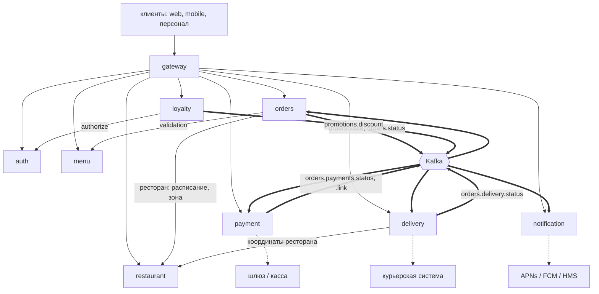
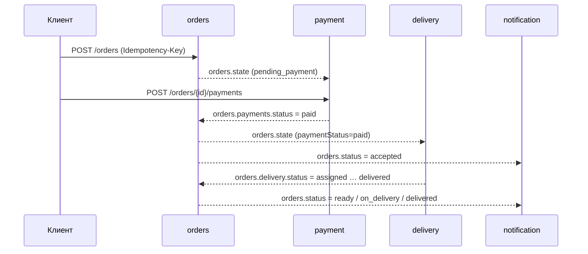

# Аналитическая документация по сервисам

Для каждого сервиса платформы «Заказ еды» — отдельный документ в формате, привычном системному аналитику. Источник правды по коду — репозиторий, по архитектурным решениям — ADR в `PROJECT-CONTEXT.md`; контракты — `contracts/openapi/*.yaml` и `contracts/asyncapi/kafka-events.yaml`.

Состояние на master `54d443b` (после S9).

## Состав документов

| Сервис | Порт | Документ | OpenAPI | Роль в системе |
|---|---|---|---|---|
| auth-service | 8081 | [auth.md](auth.md) | 1.3.0 | регистрация, вход, JWT (RS256), JWKS, роли и привязки, `authorize` |
| gateway | 8080 | [gateway.md](gateway.md) | 1.4.0 | единая точка входа: маршрутизация, авторизация на периметре, лимиты, CORS |
| restaurant-service | 8082 | [restaurant.md](restaurant.md) | 1.2.0 | рестораны, поиск по области карты, расписание, «открыто сейчас» |
| menu-service | 8083 | [menu.md](menu.md) | 1.3.0 | меню, цены, стоп-лист, валидация корзины |
| orders-service | 8084 | [orders.md](orders.md) | 1.7.0 | заказы, автомат статусов, скидки, оркестрация по событиям |
| payment-service | 8085 | [payment.md](payment.md) | 1.4.0 | оплата (онлайн, курьеру, касса), вебхуки, сверка, возвраты |
| loyalty-service | 8086 | [loyalty.md](loyalty.md) | 1.2.0 | акции и их жизненный цикл, публикация `promotions.discount` |
| delivery-service | 8087 | [delivery.md](delivery.md) | 1.3.0 | заявки курьерской системе, статус и координаты доставки |
| notification-service | 8088 | [notification.md](notification.md) | 1.2.0 | push-токены и уведомления о статусах заказа |

`tools/mock-externals` (шлюз, касса, курьерская система, push) сервисом не является: это имитация внешних систем для dev и e2e.

AsyncAPI — версия 1.5.0.

## Структура каждого документа

1. **Суть** — назначение, принципы, границы ответственности, контекстная схема.
2. **Методы** — таблица операций, доступ, идемпотентность, коды ошибок.
3. **Контракты** — OpenAPI/AsyncAPI, внешние протоколы, конфигурация (env).
4. **Логика** — автоматы статусов, алгоритмы, правила валидации, фоновые процессы.
5. **События (Kafka)** — публикуемые и потребляемые топики, поля, гарантии.
6. **Работа с БД** — ER-диаграмма, таблицы, индексы, блокировки, жизненный цикл данных.
7. **Сценарии использования** — основные и альтернативные потоки, диаграммы последовательности.
8. **Прочие важные моменты** — безопасность, наблюдаемость, **известные ограничения и находки**.

## Карта взаимодействий

Топики и их участники:

| Топик | Продюсер | Потребители |
|---|---|---|
| `orders.state` | orders | payment, delivery |
| `orders.status` | orders | payment, delivery, notification |
| `orders.payments.status` | payment | orders |
| `orders.payments.link` | payment | delivery |
| `orders.delivery.status` | delivery | orders |
| `promotions.discount` | loyalty | orders |
| `orders.dish.status`, `production.lead.time` | внешняя система производства (в dev — mock) | orders |

Топики производства публикует внешняя система (не сервис платформы); подробности — `orders.md`. Restaurant и menu orders вызывает синхронно по HTTP.

## Сквозной сценарий «заказ → доставка»

## Общие платформенные конвенции

Применяются ко всем сервисам; в документах сервисов повторно не описываются.

**HTTP**

- Ошибки — `application/problem+json` (RFC 9457) с полями `type, title, status, detail, instance` и расширением `code` — стабильный машинный код ошибки; клиент ветвится по `code`, а не по тексту.
- Ответ на неизвестный или чужой ресурс — `404` (существование чужого не раскрывается), а не `403`.
- `X-Request-Id` сквозной (генерируется на входе, пробрасывается в исходящие вызовы и логи).
- Служебные маршруты: `/healthz` (процесс жив), `/readyz` (проверки зависимостей), `/metrics` (Prometheus).
- Деньги — `integer` в копейках (ADR-13), `float` запрещён; валюта — ISO-4217.
- Время — RFC 3339 в UTC.

**Идемпотентность HTTP** (`pkg/idempotency`)

- Заголовок `Idempotency-Key` (1–128 печатных ASCII-символов); обязателен на операциях, помеченных в контракте.
- Область ключа: путь + (для многих сервисов) идентификатор пользователя. Тот же ключ и тело → сохранённый ответ с `Idempotent-Replay: true`; тот же ключ с другим телом → `422 IDEMPOTENCY_KEY_REUSED`; параллельный дубль, пока первый выполняется → `409 IDEMPOTENCY_IN_PROGRESS`; хранилище недоступно → `503 IDEMPOTENCY_UNAVAILABLE`. Срок хранения ответа — 24 часа.
- Отказы авторизации (401/403) проверяются **до** идемпотентности и под ключом не запоминаются.

**Kafka** (`pkg/kafka`, franz-go)

- Конверт события: заголовки `event-id` (UUID), `event-type` (например `orders.state.v1`), `occurred-at`, `traceparent`; тело — JSON payload; ключ партиции — идентификатор агрегата.
- **Transactional outbox:** событие записывается в таблицу `outbox` в той же транзакции, что и изменение данных; relay публикует его и «будится» сразу после коммита.
- **Inbox:** потребитель выполняет обработчик и запись в `processed_events` в одной транзакции — повторная доставка безвредна.
- **DLQ:** после 5 неудачных попыток событие уходит в `<topic>.dlq` с заголовками `x-error`, `x-source` (`topic/partition@offset`), `x-attempts`; backoff между попытками — 200 мс…5 с.
- Топики между собой **не упорядочены**, поэтому потребители хранят «опережающие» факты (статус заказа отдельно от реплики, ссылки и отмены, пришедшие раньше заказа) и сравнивают `revision`/`updatedAt`.

**Интеграции с внешними системами** (шлюз, касса, курьерская система, push)

- Вызов — только вне транзакций БД; запись намерения предшествует вызову.
- Идемпотентность внешних операций — ключ `Idempotency-Key` = идентификатор нашей записи.
- Фоновая сверка (reconciler) с «арендой» записи (`next_poll_at` + `FOR UPDATE SKIP LOCKED`): несколько экземпляров не обрабатывают одно и то же; результат применяется тем же кодом, что и вебхук.
- Вебхуки — мимо gateway, защита — HMAC-SHA256 (`X-Signature`, окно 5 минут, секрет на источник); дедупликация по `eventId`.
- Классификация ответов: 4xx — определённый отказ, таймаут/5xx — «статус неизвестен».

**Безопасность**

- JWT RS256 проверяется локально по JWKS (ADR-11); introspect — только на чувствительных маршрутах (fail-closed).
- Секреты — только через env; вне `APP_ENV=dev` обязательны, не короче 16 символов, dev-значения запрещены (сервис не стартует).
- PII (телефоны, имена) в логах маскируется.

**Данные**

- БД на сервис (один Postgres, отдельные базы); чужие данные — только через реплики, наполняемые событиями.
- Миграции — SQL-файлы, встроенные в бинарь (`embed.go`), применяются при старте.
- Очистка старых данных (`outbox`, `processed_events`, журналы) в большинстве сервисов не реализована — см. «Известные ограничения» в каждом документе.

## Сводка расхождений и находок, выявленных при подготовке документации

Подробности — в разделах «Известные ограничения и находки» документов сервисов.

| Сервис | Находка |
|---|---|
| orders | `RESTAURANT_CLOSED` в коде и контракте — HTTP 409, а в `PROJECT-STATE.md` записано 422; документ следует коду |
| auth | гонка регистрации одного e-mail возвращает 500 вместо 409; длинный не-ASCII пароль (> 72 байт) даёт 500; `user_devices`/`device_id` не используются; нет очистки refresh-токенов |
| gateway | CORS не разрешает `DELETE`; лимитер при сбое хранилища fail-open |
| payment | вебхук по платежу `courier_card` отвергается (`404`): канал `/gateway` принимает только `online_card`, итог курьерского платежа добывает reconciler; нет интерфейса для `refund_status=failed` |
| delivery | заказ без координат остаётся без доставки без сигнала для orders; `BumpRevision` не обновляет адрес |
| loyalty | нет автозавершения по сроку; не проверяется существование ресторана и позиций меню; глобальный advisory-lock на активацию |
| notification | гости не получают push; события оплаты/доставки в уведомления не превращаются |
| общее | нет политики очистки `outbox`, `processed_events` и журналов |
