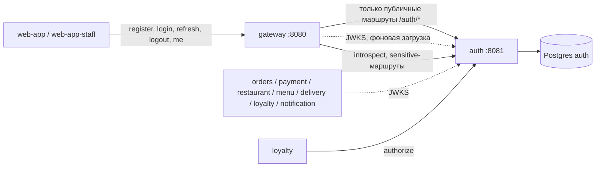
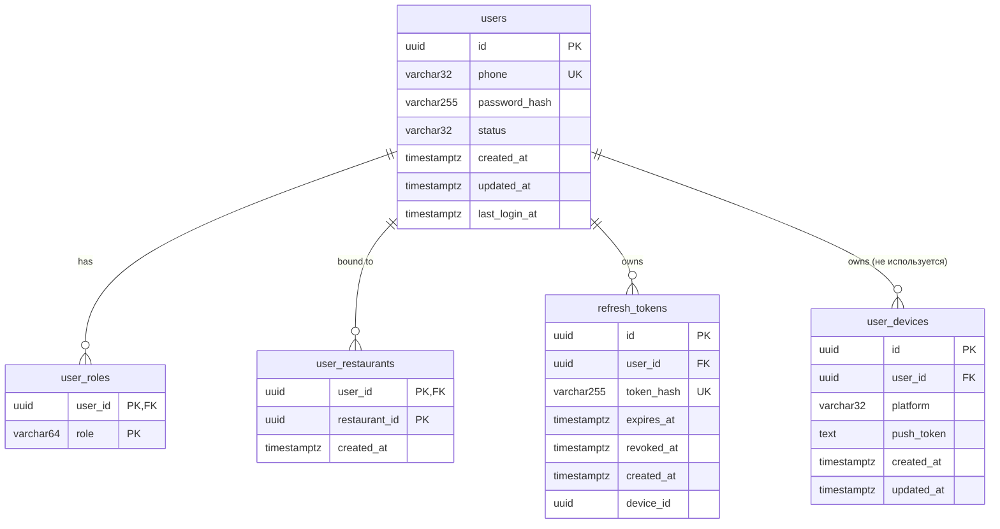
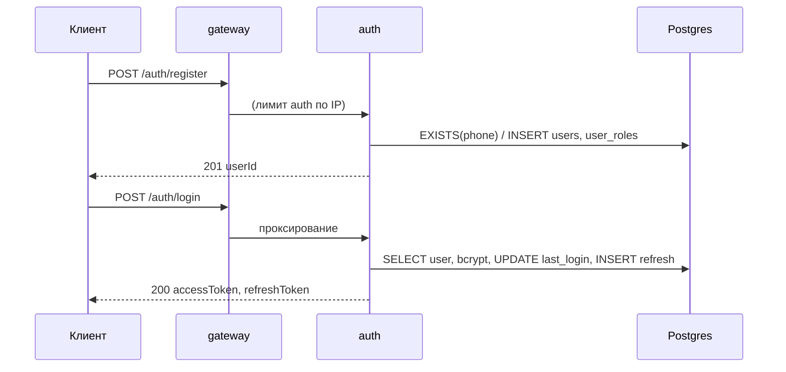

# auth-service — аналитическая документация

| | |
|---|---|
| Сервис | `services/auth`, порт `8081`, БД `auth` (Postgres) |
| Контракт | `contracts/openapi/auth.yaml` v1.3.0 |
| Kafka | не использует (ни публикует, ни потребляет) |
| Идемпотентность | не используется (регистрация защищена `UNIQUE(phone)`) |
| Состояние на | master `54d443b` (после S9, 2026-10-26) |

---

## 1. Суть

**Назначение.** Единственный источник идентичности и ролей платформы: регистрирует клиентов, проверяет пароль, выпускает access-токен (JWT RS256) и refresh-токен (непрозрачный), публикует открытые ключи (JWKS), отвечает на два внутренних вопроса остальных сервисов: «жив ли этот токен прямо сейчас» (`introspect`) и «может ли этот пользователь выполнить это действие» (`authorize`).

**Что внутри зоны ответственности**

- регистрация клиента по телефону (E.164) и паролю;
- вход, выпуск пары токенов, ротация и отзыв refresh-токена;
- хранение ролей `CUSTOMER / STAFF / FRANCHISE_OWNER / HQ_STAFF` и привязки сотрудников к ресторанам;
- публикация JWKS, ротация ключей подписи без простоя (ADR-11);
- каталог защищённых действий (`order.manage`, `promotion.manage`) и принятие решений по нему.

**Что вне зоны ответственности**

- профиль пользователя (имя, адреса) — сервиса профиля нет (ADR-3 «принят, но не активен»);
- SMS/OTP, восстановление пароля, подтверждение телефона (статус `PENDING_VERIFICATION` есть в схеме, но кодом не используется);
- администрирование пользователей (назначение ролей и привязок через API нет — только seed, см. §8);
- блокировка аккаунта после N неудачных входов (есть только лимит gateway по IP) — долг №38;
- проверка JWT на каждом запросе: её делают сами потребители локально по JWKS (ADR-11), auth в горячем пути не стоит.

**Место в архитектуре**



`introspect` и `authorize` наружу через gateway **не публикуются** (маршрут вне таблицы → `404 ROUTE_NOT_FOUND`); они доступны только по внутренней сети.

---

## 2. Методы

Все ошибки — `application/problem+json` (RFC 9457) с полем `code`. Общие для сервиса: `INVALID_JSON` (400, не разобрано тело), `INTERNAL` (500).

| # | Метод и путь | operationId (контракт) | Доступ | Успех | Назначение |
|---|---|---|---|---|---|
| 1 | `POST /auth/register` | register | публично | 201 | Создать клиента |
| 2 | `POST /auth/login` | login | публично | 200 | Пара токенов по телефону и паролю |
| 3 | `POST /auth/refresh` | refresh | публично (по refresh-токену) | 200 | Обменять refresh на новую пару |
| 4 | `POST /auth/logout` | logout | публично (по refresh-токену) | 200 | Отозвать refresh-токен |
| 5 | `GET /auth/me` | me | Bearer access | 200 | Профиль и роли из БД |
| 6 | `GET /auth/.well-known/jwks.json` | jwks | публично | 200 | Открытые ключи, `Cache-Control: public, max-age=60` |
| 7 | `POST /auth/introspect` | introspect | внутренний | 200 | Токен активен? |
| 8 | `POST /auth/authorize` | authorize | внутренний, Bearer пользователя | 200 | Решение по действию |
| 9 | `GET /health/`, `GET /health` | — | служебный | 200 | liveness `{"status":"OK"}` |
| 10 | `GET /actuator/health` | — | служебный | 200/503 | readiness, компонент `db` |
| 11 | `GET /metrics` | — | служебный | 200 | Prometheus |

Режим запуска `--migrate-only` применяет миграции и завершается (для Job в k8s).

Коды ошибок по методам:

| Код (`code`) | HTTP | Когда |
|---|---|---|
| `VALIDATION_FAILED` | 400 | телефон не E.164 (`^\+[1-9][0-9]{7,14}$`); пароль вне 6…72 символов или пустой; пустой `refreshToken`/`token`; `restaurantId` не UUID; неполный вопрос `authorize` |
| `UNKNOWN_ACTION` | 400 | `authorize` с действием вне каталога |
| `INVALID_CREDENTIALS` | 401 | нет такого телефона **или** неверный пароль (не различаются намеренно) |
| `INVALID_TOKEN` | 401 | нет/битый/просроченный access, чужой `iss/aud`, неизвестный `kid`; заголовок `WWW-Authenticate: Bearer error="invalid_token"` |
| `INVALID_REFRESH_TOKEN` | 401 | refresh не найден или уже отозван |
| `REFRESH_TOKEN_EXPIRED` | 401 | срок refresh истёк |
| `USER_NOT_ACTIVE` | 403 | статус не `ACTIVE` (на входе, refresh, `/me`) |
| `PHONE_ALREADY_REGISTERED` | 409 | телефон занят |

---

## 3. Контракты

### 3.1. REST

**`POST /auth/register`**

```json
// запрос
{ "phone": "+79990001122", "password": "secret1" }
// 201
{ "userId": "uuid", "phone": "+79990001122", "status": "ACTIVE" }
```

Всегда создаётся `CUSTOMER`, статус сразу `ACTIVE` (подтверждения телефона нет). Повышение роли через API невозможно.

**`POST /auth/login`** → `TokenPair`

```json
{ "accessToken": "eyJ…", "refreshToken": "<86 символов base64url>", "tokenType": "Bearer", "expiresIn": 900 }
```

`expiresIn` — секунды жизни access (по умолчанию 900).

**`POST /auth/refresh`**: `{ "refreshToken": "…" }` → новая `TokenPair`; старый refresh сразу отзывается (одноразовый).

**`POST /auth/logout`**: `{ "refreshToken": "…" }` → `{ "message": "Logged out successfully" }`. Повторный logout тем же токеном → `401 INVALID_REFRESH_TOKEN` (не идемпотентен).

**`GET /auth/me`** → `{ userId, phone, roles[], status, restaurants[] }`. Берёт актуальные данные из БД, не из токена.

**`POST /auth/introspect`**: `{ "token": "…" }`

```json
{ "active": false }
{ "active": true, "userId": "uuid", "phone": "…", "roles": ["STAFF"], "restaurants": ["uuid"] }
```

Недействительный токен — **не ошибка**, а `200 active=false`. Пользователь, заблокированный после выдачи токена, тоже даёт `active=false` (в этом смысл метода: подпись токена это не покажет).

**`POST /auth/authorize`** (Bearer — токен *пользователя, о котором спрашивают*)

```json
// запрос
{ "action": "promotion.manage", "scope": "local", "restaurantId": "uuid" }
// ответ
{ "allowed": true }
{ "allowed": false, "reason": "NOT_BOUND_TO_RESTAURANT" }
```

Отказ — это `200 allowed=false`, а не 403: 4xx зарезервированы за некорректным вопросом или токеном.

**`GET /auth/.well-known/jwks.json`**

```json
{ "keys": [ { "kty":"RSA","use":"sig","alg":"RS256","kid":"local-dev-key","n":"…","e":"AQAB" } ] }
```

Первым идёт текущий ключ, затем прежние в алфавитном порядке `kid`.

### 3.2. Access-токен (JWT RS256)

| Claim | Значение |
|---|---|
| заголовок `kid` | идентификатор ключа (`JWT_KEY_ID`) |
| `iss` | `JWT_ISSUER`, по умолчанию `restaurant-auth-service` |
| `aud` | `JWT_AUDIENCE`, по умолчанию `restaurant-api` |
| `sub` | `userId` (UUID) |
| `phone` | телефон |
| `roles[]` | роли, отсортированы |
| `restaurants[]` | UUID привязанных ресторанов, отсортированы |
| `iat`, `exp`, `jti` | время выдачи, истечения (по умолчанию +15 мин), случайный UUID |

Проверка (`token.Validate`): только `RS256`, `kid` из известных (текущий + прежние), `iss`, `aud`, `exp` обязательны, непустые `phone` и `roles`, каждая роль из целевого набора. Токены `alg=none` и HS256 отвергаются.

### 3.3. Refresh-токен

64 случайных байта (`crypto/rand`) в base64url без паддинга. В БД хранится только `SHA-256` в base64url (`token_hash`); открытое значение показывается клиенту один раз.

### 3.4. Конфигурация (env)

| Переменная | По умолчанию | Смысл |
|---|---|---|
| `DATABASE_URL` | обязательна | строка подключения |
| `HTTP_PORT` / `APP_ENV` / `LOG_LEVEL` | 8081 / dev / info | базовые |
| `JWT_ISSUER`, `JWT_AUDIENCE` | см. выше | значения claims |
| `JWT_ACCESS_TTL` | 15m | жизнь access |
| `REFRESH_TOKEN_TTL` | 720h (30 сут.) | жизнь refresh |
| `JWT_KEY_ID` | `local-dev-key` | `kid` текущего ключа |
| `JWT_PRIVATE_KEY_PATH`, `JWT_PUBLIC_KEY_PATH` | `./config/keys/*.pem` | PEM-файлы; пара должна совпадать, иначе сервис не стартует |
| `JWT_PREVIOUS_PUBLIC_KEYS` | пусто | `kid=path,kid2=path2` — прежние публичные ключи для ротации |
| `BCRYPT_COST` | 12 | допустимо 10…15 |
| `SEED_ON_START` | false | dev-пользователи; при `APP_ENV=prod` — ошибка конфигурации |

---

## 4. Логика

### 4.1. Слои

`httpapi` (валидация, сопоставление ошибок) → `service` (транзакции, bcrypt, выпуск токенов) → `store` (SQL на pgx) и `token` (JWT/JWKS) ↔ `domain` (сущности, ошибки, чистая функция `Authorize`).

### 4.2. Регистрация

1. Валидация телефона и пароля.
2. Транзакция: `SELECT EXISTS(phone)` → если занят, `409`.
3. bcrypt-хэш (cost из конфига), вставка `users` + `user_roles(CUSTOMER)`, commit.

Гонка двух параллельных регистраций одного телефона закрыта `UNIQUE INDEX ux_users_phone`: проигравший получит нарушение уникальности, которое в коде отдельно не сопоставляется и вернётся как `500 INTERNAL`, а не `409` (узкое место, см. §8).

### 4.3. Вход

Поиск по телефону → `bcrypt.CompareHashAndPassword` → проверка статуса → обновление `last_login_at` → выпуск пары, всё в одной транзакции. Порядок «пароль, потом статус» намеренный: заблокированный пользователь с неверным паролем получит `INVALID_CREDENTIALS`, а не `USER_NOT_ACTIVE` (статус не раскрывается тому, кто пароль не знает).

Замечание по времени ответа: для неизвестного телефона bcrypt не вызывается, поэтому ответ заметно быстрее, чем для известного. Это канал перечисления телефонов (user enumeration по времени). Смягчение сейчас — лимит gateway на `register`, `login`, `refresh` (10 запросов в минуту на IP по умолчанию).

### 4.4. Refresh и logout

`SELECT … FOR UPDATE` по `token_hash` в транзакции (параллельный обмен одного токена сериализуется), затем проверки: токен найден → не отозван → не истёк → пользователь `ACTIVE`. Далее отзыв старого (`revoked_at`) и выпуск новой пары в той же транзакции. Роли и привязки в новом access читаются заново — смена прав вступает в силу не позже следующего refresh (≤15 мин жизни access).

Reuse-detection не реализован: повторное предъявление уже отозванного токена даёт `INVALID_REFRESH_TOKEN`, но остальные токены пользователя не отзываются.

### 4.5. `Authorize` — матрица решений

Чистая функция `domain.Authorize(user, request)`. Состояние пользователя берётся из БД на каждый вызов (не из токена), поэтому блокировка и смена привязки действуют немедленно.

| Действие | scope | `HQ_STAFF` | `FRANCHISE_OWNER` | `STAFF` | `CUSTOMER` |
|---|---|---|---|---|---|
| `promotion.manage` | `national` | разрешено | `SCOPE_NOT_ALLOWED` | `ROLE_REQUIRED` | `ROLE_REQUIRED` |
| `promotion.manage` | `local` (+`restaurantId`) | любой ресторан | свой ресторан, иначе `NOT_BOUND_TO_RESTAURANT` | `ROLE_REQUIRED` | `ROLE_REQUIRED` |
| `order.manage` (+`restaurantId`) | — | любой ресторан | свой, иначе `NOT_BOUND_TO_RESTAURANT` | свой, иначе `NOT_BOUND_TO_RESTAURANT` | `ROLE_REQUIRED` |

Предварительно для любого действия: статус не `ACTIVE` → `NOT_ACTIVE` (раньше проверки роли). Некорректный вопрос — `ErrInvalidAuthz` (400 `VALIDATION_FAILED`): `scope` обязателен для `promotion.manage`, `restaurantId` обязателен для `scope=local` и для `order.manage`; неизвестный `scope` — тоже 400. Неизвестное действие → 400 `UNKNOWN_ACTION`.

Кто вызывает: `loyalty` (`promotion.manage`, включая `scope`), доступ к заказам персонала `orders` проверяет сам по claim `restaurants[]` и `authclient`, `order.manage` в каталоге есть для будущих потребителей.

### 4.6. Ротация ключей подписи без простоя

1. Сгенерировать новую пару, оставить старый публичный ключ.
2. Запустить auth с новым `JWT_KEY_ID` и приватным/публичным ключом + `JWT_PREVIOUS_PUBLIC_KEYS=<старый kid>=<путь>`.
3. JWKS отдаёт оба ключа; новые токены подписаны новым `kid`, ранее выданные проверяются по старому.
4. Через `JWT_ACCESS_TTL` убрать старый ключ из переменной.

Потребители подхватывают новый `kid` сами: при неизвестном `kid` `authclient.JWKSVerifier` перезагружает JWKS не чаще раза в `MinRefresh` (10 с).

### 4.7. Seed и очистка

- `SEED_ON_START=true` (dev): идемпотентно создаются 6 пользователей (§8.3). Запрещено при `APP_ENV=prod`.
- В `prod` при старте **удаляются** учётки из миграции `002_seed_dev_users.sql` (UUID `…0001`–`…0003`), которые создаются любой средой, где применены миграции.

---

## 5. События (Kafka)

Сервис не публикует и не потребляет события. Это осознанно: идентичность запрашивается синхронно (JWKS, introspect, authorize), а факты вроде «пользователь заблокирован» в системе пока нигде не нужны как поток.

Последствие: блокировка пользователя действует на потребителей с лагом до `JWT_ACCESS_TTL` (15 мин), кроме `sensitive`-маршрутов gateway, где выполняется `introspect` (кэш `INTROSPECT_CACHE_TTL` = 10 с), и операций `loyalty`, где вызывается `authorize`.

---

## 6. Работа с БД

БД `auth`, роль `auth`. Миграции по модулю `auth` (`schema_migrations(module, version, name, checksum, applied_at)`); при первом старте после S5 `pgxutil.AdoptLegacy` усыновляет старую таблицу `schema_migrations(version)`, чтобы 001/002 не применились повторно.

### 6.1. ER-диаграмма



`user_restaurants.restaurant_id` — **без внешнего ключа**: ресторан живёт в БД `restaurant` (принцип «база на сервис»). Целостность держится соглашением и seed.

### 6.2. Таблицы

**`users`** — учётные записи.

| Колонка | Тип | Ограничения / смысл |
|---|---|---|
| `id` | uuid | PK, генерируется приложением |
| `phone` | varchar(32) | NOT NULL, уникален (`ux_users_phone`); E.164 |
| `password_hash` | varchar(255) | bcrypt (`$2a/$2y…`) |
| `status` | varchar(32) | CHECK `ACTIVE, BLOCKED, DELETED, PENDING_VERIFICATION` |
| `created_at`, `updated_at` | timestamptz | NOT NULL |
| `last_login_at` | timestamptz | NULL до первого входа |

**`user_roles`** — роли (многие-ко-многим по смыслу, обычно одна). PK `(user_id, role)`, FK на `users` `ON DELETE CASCADE`, CHECK `role IN (CUSTOMER, STAFF, FRANCHISE_OWNER, HQ_STAFF)` (после миграции 003).

**`user_restaurants`** — привязка сотрудников и владельцев к ресторанам. PK `(user_id, restaurant_id)`, FK на `users` `ON DELETE CASCADE`, индекс `ix_user_restaurants_restaurant (restaurant_id)` (обратный поиск «кто работает в ресторане»; сейчас кодом не используется).

**`refresh_tokens`** — выданные refresh-токены. `token_hash` уникален; `revoked_at` ≠ NULL — отозван; `device_id` в логике не задействован (всегда NULL).

**`user_devices`** — осталась от наследия Java-версии; кодом Go **не читается и не пишется**. Push-токены устройств живут в `notification` (`device_tokens`). Кандидат на удаление отдельной миграцией.

### 6.3. Индексы

| Индекс | Назначение |
|---|---|
| `ux_users_phone` (unique) | вход по телефону, защита от дублей |
| `ux_refresh_tokens_token_hash` (unique) | поиск refresh при обмене и logout |
| `ix_refresh_tokens_user_id` | отзыв/просмотр токенов пользователя (пока не используется) |
| `ix_refresh_tokens_expires_at` | задел под очистку просроченных (очистки нет) |
| `ix_user_roles / PK(user_id, role)` | чтение ролей пользователя |
| `ix_user_restaurants_restaurant` | обратный поиск по ресторану |
| PK `user_restaurants(user_id, restaurant_id)` | чтение привязок пользователя |

### 6.4. Миграции

| Файл | Содержание |
|---|---|
| `001_create_auth_schema.sql` | таблицы `users`, `user_roles`, `refresh_tokens`, `user_devices`, индексы |
| `002_seed_dev_users.sql` | три dev-учётки (ключ UUID `…0001`–`…0003`), создаются **в любой среде** |
| `003_roles_restaurants.sql` | роли `ADMIN→HQ_STAFF`, удаление `COURIER/KITCHEN`, новый CHECK, таблица `user_restaurants` |

### 6.5. Транзакционные границы и конкурентность

- `Register`, `Login`, `Refresh`, `Logout` — по одной транзакции.
- Обмен refresh сериализуется строковой блокировкой `FOR UPDATE`.
- `Introspect`, `Authorize`, `Me` читают без транзакции, с тремя запросами (user, roles, restaurants) — между ними возможна неконсистентность на долю секунды; на практике не влияет.
- Подключение: пул 2…20 соединений (`AppName=auth-service`).

### 6.6. Рост данных

`refresh_tokens` растёт на каждый вход и каждый refresh (30 суток хранения, отозванные и просроченные строки не удаляются). Очистки нет — долг; при росте добавить периодическое `DELETE … WHERE expires_at < now() - interval` по `ix_refresh_tokens_expires_at`.

---

## 7. Сценарии использования

### UC-AUTH-01. Регистрация и первый вход клиента

- **Актор:** новый клиент (web-app). **Предусловие:** телефон не зарегистрирован.
- **Основной поток:** `POST /auth/register` → 201 → `POST /auth/login` → пара токенов → приложение хранит refresh, access держит в памяти.
- **Альтернативы:** A1 телефон занят → 409 `PHONE_ALREADY_REGISTERED`; A2 пароль короче 6 → 400; A3 лимит gateway `auth` исчерпан → 429 от gateway.
- **Постусловие:** есть `users` (ACTIVE) + `user_roles(CUSTOMER)`; после входа — `refresh_tokens`, `last_login_at`.



### UC-AUTH-02. Обновление сессии

- **Основной поток:** access истёк (401 на защищённом запросе) → `POST /auth/refresh` → новая пара → повтор запроса.
- **Альтернативы:** A1 refresh отозван/неизвестен → 401 `INVALID_REFRESH_TOKEN`, клиент уходит на экран входа; A2 refresh истёк → `REFRESH_TOKEN_EXPIRED`; A3 пользователя заблокировали → 403 `USER_NOT_ACTIVE`; A4 два параллельных refresh одним токеном — выигрывает первый, второй получает `INVALID_REFRESH_TOKEN` (клиент должен сериализовать обновление).

### UC-AUTH-03. Выход

`POST /auth/logout` с refresh → токен отозван. Access-токен остаётся действительным до `exp` (≤15 мин) — осознанная цена безстатусных JWT.

### UC-AUTH-04. Проверка токена потребителем (ADR-11)

Сервис при старте/по `kid` грузит JWKS, далее проверяет подпись, `iss`, `aud`, `exp` локально. Auth недоступен — проверка продолжается по кэшу (stale-if-error). Для денежных операций gateway дополнительно вызывает `introspect` (fail-closed: недоступен → 503 `AUTH_UNAVAILABLE`).

### UC-AUTH-05. Блокировка пользователя

Нет API; администратор меняет `users.status='BLOCKED'` в БД. Эффект: вход и refresh → 403; `introspect` → `active=false`; `authorize` → `NOT_ACTIVE`; выданные access живут до `exp`, кроме `sensitive`-маршрутов.

### UC-AUTH-06. Проверка прав на акцию (вызов из loyalty)

`loyalty` пробрасывает `Authorization` пользователя в `POST /auth/authorize` с `action=promotion.manage`, `scope`, `restaurantId`; `allowed=false` → loyalty отдаёт 403 с `reason` в `code`.

---

## 8. Прочие важные моменты

### 8.1. Безопасность

- bcrypt, cost 12 (по умолчанию), пароль 6…72 символа. Предел bcrypt — 72 **байта**, а валидация считает руны: пароль из многобайтовых символов (например, 40 кириллических букв = 80 байт) пройдёт валидацию, но `bcrypt.GenerateFromPassword` (x/crypto v0.45) вернёт `ErrPasswordTooLong`, и клиент получит `500 INTERNAL` вместо `400`. Лечится проверкой длины в байтах.
- Только RS256; приватный ключ — секрет k8s (монтируется томом `0440`, нужен `fsGroup: 65532`, иначе `permission denied`, грабля S5.1).
- Токены и пароли не логируются (маскирование в `pkg/logging`).
- В prod запрещены `SEED_ON_START` и dev-режим `authclient`.

### 8.2. Нефункциональные требования и метрики

- RED-метрики `pkg/metrics` (`http_requests_total`, `http_request_duration_seconds`, `http_requests_in_flight`) по шаблону маршрута.
- Доменных счётчиков (успешные/неуспешные входы, блокировки) нет — кандидат для S11 (алерт на всплеск `INVALID_CREDENTIALS`).
- Узкое место по CPU: bcrypt cost 12 ≈ 200–300 мс на ядро на вход; ёмкость входов ограничена ядрами (нагрузочные замеры — S11).

### 8.3. Dev-учётки (только dev/CI)

| Телефон | Пароль | Роль | Привязка |
|---|---|---|---|
| +79990000000 | 123456 | CUSTOMER | — |
| +79991111111 | admin123 | HQ_STAFF | — |
| +79992222222 | blocked123 | CUSTOMER, `BLOCKED` | — |
| +79993333333 | staff123 | STAFF | ресторан №4 (`a1000000-…-04`) |
| +79994444444 | staff2123 | STAFF | ресторан №1 |
| +79995555555 | owner123 | FRANCHISE_OWNER | ресторан №4 |

### 8.4. Известные ограничения и долги

1. Гонка регистрации одного телефона заканчивается 500 вместо 409 (нарушение `ux_users_phone` не сопоставляется).
2. Время ответа различается для известных/неизвестных телефонов (§4.3).
3. Нет lockout после N неудач, нет reuse-detection refresh, нет очистки `refresh_tokens` (долг №38).
4. Роли и привязки назначаются только seed/БД; API администрирования нет.
5. Таблица `user_devices` и колонка `refresh_tokens.device_id` не используются.
6. Лимит пароля считается в рунах, а bcrypt ограничен 72 байтами — длинный не-ASCII пароль даёт 500 (§8.1).
7. Каталог `authorize` содержит два действия; расширяется по мере необходимости. Политика продублирована в `loyalty/internal/authz` для dev-режима (долг №62).

### 8.5. Тестирование

Unit: матрица `Authorize` (14 случаев + некорректные вопросы), `token` (подпись, `alg=none`, ротация), `config`, `service`/`store` на реальном Postgres; миграции (`migrations_test.go`). Postman: `postman/auth/` — 30 запросов / 84 проверки (окружения `local`, `arch-homework`). Контрактные проверки: `make contract-check SCENARIO=auth` (в CI job `perimeter`).

### 8.6. Связанные документы

`contracts/openapi/auth.yaml`, `services/auth/README.md`; устаревшее описание Java-версии: `services/auth/docs/auth-service-documentation.md` (описывает прежние роли и репозиторий `auth_go`, использовать только как историю).
