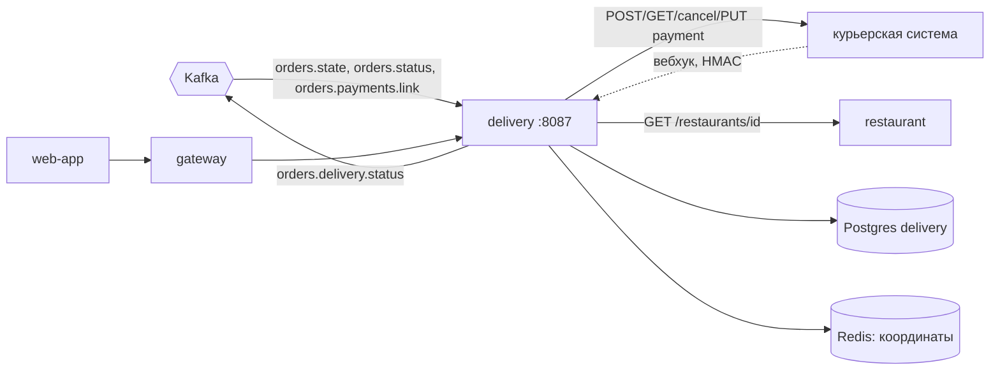
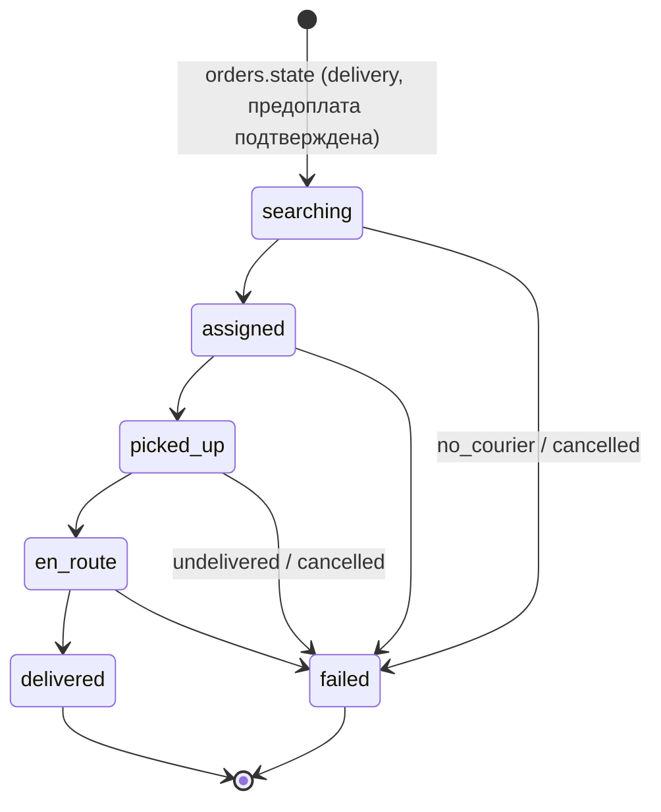
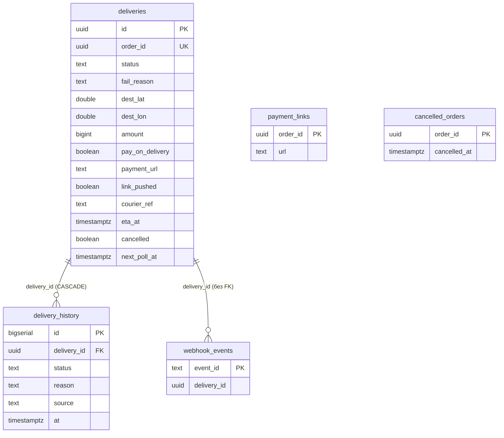
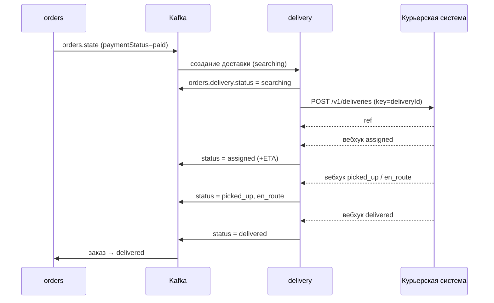

# delivery-service — аналитическая документация

| | |
|---|---|
| Сервис | `services/delivery`, порт `8087`, БД `delivery` (Postgres) + Redis (последняя точка курьера) |
| Контракт | `contracts/openapi/delivery.yaml` v1.3.0; события — `contracts/asyncapi/kafka-events.yaml` v1.5.0 |
| Kafka | потребляет `orders.state`, `orders.status`, `orders.payments.link`; публикует `orders.delivery.status` |
| Внешние системы | курьерская система (в dev — `tools/mock-externals`, модуль `courier`); restaurant-service (координаты ресторана) |
| Деньги | `bigint` копейки (ADR-13); сервис суммы не считает, а только передаёт курьерской системе |
| Состояние на | master `54d443b` (после S9) |

---

## 1. Суть

**Назначение.** Посредник между платформой и внешней курьерской системой. Для оплаченного (или оплачиваемого курьеру) заказа с доставкой сервис:

1. создаёт «заявку на курьера» во внешней системе (идемпотентно по `deliveryId`);
2. отслеживает статус — вебхуками и, как страховка, опросом;
3. публикует в `orders.delivery.status` снимок статуса и ETA, по которому `orders` двигает заказ;
4. отдаёт клиенту статус доставки, контакты курьера и его последнюю точку на карте;
5. передаёт курьерской системе ссылку на оплату картой курьеру (UC-PAY-03);
6. снимает заявку при отмене заказа и при исчерпании времени поиска.

**Принципы**

- **Заявку не создаём, пока не подтверждена предоплата (ADR-10).** `ShouldDeliver`: `fulfillmentType=delivery` **и** (`paymentStatus=paid` **или** способ оплаты `courier`/`restaurant`). Поэтому `orders.state` публикуется минимум дважды: при создании (`pending`) и после оплаты (`paid`); delivery создаёт доставку на втором.
- **Все внешние вызовы — вне транзакций БД**, под «арендой» строки (`next_poll_at`), как у payment.
- **Единственное место смены статуса** — `applyTx`; вебхук, опрос, таймаут и отмена проходят через него.
- **Статусы только вперёд**, терминальные неизменны, повтор — no-op.
- **Минимизация PII:** контакты курьера видны клиенту только пока `assigned|picked_up|en_route`; в логах телефон маскируется (`MaskPhone`).
- **Координаты курьера вторичны:** хранятся в Redis с TTL; сбой Redis не ломает доставку.

**Вне зоны ответственности**

- выбор и назначение курьера, расчёт стоимости доставки (делает внешняя система; стоимость доставки в `orders`);
- маршрутизация, зоны доставки, расчёт ETA (приходит от курьерской системы);
- хранение трека (только последняя точка);
- интерфейс для курьера;
- повторный поиск после `no_courier`: клиенту предлагается самовывоз (`hint=pickup`).

---

## 2. Методы

Снаружи через gateway; вебхук идёт мимо gateway.

| Метод | Путь | operationId | Доступ | Успех |
|---|---|---|---|---|
| GET | `/orders/{orderId}/delivery` | `getDeliveryInfo` | владелец заказа, сотрудник его ресторана, гость по знанию UUID | `200` |
| GET | `/orders/{orderId}/delivery/courier-location` | `getCourierLocation` | то же | `200` |
| POST | `/webhooks/delivery/status` | `onCourierDeliveryStatus` | подпись `X-Signature` | `200 {"status":"accepted"}` |
| GET | `/healthz`, `/readyz`, `/metrics` | — | служебные | `200` |

**`DeliveryInfo`:** `orderId, deliveryId?, status, failReason?, hint?, courier{name,phone}?, etaAt?, payOnDelivery?, updatedAt`. После терминального статуса `etaAt` не возвращается; `courier` — только при `assigned|picked_up|en_route`.

**`CourierLocation`:** `{location{lat,lon}, updatedAt}`.

**Вебхук `DeliveryStatusCallback`:** `eventId (≤128 символов), orderId (UUID), deliveryId?, courierId?, courier{name,phone}?, status (assigned|picked_up|en_route|delivered|failed), reason?, etaAt?, paid?, timestamp (обязателен)`. Неизвестные поля не отвергаются.

**Коды ошибок**

| HTTP | `code` | Когда |
|---|---|---|
| 400 | `INVALID_PARAMETER` | вебхук не соответствует структуре; `INVALID_JSON` — битое тело |
| 401 | `INVALID_SIGNATURE` | подпись отсутствует/неверна/вне окна 5 минут |
| 404 | `DELIVERY_NOT_FOUND` | доставки нет, не-UUID, чужой заказ (существование не раскрывается); с `Retry-After: 1` — событие `orders.state` могло не дойти |
| 404 | `LOCATION_NOT_AVAILABLE` | курьер не в пути, точки нет или она истекла по TTL, хранилище отключено |
| 413 | `BODY_TOO_LARGE` | тело вебхука > 64 КиБ |
| 503 | `LOCATION_STORE_UNAVAILABLE` | Redis недоступен при чтении точки |
| 503 | `WEBHOOK_DISABLED` | не задан `COURIER_WEBHOOK_SECRET` |

---

## 3. Контракты

**OpenAPI** `delivery.yaml` v1.3.0: все три операции `x-status: implemented`.

**Подпись вебхука:** `X-Signature` (HMAC-SHA256 от тела + метка времени, окно 5 минут, `pkg/webhook`); секрет `COURIER_WEBHOOK_SECRET`.

**Исходящий протокол к курьерской системе** (`internal/courier`, REST/JSON, Bearer-ключ `COURIER_API_KEY`):

| Операция | Запрос | Идемпотентность |
|---|---|---|
| `Create` | `POST /v1/deliveries` | `Idempotency-Key = deliveryId` |
| `Status` | `GET /v1/deliveries/{ref}` | — |
| `Cancel` | `POST /v1/deliveries/{ref}/cancel` | — |
| `SetPayment` | `PUT /v1/deliveries/{ref}/payment` | — |

Тело `Create`: `orderId, orderNumber, pickup{point,address}, dropoff{point,address}, contactName, contactPhone, payment?{url,amount,currency}`. Ответ (`State`): `ref, status, courierId/name/phone, etaAt, reason, paid, location{lat,lon}, locationAt`. 4xx → `RejectedError`; 404 → `ErrNotFound`; остальное — «неизвестно», повтор.

**Клиент restaurant-service:** `GET /restaurants/{id}` (через `httpx.Client` с ретраями идемпотентных GET и circuit breaker), кэш в памяти 10 минут; нужны `location` и `address`.

**Конфигурация (env)**

| Переменная | По умолчанию | Смысл |
|---|---|---|
| `COURIER_URL` | `http://localhost:9094` | курьерская система |
| `COURIER_API_KEY`, `COURIER_WEBHOOK_SECRET` | dev-значения только при `APP_ENV=dev` | вне dev обязательны, ≥ 16 символов |
| `COURIER_TIMEOUT` | 5s | один вызов |
| `RESTAURANT_URL` | `http://localhost:8082` | restaurant-service |
| `REDIS_ADDR`, `REDIS_PASSWORD` | пусто | пусто → координаты в памяти процесса (только dev/один под) |
| `SEARCH_TIMEOUT` | 10m | курьер не назначен → `failed/no_courier` |
| `LOCATION_TTL` | 1m | жизнь точки в Redis |
| `POLL_INTERVAL` / `POLL_BACKOFF_MAX` | 3s / 30s | период опроса / потолок backoff при сбоях |
| `LINK_WAIT` | 20s | сколько ждать платёжную ссылку перед заявкой (оплата курьеру) |
| `RECONCILE_INTERVAL` | 1s | тик цикла диспетчеризации |

---

## 4. Логика

### 4.1 Автомат статусов

Правило `CanAdvance`: ранги `searching 0 < assigned 1 < picked_up 2 < en_route 3 < delivered = failed 4`; переход допустим при росте ранга (**пропуск промежуточных допустим**, потому что уведомление могло потеряться), `failed` — из любого нетерминального, терминальные неизменны. Откат назад не применяется (WARN в логе).

Причина `failed`: `no_courier` (поиск), `undelivered` (курьер уже выехал), `cancelled` (заказ отменён). Если источник не дал валидную причину, она выводится из состояния: `undelivered`, если курьер был «активен» (`picked_up|en_route`), иначе `no_courier`.

`hint=pickup` выставляется, если `failed` с причиной `no_courier` — клиенту предлагается забрать заказ самому.

### 4.2 Создание доставки (`orders.state`)

Обработчик внутри inbox-транзакции:

1. `fulfillmentType ≠ delivery` → пропуск.
2. Доставка уже есть → `BumpRevision` (только если `revision` новее): обновляются `amount, currency, contact_name, contact_phone`; **статус и адрес не меняются**.
3. `ShouldDeliver` ложно (предоплата не подтверждена) → пропуск, ждём следующую ревизию.
4. Заказ уже отменён (`cancelled_orders`) → не создаём.
5. Нет валидных координат `deliveryLocation` → ERROR-лог, метрика `no_location`, **доставка не создаётся**, событие считается обработанным (не «ядовитое»).
6. `payment_links` может содержать ссылку, пришедшую раньше заказа → переносится в `payment_url`.
7. Вставка `deliveries` (`status=searching`, `next_poll_at=now`), запись в `delivery_history` (source `state`), событие `orders.delivery.status = searching`.

`pay_on_delivery = (paymentMethod == "courier")`.

### 4.3 Диспетчеризация и опрос (reconciler)

Цикл каждые `RECONCILE_INTERVAL`: `ClaimDue` (`FOR UPDATE SKIP LOCKED` + сдвиг `next_poll_at` на lease) → `process` по ветке:

| Условие | Ветка | Действие |
|---|---|---|
| `cancelled=true` | `processCancel` | `Cancel` у курьерской системы (если `courier_ref` есть); временный сбой → retry с backoff; затем `failed/cancelled` |
| `courier_ref=''` | `processDispatch` | см. ниже |
| иначе | `processPoll` | см. ниже |

**`processDispatch`**

1. `SEARCH_TIMEOUT` истёк → `failed/no_courier` (`timeout`).
2. Оплата курьеру, ссылки ещё нет и с создания прошло < `LINK_WAIT` → повтор через 1 с.
3. Координаты ресторана из restaurant-service; недоступен → retry с backoff.
4. `Create` с ключом = `deliveryId`; для `pay_on_delivery` в запросе уходит `payment{url,amount,currency}`, если ссылка уже есть.
5. Отказ 4xx → `failed/no_courier`; сбой → retry; успех → в транзакции записываются `courier_ref`, наблюдение (статус, курьер, ETA) и точка курьера (Redis).

Идемпотентность по ключу означает, что падение процесса между вызовом и записью `courier_ref` безопасно: повторный `Create` вернёт ту же заявку.

**`processPoll`**

1. Оплата курьеру, ссылка есть, `link_pushed=false` → `SetPayment`; успех → `link_pushed=true` (только если ссылка не поменялась за время вызова).
2. Поиск просрочен → `Cancel` у курьерской системы. Если за это время курьера успели назначить (ответ `Cancel` не `searching`/`failed`), заявка остаётся в силе и применяется ответ; иначе `failed/no_courier`.
3. `Status`: `ErrNotFound` — курьерская система потеряла заявку → `courier_ref=''`, повторная диспетчеризация (идемпотентно по ключу); иной сбой → retry с backoff; успех → `applyTx`, следующий опрос через `POLL_INTERVAL`.

Backoff при сбоях: `POLL_INTERVAL · 2^n`, потолок `POLL_BACKOFF_MAX`; при успехе счётчик сбрасывается.

### 4.4 Применение наблюдения (`applyTx`)

- терминальная доставка — игнор;
- статус изменился и это допустимый переход → обновление, запись в `delivery_history`, метрика;
- данные курьера (`id`, `name`, `phone`) обновляются, если непустые и отличаются;
- **ETA публикуется, только если сдвинулась на ≥ 1 минуты** (`etaStep`) либо появилась впервые — чтобы не засыпать топик;
- `paid` (курьерская система сообщила об оплате) — информативный флаг `paid_reported`, на статус и заказ не влияет (источник истины об оплате — payment);
- `updated_at` строго растёт (минимум +1 мс) — по нему потребитель отсекает устаревшие события;
- событие `orders.delivery.status` кладётся в outbox при смене статуса или заметном сдвиге ETA.

### 4.5 Вебхук курьерской системы

Подпись → разбор → `Validate` → поиск доставки по `orderId` (нет — `404`, курьерская система повторит) → в транзакции `TryRecordWebhook(eventId)`: повтор → `200` без эффекта → `FOR UPDATE` → `applyTx`. После коммита — запись/очистка координат (для вебхука точка не передаётся).

### 4.6 Отмена заказа (`orders.status = cancelled`)

- Доставки нет → `cancelled_orders` (редкий порядок: отмена раньше `orders.state`).
- Доставка терминальна или уже помечена → игнор.
- Иначе `cancelled=true`, `next_poll_at=now`: сам вызов `Cancel` и перевод в `failed/cancelled` делает reconciler (вызов вне транзакции).

### 4.7 Платёжная ссылка (`orders.payments.link`)

`SavePaymentLink` (upsert в `payment_links` и обновление `deliveries.payment_url`, `link_pushed=false`); если доставка уже существует и ссылка изменилась — `Expedite`: ближайший проход reconciler передаст ссылку через `SetPayment`.

### 4.8 Координаты курьера

После каждого применённого состояния в «активных» статусах (`picked_up|en_route`) точка пишется в Redis (`delivery:courier-location:{orderId}`, JSON, TTL `LOCATION_TTL`); при терминальном статусе ключ удаляется. `getCourierLocation`: доставка не активна, хранилища нет или точка истекла → `404 LOCATION_NOT_AVAILABLE`; ошибка Redis → `503`. Без `REDIS_ADDR` используется хранилище в памяти процесса (в нескольких экземплярах точки будут расходиться).

---

## 5. События (Kafka)

Ключ партиции — `orderId`. Группа потребителя — `delivery-service`. Невалидный payload → повторы (5 попыток, backoff 200 мс…5 с) → `<topic>.dlq`.

### 5.1 Публикуемое: `orders.delivery.status` (`orders.delivery.status.v1`)

| Поле | Тип | Примечание |
|---|---|---|
| `orderId`, `deliveryId` | uuid | |
| `courierId` | string? | |
| `status` | `searching|assigned|picked_up|en_route|delivered|failed` | |
| `reason` | `no_courier|undelivered|cancelled`? | для `failed` |
| `etaAt` | RFC 3339? | не публикуется для терминальных статусов |
| `updatedAt` | RFC 3339 | строго растёт |

События: при создании (`searching`), каждой смене статуса, существенном сдвиге ETA. Потребитель — orders (двигает заказ, учитывает `failed` и подсказку `pickup`; см. `orders.md`).

### 5.2 Потребляемые

| Топик | Обработка |
|---|---|
| `orders.state` | создание доставки / `BumpRevision` (см. §4.2) |
| `orders.status` | реагирует только на `cancelled` (§4.6) |
| `orders.payments.link` | сохранение ссылки на оплату курьеру (§4.7) |

Порядок топиков между собой не гарантируется, поэтому сервис хранит «опережающие» данные: `payment_links` (ссылка раньше заказа) и `cancelled_orders` (отмена раньше `orders.state`).

### 5.3 Гарантии

Transactional outbox для публикации; inbox `processed_events` в одной транзакции с обработчиком; идемпотентность обработки состояния (`revision`), вебхука (`eventId`) и исходящих вызовов (`Idempotency-Key = deliveryId`).

---

## 6. Работа с БД

БД `delivery`; общие таблицы `outbox`, `processed_events` создаёт `pkg/kafka`. Миграция одна — `001_init.sql`.

### 6.1 ER-диаграмма

`payment_links` и `cancelled_orders` не связаны внешними ключами: они хранят факты, пришедшие раньше `deliveries`.

### 6.2 Таблицы

**`deliveries`** — одна строка на заказ (`order_id UNIQUE`).

| Колонка | Тип | Примечание |
|---|---|---|
| `id` | uuid PK | он же `Idempotency-Key` заявки |
| `order_id`, `order_number` | uuid UNIQUE, text | |
| `restaurant_id` | uuid | |
| `owner_user_id` | text | `''` — гость |
| `revision` | int ≥ 1 | последняя применённая ревизия `orders.state` |
| `status` | text CHECK | 6 статусов |
| `fail_reason` | text CHECK | `''|no_courier|undelivered|cancelled` |
| `address`, `dest_lat`, `dest_lon` | text, double | `CHECK` на диапазоны широты и долготы |
| `contact_name`, `contact_phone` | text | PII |
| `amount`, `currency` | bigint, text | копейки; по умолчанию `RUB` |
| `pay_on_delivery`, `payment_url`, `link_pushed` | bool, text, bool | оплата курьеру |
| `courier_ref` | text | `''` — заявка ещё не создана |
| `courier_id`, `courier_name`, `courier_phone` | text | PII |
| `eta_at` | timestamptz NULL | |
| `paid_reported` | bool | информативно |
| `cancelled` | bool | заказ отменён, заявку нужно снять |
| `search_started_at` | timestamptz | точка отсчёта `SEARCH_TIMEOUT` |
| `next_poll_at`, `poll_attempts` | timestamptz NULL, int | планирование; `NULL` у терминальных |
| `created_at`, `updated_at` | timestamptz | |

**`delivery_history`** — журнал статусов (`status`, `reason`, `source ∈ state|webhook|poll|timeout|cancel`, `at`).

**`webhook_events`** — `event_id` (text PK, до 128 символов) для дедупликации.

**`payment_links`**, **`cancelled_orders`** — опережающие факты (см. выше).

### 6.3 Индексы

| Индекс | Назначение |
|---|---|
| `order_id UNIQUE` | идемпотентное создание, доступ по заказу |
| `deliveries_poll_idx (next_poll_at) WHERE next_poll_at IS NOT NULL` | выборка `ClaimDue` |
| `deliveries_restaurant_idx (restaurant_id, created_at DESC)` | заделка под список доставок ресторана (в коде пока не используется) |
| `delivery_history_idx (delivery_id, id)` | чтение журнала по доставке |

### 6.4 Блокировки и транзакции

`FOR UPDATE` строки доставки на любое изменение; `ClaimDue` — `FOR UPDATE SKIP LOCKED` в одном `UPDATE … RETURNING` (аренда); внешние вызовы — вне транзакций.

### 6.5 Redis

Единственный ключ `delivery:courier-location:{orderId}` — JSON `{lat, lon, updatedAt}` с TTL `LOCATION_TTL` (1 мин). Не критичен для готовности: Redis не входит в `readyz`.

---

## 7. Сценарии использования

### UC-DLV-01 Доставка предоплаченного заказа

### UC-DLV-02 Клиент следит за доставкой

`GET …/delivery` возвращает статус, ETA и контакты курьера (пока он активен); `GET …/courier-location` — последнюю точку, пока `picked_up|en_route`. Клиент опрашивает с периодичностью, сравнимой с `LOCATION_TTL`.

### UC-DLV-03 Курьер не найден

За `SEARCH_TIMEOUT` (10 мин) курьер не назначен → `Cancel` заявки → `failed/no_courier` → `hint=pickup`; orders решает судьбу заказа.

### UC-DLV-04 Оплата картой курьеру

`orders.state` (`courier`) создаёт доставку сразу. Payment публикует `orders.payments.link` → ссылка сохраняется; диспетчер ждёт её до `LINK_WAIT` (20 с), затем создаёт заявку с `payment` или, если ссылка пришла позже, передаёт её `SetPayment` на следующем опросе.

### UC-DLV-05 Отмена заказа

Заказ отменён → доставка помечена → reconciler снимает заявку → `failed/cancelled`. Отмена раньше `orders.state` → запись в `cancelled_orders`, доставка не создаётся.

### UC-DLV-06 Потеря вебхука

Опрос `Status` каждые 3 с продолжает работу независимо от вебхуков; рассинхронизации нет.

### UC-DLV-07 Курьерская система потеряла заявку

`Status` → 404 → сброс `courier_ref` → повторный `Create` с тем же ключом.

---

## 8. Прочие важные моменты

### Безопасность и PII

- Токен проверяется локально по JWKS; вебхук защищён HMAC и окном replay; секреты вне dev — обязательны, ≥ 16 символов.
- Чужая доставка → `404`, а не `403`.
- Телефон и имя курьера скрываются после завершения доставки; в логах телефоны маскируются. Телефон и имя клиента (`contact_*`) хранятся в БД в открытом виде.

### Наблюдаемость

Метрики: `delivery_status_transitions_total{status,source}`, `delivery_courier_calls_total{op,result}`, `delivery_courier_call_duration_seconds{op}`, `delivery_webhooks_total{result}`, `delivery_location_writes_total{result}`, `delivery_state_events_total{result}`, `delivery_reconcile_total{result}`, плюс gauges активных доставок и возраста самой старой `searching`. **Алерты-кандидаты:** рост `state_events{no_location}`, `courier_calls{error}`, возраст `searching` приближается к `SEARCH_TIMEOUT`.

### Известные ограничения и находки

1. **Заказ без координат остаётся без доставки.** При `deliveryLocation` пустом/невалидном сервис логирует ошибку и считает событие обработанным: ни `failed`, ни события для orders не публикуется, заказ с оплатой может зависнуть. Нужны либо валидация координат в `orders` (по контракту), либо публикация `failed`.
2. **`BumpRevision` не обновляет адрес и координаты доставки.** Если orders когда-либо разрешит менять адрес после оформления, delivery его не применит (заявка уже отправлена, у курьерской системы нет операции «изменить адрес»).
3. **Откат статуса молча отбрасывается** (только WARN): рассинхрон с курьерской системой исправится только её последующим корректным статусом.
4. **Вебхук без `deliveryId` в проверках**: доставка ищется по `orderId`, поле `deliveryId` при сопоставлении не проверяется.
5. **Без Redis** координаты хранятся в памяти процесса: при нескольких репликах клиент увидит точку лишь с той реплики, которая её записала. Для продакшена Redis обязателен.
6. **Нет очистки** `delivery_history`, `webhook_events`, `payment_links`, `cancelled_orders` (как и `outbox`/`processed_events`).
7. **`deliveries_restaurant_idx` пока не используется** — задел под экран ресторана.
8. **ETA после терминальных статусов** не публикуется и не возвращается — осознанное решение.
