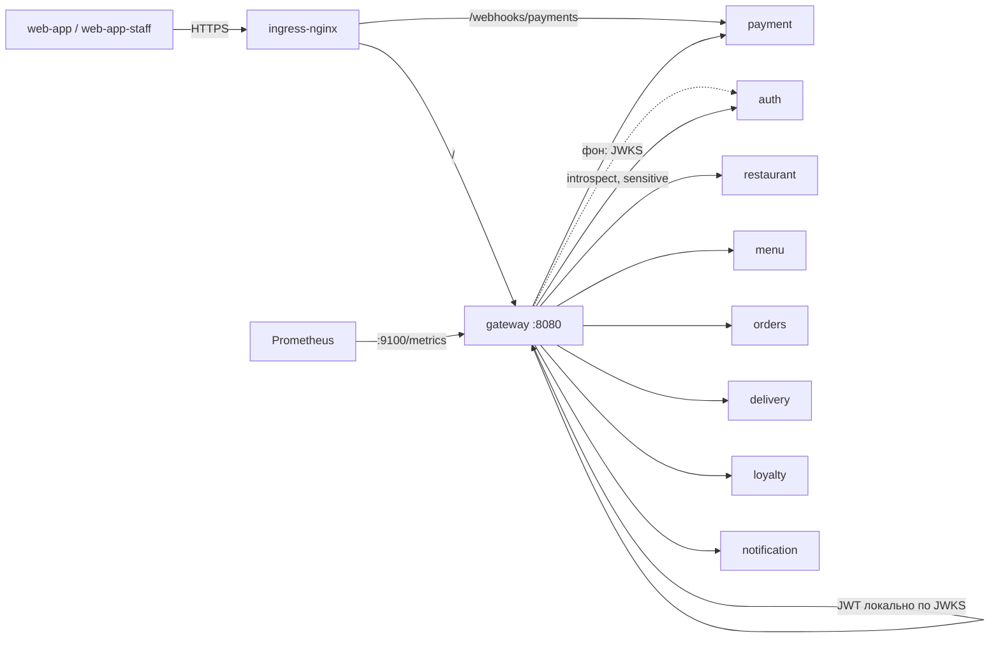
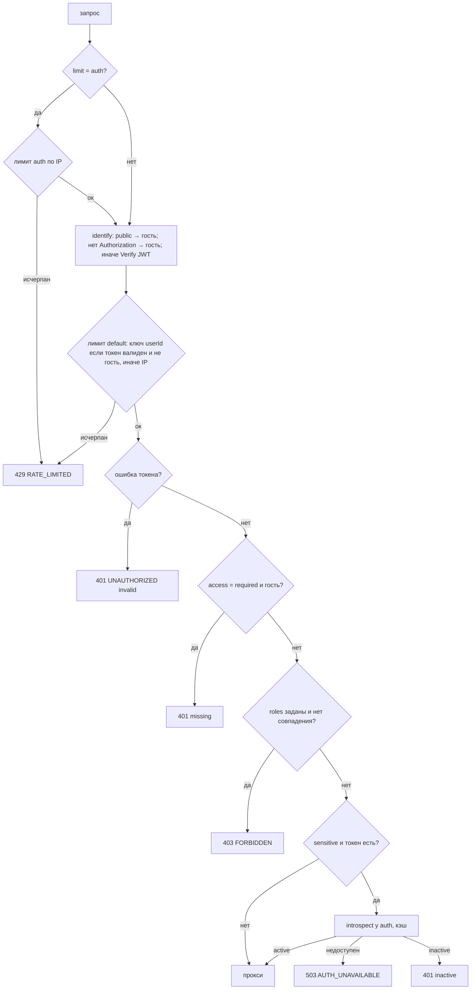
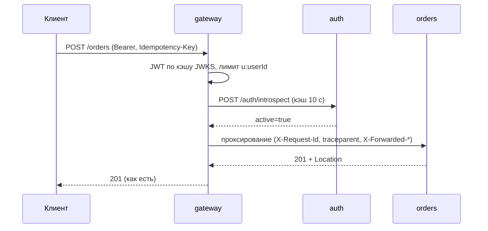

# gateway-service (api-gateway) — аналитическая документация

| | |
|---|---|
| Сервис | `services/gateway`, порт `8080` (клиентский трафик и пробы), `9100` (только `/metrics`) |
| БД / Kafka / Redis | **нет** (без состояния; лимиты и кэш introspect — в памяти реплики) |
| Контракт | `contracts/openapi/gateway.yaml` v1.4.0 (политика периметра + `x-routes`) и контракты сервисов |
| Реализация | `net/http` + `ServeMux` + `httputil.ReverseProxy`, `internal/{config,routes,limiter,clientip,introspect,gateway}` |
| Состояние на | master `54d443b` (после S9) |

---

## 1. Суть

**Назначение.** Единая публичная точка входа в платформу. Gateway **не имеет собственных бизнес-операций**: он принимает запрос из интернета, решает по таблице маршрутов, можно ли его пропустить, и проксирует на нужный сервис без изменения пути, метода, тела и кода ответа. Всё, что gateway «добавляет», — периметр:

- аутентификация JWT на входе (локальная проверка подписи по JWKS, ADR-11);
- ролевой допуск по маршруту;
- дополнительная онлайн-проверка токена (`introspect`) для денежных операций;
- лимиты частоты (token bucket) и ограничение размера тела;
- CORS, сквозные заголовки (`X-Request-Id`, `traceparent`, `X-Forwarded-*`);
- единая форма ошибок периметра (problem+json);
- сокрытие внутренних путей: всё, чего нет в таблице, — `404 ROUTE_NOT_FOUND`.

**Принцип.** Gateway — первая линия обороны, но не единственная: сервисы за ним работают в `AUTH_MODE=jwks` и **повторно проверяют тот же JWT** (defense in depth). Заголовки `X-User-*` снаружи вырезаются, gateway сам их не подставляет.

**Вне зоны ответственности**

- бизнес-валидация и авторизация по ресурсам (владелец заказа, привязка к ресторану) — внутри сервисов;
- агрегация/BFF (композиция ответов `withPromotions` не сделана, долг №63);
- публичные вебхуки платёжного шлюза и курьерской системы: они идут **мимо** gateway (ingress → payment/delivery), чтобы отказ периметра не терял уведомления внешних систем; их защищают HMAC, окно replay, дедупликация и лимиты ingress;
- распределённый rate limit (лимит на реплику; общий на Redis — S11).

---

## 2. Методы

Собственных клиентских эндпоинтов у gateway нет. Служебные:

| Метод и путь | Порт | Назначение |
|---|---|---|
| `GET /health`, `GET /health/` | 8080 | liveness `{"status":"OK"}` |
| `GET /actuator/health` | 8080 | readiness: `jwks` UP, когда загружен хотя бы один ключ; иначе `503 DOWN`. Недоступность сервисов готовность **не** снимает |
| `GET /metrics` | 9100 | Prometheus; наружу через ingress не публикуется |
| `OPTIONS *` | 8080 | CORS-preflight (только для разрешённых origin) → `204` |
| `*` вне таблицы | 8080 | `404 ROUTE_NOT_FOUND` |

### 2.1. Таблица маршрутов (37)

Источник истины — `internal/routes/routes.json` (встроен в образ); синхронность с `x-routes` в `gateway.yaml` и с контрактами сервисов проверяет `make check-routes`.

Обозначения: **P** — public, **O** — optional (нет токена = гость, плохой токен = 401), **R** — required. **S** — sensitive (introspect). Роли: `STF` = STAFF, `FO` = FRANCHISE_OWNER, `HQ` = HQ_STAFF. «Лимит auth» — строгий класс по IP.

| # | Метод и путь | Upstream | Доступ | Роли | S | Лимит |
|---|---|---|---|---|---|---|
| 1 | `POST /auth/register` | auth | P | — | | auth |
| 2 | `POST /auth/login` | auth | P | — | | auth |
| 3 | `POST /auth/refresh` | auth | P | — | | auth |
| 4 | `POST /auth/logout` | auth | P | — | | default |
| 5 | `GET /auth/me` | auth | R | любая | | default |
| 6 | `GET /auth/.well-known/jwks.json` | auth | P | — | | default |
| 7 | `GET /restaurants` | restaurant | P | — | | default |
| 8 | `GET /restaurants/{restaurantId}` | restaurant | P | — | | default |
| 9 | `GET /restaurants/{restaurantId}/menu` | menu | P | — | | default |
| 10 | `POST /restaurants/{restaurantId}/menu/validation` | menu | P | — | | default |
| 11 | `POST /carts` | orders | O | — | | default |
| 12 | `GET /carts/{cartId}` | orders | O | — | | default |
| 13 | `PUT /carts/{cartId}/items` | orders | O | — | | default |
| 14 | `PUT /carts/{cartId}/fulfillment` | orders | O | — | | default |
| 15 | `POST /orders` | orders | O | — | **S** | default |
| 16 | `GET /orders/search` | orders | R | STF, FO, HQ | | default |
| 17 | `GET /orders/{orderId}` | orders | O | — | | default |
| 18 | `GET /orders/{orderId}/eta` | orders | O | — | | default |
| 19 | `PUT /orders/{orderId}/pickup-slot` | orders | O | — | | default |
| 20 | `POST /orders/{orderId}/issuance` | orders | R | STF, FO, HQ | | default |
| 21 | `POST /orders/{orderId}/cancellation` | orders | R | STF, FO, HQ | **S** | default |
| 22 | `GET /orders/{orderId}/payment-methods` | payment | O | — | | default |
| 23 | `POST /orders/{orderId}/payments` | payment | O | — | **S** | default |
| 24 | `POST /orders/{orderId}/payments/pos` | payment | R | STF, FO, HQ | **S** | default |
| 25 | `GET /orders/{orderId}/payments/{paymentId}` | payment | O | — | | default |
| 26 | `GET /orders/{orderId}/delivery` | delivery | O | — | | default |
| 27 | `GET /orders/{orderId}/delivery/courier-location` | delivery | O | — | | default |
| 28 | `GET /promotions` | loyalty | O | — | | default |
| 29 | `POST /promotions` | loyalty | R | FO, HQ | **S** | default |
| 30 | `GET /promotions/{promotionId}` | loyalty | R | FO, HQ | | default |
| 31 | `PUT /promotions/{promotionId}` | loyalty | R | FO, HQ | **S** | default |
| 32 | `GET /promotions/{promotionId}/history` | loyalty | R | FO, HQ | | default |
| 33 | `POST /promotions/{promotionId}/activation` | loyalty | R | FO, HQ | **S** | default |
| 34 | `POST /promotions/{promotionId}/completion` | loyalty | R | FO, HQ | **S** | default |
| 35 | `POST /notifications/device-tokens` | notification | R | любая | | default |
| 36 | `GET /notifications/device-tokens` | notification | R | любая | | default |
| 37 | `DELETE /notifications/device-tokens/{tokenId}` | notification | R | любая | | default |

Намеренно **вне таблицы** (→ `404 ROUTE_NOT_FOUND`): `POST /auth/introspect`, `POST /auth/authorize`, `/metrics` и `/actuator/*` любого сервиса, `/webhooks/*`. Загрузчик таблицы при старте отвергает любую строку с `/webhooks`, `/metrics`, `/auth/introspect`, `/auth/authorize` — случайно опубликовать внутреннее нельзя.

Дополнительные инварианты загрузчика (`routes.Parse`): шаблон вида `METHOD /path`; дубликатов нет; `roles` допустимы только при `access=required`; `sensitive` не может быть `public`; роли из известного набора; пустая таблица — ошибка запуска.

### 2.2. Коды ошибок периметра

Все — `application/problem+json`.

| `code` | HTTP | Когда |
|---|---|---|
| `UNAUTHORIZED` | 401 | нет токена на `required`; токен недействителен (подпись, `iss`, `aud`, `exp`, неверный формат `Authorization`); `introspect` вернул `active=false`. Добавляется `WWW-Authenticate: Bearer error="invalid_token"` |
| `FORBIDDEN` | 403 | роль токена не входит в `roles` маршрута |
| `ROUTE_NOT_FOUND` | 404 | маршрута нет в таблице |
| `RATE_LIMITED` | 429 | исчерпан лимит; заголовок `Retry-After` (целые секунды, ≥1) |
| `PAYLOAD_TOO_LARGE` | 413 | тело больше `MAX_BODY_BYTES` (по `Content-Length` сразу; при потоковой отправке — при чтении) |
| `AUTH_UNAVAILABLE` | 503 | `introspect` недоступен на sensitive-маршруте (fail-closed) |
| `UPSTREAM_TIMEOUT` | 504 | сервис не ответил за `UPSTREAM_TIMEOUT` |
| `UPSTREAM_UNAVAILABLE` | 502 | сервис недоступен |
| `INTERNAL` | 500 | паника (`Recover`) |

Все остальные коды (4xx/5xx бизнес-уровня) — это ответы сервисов, проходящие без изменений.

---

## 3. Контракты

### 3.1. Конфигурация (env)

| Переменная | По умолчанию | Назначение / ограничения |
|---|---|---|
| `HTTP_PORT` | 8080 | клиентский порт |
| `METRICS_ADDR` | `:9100` | порт метрик |
| `UPSTREAM_<NAME>_URL` | `http://localhost:8081…8088` | `AUTH, RESTAURANT, MENU, ORDERS, PAYMENT, DELIVERY, LOYALTY, NOTIFICATION`; обязателен `http(s)://host[:port]` **без пути** |
| `AUTH_JWKS_URL` | `<UPSTREAM_AUTH_URL>/auth/.well-known/jwks.json` | источник ключей |
| `AUTH_ISSUER`, `AUTH_AUDIENCE` | `restaurant-auth-service`, `restaurant-api` | проверяемые claims |
| `CORS_ALLOWED_ORIGINS` | пусто | точные origin через запятую; `*` и пути запрещены (ошибка старта) |
| `TRUSTED_PROXY_CIDRS` | пусто | чьим `X-Forwarded-For/Proto` верим; `/0` запрещён при `APP_ENV=prod` |
| `RATE_LIMIT_RPS`, `RATE_LIMIT_BURST` | 50, 100 | класс default (на реплику, ключ — userId или IP) |
| `AUTH_RATE_PER_MIN`, `AUTH_RATE_BURST` | 10, 10 | класс auth (по IP, на реплику) |
| `MAX_BODY_BYTES` | 1 048 576 | предел тела |
| `UPSTREAM_TIMEOUT` | 10s | ожидание заголовков ответа сервиса |
| `INTROSPECT_CACHE_TTL`, `INTROSPECT_TIMEOUT` | 10s, 1s | кэш и таймаут онлайн-проверки |

Режим аутентификации в gateway зашит `jwks`; `AUTH_MODE=dev` у gateway не существует. Любое неположительное значение лимитов — ошибка старта.

### 3.2. Что gateway делает с заголовками

| Заголовок | Поведение |
|---|---|
| `Authorization` | передаётся сервису как есть (сервисы проверяют JWT сами) |
| `X-User-Id`, `X-User-Roles`, `X-Restaurant-Ids` | **удаляются** из входящего запроса |
| `X-Real-Ip`, `X-Forwarded-Prefix`, `X-Original-Forwarded-For` | удаляются |
| `X-Forwarded-For` | перезаписывается: ставится вычисленный IP клиента (не цепочка) |
| `X-Forwarded-Host`, `X-Forwarded-Proto` | формируются gateway; входящий `X-Forwarded-Proto` учитывается только от доверенного пира |
| `X-Request-Id` | входящий принимается, если `^[A-Za-z0-9._-]{1,64}$`, иначе генерируется UUID; уходит сервису и клиенту; дубль от сервиса удаляется из ответа |
| `traceparent` | входящий сохраняется, иначе строится из `trace_id` запроса (`00-<trace>--01`) |
| `Host` | заменяется на хост сервиса |
| `Idempotency-Key`, `If-None-Match` | проходят насквозь (разрешены CORS) |

### 3.3. CORS

Для origin из `CORS_ALLOWED_ORIGINS`: `Access-Control-Allow-Origin: <origin>`, `Expose-Headers: ETag, Location, Retry-After, Idempotent-Replay, X-Request-Id`; preflight → `204`, `Allow-Methods: GET, POST, PUT, OPTIONS`, `Allow-Headers: Authorization, Content-Type, Idempotency-Key, If-None-Match, X-Request-Id`, `Max-Age: 600`. `Vary: Origin` добавляется всегда при наличии `Origin`. Для неразрешённого origin CORS-заголовков нет, запрос обрабатывается как обычно (браузер сам заблокирует ответ).

> **Находка.** В `Allow-Methods` нет `DELETE`, а маршрут `DELETE /notifications/device-tokens/{tokenId}` в таблице есть: браузерный клиент (S10) не пройдёт preflight на удаление токена устройства. Исправление — добавить `DELETE` в список методов.

### 3.4. Метрики

| Метрика | Метки |
|---|---|
| `gateway_rate_limited_total` | `class` = `default` \| `auth` |
| `gateway_auth_rejected_total` | `reason` = `invalid`, `missing`, `forbidden`, `inactive`, `introspect_unavailable` |
| `gateway_upstream_errors_total` | `upstream`, `kind` = `timeout` \| `unavailable` \| `too_large` |
| `gateway_introspections_total` | `result` = `active` \| `inactive` \| `unavailable` |
| `http_requests_total`, `http_request_duration_seconds`, `http_requests_in_flight` | RED по **шаблону** маршрута из таблицы (низкая кардинальность) |

---

## 4. Логика

### 4.1. Конвейер обработки запроса

Порядок middleware (снаружи внутрь): `RequestContext` (request-id, trace) → `Recover` → `AccessLog` → метрики → CORS → лимит тела → `ServeMux` → `guard(route)` → `ReverseProxy`.

Решение `guard` для маршрута:

Важные следствия порядка:

1. **Лимит default считается до отказа по токену**: 401/403 тоже расходуют лимит клиента, а запросы с плохим токеном считаются по IP.
2. **Лимит `auth` и `default` считаются по одному IP**: логин расходует оба счётчика. При проверках в кластере порядок проверок важен (грабля долга №37).
3. **Sensitive без токена** (гостевое создание заказа, гостевая оплата) introspect **не вызывает**: гость идентифицируется знанием UUID ресурса, проверять нечего.
4. Для `public` маршрутов токен не проверяется вообще, даже если приложен (в т.ч. просроченный).

### 4.2. Проверка JWT (`authclient.JWKSVerifier`)

- Алгоритм только RS256; `alg=none`, HS256 отвергаются. Проверяются `iss`, `aud`, `exp` (обязателен), `iat`, допуск по часам (leeway) 5 с.
- Кэш ключей по `kid`. Неизвестный `kid` → перезагрузка JWKS не чаще `MinRefresh` (10 с); пока набор ключей **пуст** (auth стартовал позже) — не чаще раза в секунду, чтобы валидные токены не получали 401 до 10 с.
- Auth недоступен — работа на устаревшем кэше (stale-if-error).

### 4.3. Introspect для sensitive-маршрутов

`POST <auth>/auth/introspect {"token": …}`, таймаут 1 с, **без ретраев**. Результат кэшируется по `jti` токена на `min(INTROSPECT_CACHE_TTL, exp − now)`; кэш в памяти (до 10 000 записей; при переполнении сначала удаляются протухшие, если мало — очищается целиком). Любой сбой (сеть, не-200, ошибка разбора) → `ErrUnavailable` → `503 AUTH_UNAVAILABLE`. Ответ `active=false` кэшируется так же, как `true` (заблокированный пользователь не нагружает auth повторными проверками).

Эффект: блокировка пользователя действует на денежных маршрутах за ≤10 с; на остальных — до истечения access-токена (≤15 мин).

### 4.4. Лимитер (token bucket)

- Корзина на ключ: ёмкость `burst`, пополнение `rate` токенов/с; запрос списывает 1 токен. Ключи: `u:<userId>` (валидный токен), иначе `ip:<ip>`; для класса auth — `ip:<ip>`.
- Класс auth: `AUTH_RATE_PER_MIN / 60` токенов/с при `AUTH_RATE_BURST` (10/мин, всплеск 10).
- `Retry-After` = время до накопления одного токена, округлённое вверх до секунд, минимум 1.
- Ограничение памяти: до 100 000 ключей на лимитер; при переполнении запускается чистка полностью заполненных корзин (не чаще раза в секунду); если места всё равно нет, **запрос пропускается без учёта** (fail-open). Это сознательный выбор против отказа в обслуживании через переполнение таблицы, но он же ослабляет лимит при атаке с огромным числом уникальных ключей.
- Состояние локально: при N репликах эффективный предел до N раз выше (долг №39).

### 4.5. Определение IP клиента

`clientip.Resolver.From`: если непосредственный пир **не** входит в `TRUSTED_PROXY_CIDRS` — берётся адрес пира, `X-Forwarded-For` игнорируется (подделка не обходит лимит). Если пир доверенный — цепочка `X-Forwarded-For` просматривается **справа налево**, первый недоверенный адрес и есть клиент; мусор в заголовке → адрес пира. IPv4-mapped IPv6 приводятся к IPv4. В CI/на `localhost` нужен `::1/128` в доверенных (иначе весь прогон попадает под один IP).

### 4.6. Проксирование

- `ReverseProxy` на каждый upstream, общий транспорт: без системного прокси, dial-таймаут 2 с, `ResponseHeaderTimeout = UPSTREAM_TIMEOUT`, keep-alive, до 64 idle-соединений на хост.
- Ретраев и circuit breaker на уровне gateway **нет** (ошибка сервиса возвращается клиенту как `502/504`); повторять запрос должен клиент, учитывая идемпотентность (`Idempotency-Key`).
- `MaxBytesReader` ограничивает тело и при потоковой передаче; превышение — `413`.
- Ошибка клиента «ушёл» (`context canceled`) логируется на уровне DEBUG и не считается ошибкой апстрима.

### 4.7. Старт и готовность

Gateway стартует **независимо от auth**: ключи грузятся в фоне (`warmup`, пауза 1→2→4→8→15 с). До первой загрузки `/actuator/health` = 503 (трафик не идёт), liveness = 200 (нет цикла перезапусков). Метрики обслуживаются отдельным сервером на `METRICS_ADDR`. Остановка по SIGTERM — graceful (10 с клиентский, 5 с метрики).

---

## 5. События (Kafka)

Gateway не публикует и не потребляет события. Он также не пишет в БД. Любая асинхронность (оплата, производство, доставка, уведомления) живёт за ним, а клиент видит её через обычные `GET` (поллинг статуса заказа, ETA, платежа, доставки).

---

## 6. Работа с БД

Не применимо: хранилища нет. Состояние в памяти процесса (теряется при рестарте, это допустимо):

| Что | Структура | Размер/срок |
|---|---|---|
| Корзины лимитера `default` и `auth` | `map[string]*bucket` | ≤ 100 000 ключей на лимитер |
| Кэш introspect | `map[jti]{active, expires}` | ≤ 10 000, TTL ≤ 10 с |
| Ключи JWKS | по `kid` | единицы |

Следствия для эксплуатации: после рестарта реплики счётчики лимитов обнуляются; при масштабировании лимиты не суммируются.

---

## 7. Сценарии использования

### UC-GW-01. Гость смотрит каталог

`GET /restaurants?lat=…&lon=…` (P) → лимит default по IP → проксирование в restaurant. Токен не проверяется. Далее `GET /restaurants/{id}/menu` (P; `ETag`/`If-None-Match` проходят насквозь, 304 возвращается как есть).

### UC-GW-02. Клиент оформляет заказ

`POST /orders` (O, sensitive) c `Authorization: Bearer …` и `Idempotency-Key`: проверка подписи → лимит по `u:<userId>` → introspect (кэш 10 с) → прокси. Гость без токена: introspect пропускается. Токен просрочен → `401`, клиент делает refresh и повторяет запрос **с тем же `Idempotency-Key`** (заказ не задвоится).

### UC-GW-03. Сотрудник выдаёт заказ

`POST /orders/{id}/issuance` (R, роли STF/FO/HQ). Клиент с ролью CUSTOMER → `403 FORBIDDEN` на периметре; сотрудник чужого ресторана пройдёт gateway, но orders вернёт `404` (проверка привязки — в сервисе).

### UC-GW-04. Подбор пароля

Скрипт шлёт `POST /auth/login` 100 раз с одного IP: после 10 запросов — `429 RATE_LIMITED`, `Retry-After`; подделка `X-Forwarded-For` не помогает (пир недоверенный либо берётся правый недоверенный хоп). Ротация подделанных значений тоже не обходит лимит (проверено в k8s-smoke).

### UC-GW-05. Auth недоступен

Чтение, гостевые запросы и запросы с ещё валидным токеном на не-sensitive маршрутах продолжают работать (JWKS в кэше). `POST /orders` с токеном, оплата, отмена, управление акциями → `503 AUTH_UNAVAILABLE`. Гостевое оформление заказа не затронуто.

### UC-GW-06. Ротация ключа подписи

Auth публикует два ключа; новый токен приходит с неизвестным `kid` → gateway один раз (не чаще 10 с) перечитывает JWKS и принимает его. Простоя нет.

### UC-GW-07. Попытка достучаться до внутреннего

`POST /auth/introspect`, `GET /metrics`, `GET /actuator/health` сервиса, `POST /webhooks/payments/gateway` через gateway → `404 ROUTE_NOT_FOUND`. Вебхук шлюза обязан идти на отдельный ingress-путь `/webhooks/payments`.

---

## 8. Прочие важные моменты

### 8.1. Безопасность — резюме

| Угроза | Мера |
|---|---|
| Подделка личности заголовками | `X-User-*` вырезаются; сервисы проверяют JWT сами |
| Подмена IP клиента | `X-Forwarded-For` только от доверенных CIDR; `/0` запрещён в prod |
| Подбор пароля | лимит auth по IP (10/мин) |
| Использование токена заблокированного пользователя на деньгах | introspect, fail-closed |
| Чтение внутренних путей | allowlist-таблица, `404` по умолчанию |
| Большие тела | `MAX_BODY_BYTES` + `MaxBytesReader` |
| Утечка внутренних ошибок | единый problem+json, без деталей upstream |
| Открытый CORS | точные origin, `*` запрещён |

### 8.2. Развёртывание

Один общий Helm-чарт `deploy/charts/service` + `deploy/values/gateway.yaml`: ingress `/` → gateway (`port http`), отдельный порт метрик (`metrics.port`) в `Service`/`ServiceMonitor`. Вебхуки платежей — отдельный Ingress на `payment` с аннотациями nginx `limit-rps`, `proxy-body-size`. В `values/gateway.yaml` `TRUSTED_PROXY_CIDRS=10.0.0.0/8` — заглушка (шире нужного, долг №48); в k8s-smoke подставляется `/32` пода controller.

### 8.3. Известные ограничения и долги

1. Лимиты на реплику, не распределённые (№39, S11: Redis).
2. CORS `Allow-Methods` не содержит `DELETE` (§3.3) — исправить до S10.
3. Лимитер fail-open при переполнении (§4.4).
4. Нет retry/circuit breaker к upstream на уровне gateway; недоступный сервис даёт `502` на каждый запрос до восстановления.
5. Introspect-кэш по `jti`: выход (`logout`) его не сбрасывает; отозванный refresh не влияет на уже выданный access.
6. Таймаут `UPSTREAM_TIMEOUT` 10 с единый для всех маршрутов (оплата и чтение каталога имеют разные профили).
7. ingress-nginx официально свёрнут (№46): аннотации лимитов привязаны к его синтаксису.
8. BFF/агрегация (`withPromotions`) отсутствует (№63).

### 8.4. Тестирование

- Unit: `limiter`, `clientip`, `introspect`, `routes`, `config`, `gateway` с fake-апстримом (проход public, подмена `X-User-*`, 404 для внутренних, optional/required/роли, sensitive+introspect, лимиты, лимит тела, сбои апстрима, CORS, метрики).
- Postman `postman/gateway/` — 80 запросов / 138 проверок (окружения `local`, `arch-homework`).
- `make perimeter-check` (= job CI `perimeter`): сервисы в `AUTH_MODE=jwks`, newman auth+gateway, chaos (заблокированный пользователь на sensitive; auth недоступен → fail-closed только на sensitive).
- `make k8s-smoke-perimeter`: 33 проверки через реальный ingress-nginx (лимиты по реальному IP, подделка `X-Forwarded-For`, вебхуки мимо gateway, тело 100 КБ → 413 от ingress).

### 8.5. Как добавить маршрут

1. Операция в контракте сервиса (`contracts/openapi/<svc>.yaml`) отдельным PR.
2. Строка в `internal/routes/routes.json` и в `x-routes` в `gateway.yaml` — одним PR; `make check-routes` ловит расхождения.
3. Для нового upstream — `UPSTREAM_<NAME>_URL` в конфиге, compose-файле и values, имя в `config.Upstreams`.
4. Внутренние/персональные операции сначала закрываются (`required` + роль) и открываются осознанным решением.
