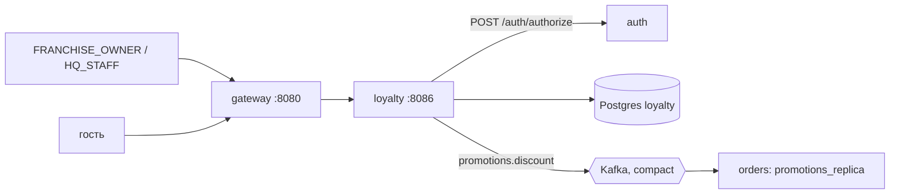
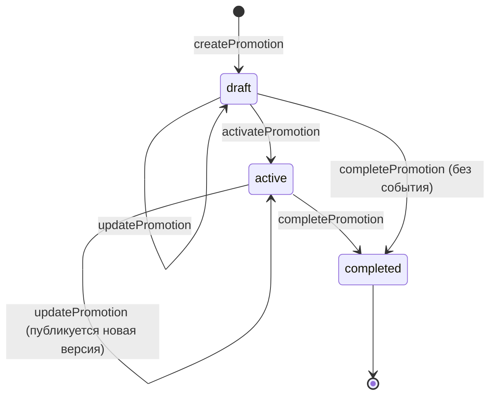
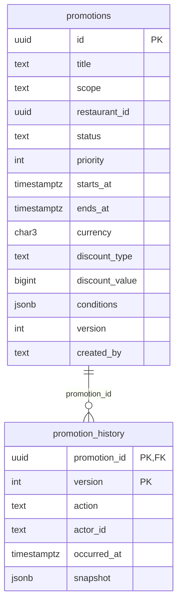
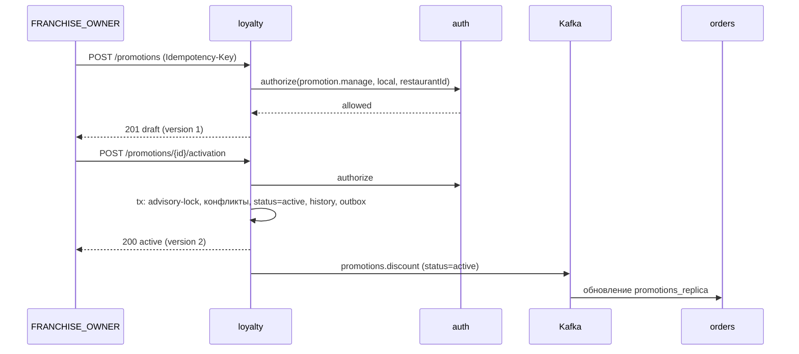

# loyalty-service — аналитическая документация

| | |
|---|---|
| Сервис | `services/loyalty`, порт `8086`, БД `loyalty` (Postgres) |
| Контракт | `contracts/openapi/loyalty.yaml` v1.2.0; событие — `contracts/asyncapi/kafka-events.yaml` v1.5.0 |
| Kafka | только публикует `promotions.discount` (компактный топик); ничего не потребляет |
| Внешние зависимости | auth-service (`POST /auth/authorize`, действие `promotion.manage`) |
| Идемпотентность | `Idempotency-Key` на `createPromotion`; активация и завершение идемпотентны по состоянию |
| Деньги | `bigint` копейки (ADR-13); процент хранится в сотых долях процента (`1500` = 15 %) |
| Состояние на | master `54d443b` (после S9) |

---

## 1. Суть

**Назначение.** Единственный источник акций и скидок сети. Сервис отвечает за их жизненный цикл (черновик → действует → завершена), правила допустимости и журнал изменений. **Саму скидку к заказу он не считает**: расчёт в `orders` по реплике акций (`promotions_replica`), которую `orders` наполняет из топика `promotions.discount`. Благодаря этому оформление заказа не зависит от доступности loyalty (ADR: реплика вместо синхронного вызова).

**Роли.** Акциями управляют `FRANCHISE_OWNER` (только своего ресторана, `scope=local`) и `HQ_STAFF` (любые, включая национальные `scope=national`). Просмотр действующих акций открыт гостю.

**Принципы**

- **Права проверяет auth-service, а не токен.** Роль в токене проверяется на входе (`RequireRole`), а охват (свой ресторан / национальная) — вызовом `/auth/authorize` с токеном пользователя, по актуальным данным БД auth: блокировка и смена привязки действуют сразу. Недоступный auth → `503` (fail-closed: управлять ценами без проверки нельзя).
- **Конфликт — только неоднозначность порядка (E2).** Две акции конфликтуют, если обе не `stackable`, **приоритет равен**, пересекаются период, охват по ресторанам и набор позиций. Разный приоритет — не конфликт: порядок известен.
- **Изменение, история и событие — одна транзакция** (transactional outbox).
- **Активация сериализуется advisory-lock'ом**, иначе две конфликтующие акции могли бы активироваться одновременно.
- **Нет статуса «запланирована».** Это `active` до `startsAt`; отдельного таймера старта нет — `orders` и список проверяют окно по времени.
- **Тип скидки `gift` из AsyncAPI не поддерживается** — только `percent` и `fixed`.

**Вне зоны ответственности**

- расчёт скидки, округление, применение к корзине (`orders`, банковское округление);
- промокоды, программа лояльности с баллами и кэшбэком, персональные акции (несмотря на название сервиса, реализованы только публичные акции);
- аналитика эффективности акций;
- удаление акций (есть только `completed`, журнал неизменяем);
- автоматическое завершение по истечении срока (см. §8).

---

## 2. Методы

| Метод | Путь | operationId | Доступ | Идемпотентность | Успех |
|---|---|---|---|---|---|
| GET | `/promotions?restaurantId=` | `listActivePromotions` | публичный | — | `200` |
| POST | `/promotions` | `createPromotion` | `FRANCHISE_OWNER`, `HQ_STAFF` + охват | `Idempotency-Key` обязателен | `201` + `Location` |
| GET | `/promotions/{id}` | `getPromotion` | то же | — | `200` |
| PUT | `/promotions/{id}` | `updatePromotion` | то же | — | `200` |
| GET | `/promotions/{id}/history` | `getPromotionHistory` | то же | — | `200` |
| POST | `/promotions/{id}/activation` | `activatePromotion` | то же | по состоянию | `200` |
| POST | `/promotions/{id}/completion` | `completePromotion` | то же | по состоянию | `200` |
| GET | `/healthz`, `/readyz`, `/metrics` | — | служебные | — | `200` |

**Тело `PromotionInput`** (create/update): `title*`, `description`, `scope*` (`local|national`), `restaurantId` (для `local`), `priority` (0–1000, по умолчанию 0), `startsAt*`, `endsAt*`, `currency` (по умолчанию `RUB`), `discount*{type: percent|fixed, value}`, `conditions{menuItemIds[], minSubtotal, fulfillment: pickup|delivery, stackable}`.

**Ответы.** `Promotion` (полное, для управления): плюс `status`, `version`, `createdBy`, `createdAt`, `updatedAt`. `PromotionPublic` (список): без `status`, `version`, `createdBy`, `createdAt`, `updatedAt`. `minSubtotal` в ответе опускается, если равен 0.

**Список (`listActivePromotions`).** Акции со статусом `active`, у которых `startsAt ≤ now < endsAt`. Без `restaurantId` — только национальные; с ним — национальные и локальные этого ресторана. Порядок: приоритет по убыванию, затем `startsAt`, `id`. Невалидный UUID → `400 VALIDATION_FAILED`; сбой БД → `503 PROMOTIONS_UNAVAILABLE`.

**Коды ошибок**

| HTTP | `code` | Когда |
|---|---|---|
| 400 | `VALIDATION_FAILED` | нет обязательных полей / невалидный `restaurantId` в списке; `INVALID_JSON`, `IDEMPOTENCY_KEY_REQUIRED` |
| 401 | `UNAUTHORIZED` | нет токена на управляющих методах |
| 403 | `FORBIDDEN` или причина auth | `NOT_ACTIVE`, `ROLE_REQUIRED`, `NOT_BOUND_TO_RESTAURANT`, `SCOPE_NOT_ALLOWED` |
| 404 | `PROMOTION_NOT_FOUND` | нет такой акции / не-UUID |
| 409 | `PROMOTION_CONFLICT` | конфликт с действующими акциями; в ответе `conflictingPromotionIds[]` |
| 409 | `PROMOTION_COMPLETED` | изменение/активация завершённой акции |
| 409 | `IDEMPOTENCY_IN_PROGRESS` | параллельный повтор |
| 422 | `PROMOTION_INVALID` | семантическая ошибка параметров (§4.1) |
| 422 | `PROMOTION_EXPIRED` | период уже закончился (активация или правка действующей) |
| 422 | `SCOPE_IMMUTABLE` | попытка сменить `scope`/`restaurantId` |
| 503 | `AUTH_UNAVAILABLE` | auth-service не дал решения |

Порядок проверки в `updatePromotion`: тело → семантика (422) → право на **новый** охват (403) → право на существующую акцию (404/403) → блокировка и состояние (409/422).

---

## 3. Контракты

**OpenAPI** `loyalty.yaml` v1.2.0: все 7 операций `x-status: implemented`.

**Вызов auth-service** (`internal/authz`): `POST {AUTH_URL}/auth/authorize` с заголовком `Authorization` пользователя и телом `{action: "promotion.manage", scope, restaurantId?}` → `{allowed, reason}`. Ответ `401` трактуется как отказ `NOT_ACTIVE` (токен отозван между gateway и сервисом); любой другой не-`200`, сетевой сбой или невалидный ответ — `ErrUnavailable` → `503`. Запрос не меняет состояние auth и идёт с постоянным `Idempotency-Key: authz-read`, что разрешает безопасный ретрай клиентом `httpx.Client`.

**Dev-режим.** При `AUTH_MODE=dev` (срезы без auth) используется `authz.Claims`: те же правила по ролям и привязкам из заголовков `X-User-*`. В prod dev-режим запрещён `authclient`.

**AsyncAPI** `promotions.discount` — см. §5.

**Конфигурация (env)**

| Переменная | По умолчанию | Смысл |
|---|---|---|
| `AUTH_URL` | пусто | адрес auth-service; **обязателен** при `AUTH_MODE=jwks` |
| `AUTH_TIMEOUT` | 2s | таймаут вызова `/auth/authorize` |
| `KAFKA_BROKERS` | — | брокеры для публикации |
| `AUTH_MODE`, `AUTH_JWKS_URL`, `AUTH_ISSUER`, `AUTH_AUDIENCE` | — | проверка токена |

---

## 4. Логика

### 4.1 Нормализация и валидация (`domain.Normalize`)

Вызывается на входе `create` и `update`; ошибка → `422 PROMOTION_INVALID`.

| Поле | Правило |
|---|---|
| `title` | после `TrimSpace` 1–120 символов (по рунам) |
| `description` | ≤ 1000 символов |
| `scope` | `local` или `national` |
| `restaurantId` | для `local` — обязательный UUID (приводится к нижнему регистру); для `national` — должен быть пуст. БД дублирует: `CHECK ((scope='local') = (restaurant_id IS NOT NULL))` |
| `priority` | 0–1000 |
| период | `endsAt > startsAt`, оба обязательны; приводятся к UTC |
| `currency` | ISO-4217 из трёх заглавных букв; пусто → `RUB`; регистр приводится |
| `discount.percent` | 1–10000 (0,01 %–100,00 %) |
| `discount.fixed` | 1–10¹⁰ копеек |
| `conditions.minSubtotal` | 0–10¹⁰ копеек |
| `conditions.fulfillment` | `""`, `pickup`, `delivery` |
| `conditions.menuItemIds` | ≤ 100 UUID, без дублей (регистронезависимо), сортируются; пусто — весь заказ |

### 4.2 Жизненный цикл

| Операция | `draft` | `active` | `completed` |
|---|---|---|---|
| `update` | меняет, версия +1, события нет | проверка срока и конфликтов, версия +1, **событие** | `409 PROMOTION_COMPLETED` |
| `activate` | срок, конфликты → `active`, версия +1, **событие** | no-op, `200` | `409 PROMOTION_COMPLETED` |
| `complete` | `completed`, версия +1, события **нет** (orders о черновике не знает) | `completed`, версия +1, **событие** | no-op, `200` |

Каждое изменение увеличивает `version` и пишет строку в `promotion_history` (действия `created`, `updated`, `activated`, `completed`) со снимком акции. Активация и обновление берут `pg_advisory_xact_lock(hashtext('loyalty.activation'))` — один глобальный замок на проверку конфликтов; завершение замок не берёт.

### 4.3 Проверка конфликтов (E2)

`Conflicts(a, b)` истинно, когда:

1. `a.ID ≠ b.ID`;
2. обе акции **не** `stackable`;
3. приоритеты **равны**;
4. охват пересекается (`Covers`): национальная пересекается с любой, две локальные — только в одном ресторане;
5. периоды пересекаются (полуоткрытые интервалы: стык `endsAt = startsAt` — не пересечение);
6. наборы позиций пересекаются (пустой набор = весь заказ, пересекается со всем).

Проверка идёт против акций со статусом `active` и `endsAt > now`. Делается при `activate` и при `update` **действующей** акции; черновики не проверяются до активации. Ответ — `409 PROMOTION_CONFLICT` со списком id.

**Решение разрулить конфликт** — смена приоритета или `stackable`, либо сужение условий/периода; автоматического разрешения нет.

### 4.4 Проверка прав

1. Токен → роль (`RequireRole`: `FRANCHISE_OWNER` или `HQ_STAFF`), иначе 401/403 уже на входе.
2. Сервис вызывает `/auth/authorize` для охвата: `create` — по охвату из тела; `get`/`history`/`activate`/`complete` — по охвату существующей акции; `update` — по новому охвату и затем по существующей (владелец не может «расширить» акцию до национальной).
3. Отказ → `403` с `code = reason` из auth.

Побочный эффект: в одном запросе сервис делает 1–2 синхронных вызова auth; метрика `loyalty_authz_total{result}`.

### 4.5 Публикация

Событие кладётся в outbox в той же транзакции при: `activate` (draft→active), `update` действующей акции, `complete` действующей акции. Снимок содержит `status`, поэтому `orders` по `completed` убирает акцию из реплики. После коммита relay будится `Wake()`.

---

## 5. События (Kafka)

### 5.1 Публикуемое: `promotions.discount` (`promotions.discount.v1`, DLQ `.dlq`)

Топик **компактный** (`cleanup.policy=compact`, 1 партиция), ключ — `promotionId`: важен последний снимок акции.

| Поле | Тип | Примечание |
|---|---|---|
| `promotionId` | uuid | ключ |
| `version` | int | монотонно растёт; потребитель отбрасывает меньшие |
| `scope` | `local|national` | |
| `restaurantId` | uuid? | для `local` |
| `title` | string | |
| `currency` | string | |
| `conditions{menuItemIds[], minSubtotal, fulfillment?, stackable}` | | `menuItemIds` всегда массив (пустой `[]` — весь заказ) |
| `discount{type, value}` | `percent` (сотые доли %) / `fixed` (копейки) | |
| `priority` | int | |
| `validFrom`, `validTo` | RFC 3339 | |
| `status` | `active|completed` | |

Потребитель — `orders`: хранит реплику и отбирает действующие акции по `status`, окну `validFrom…validTo`, охвату, условиям. Детали расчёта — `orders.md` §Скидки.

### 5.2 Потребляемые

Нет. Сервис не имеет consumer-группы и таблицы `processed_events`.

### 5.3 Гарантии

Transactional outbox. Порядок версий одной акции сохраняется ключом партиции; потеря порядка между разными акциями не важна.

---

## 6. Работа с БД

БД `loyalty`; таблицу `outbox` создаёт `pkg/kafka`, `idempotency_keys` — `pkg/idempotency`. Миграция одна — `001_init.sql`.

### 6.1 ER-диаграмма

### 6.2 Таблицы

**`promotions`**

| Колонка | Тип | Ограничения |
|---|---|---|
| `id` | uuid PK | |
| `title` | text | длина 1–120 |
| `description` | text | ≤ 1000, по умолчанию `''` |
| `scope` | text | `local|national` |
| `restaurant_id` | uuid NULL | `(scope='local') = (restaurant_id IS NOT NULL)` |
| `status` | text | `draft|active|completed` |
| `priority` | int | 0–1000, по умолчанию 0 |
| `starts_at`, `ends_at` | timestamptz | `ends_at > starts_at` |
| `currency` | char(3) | по умолчанию `RUB` |
| `discount_type` | text | `percent|fixed` |
| `discount_value` | bigint | > 0 и ≤ 10¹⁰; для `percent` ≤ 10000 |
| `conditions` | jsonb | `menuItemIds`, `minSubtotal`, `fulfillment`, `stackable`; по умолчанию `{}` |
| `version` | int ≥ 1 | растёт при каждом изменении |
| `created_by` | text | userId автора |
| `created_at`, `updated_at` | timestamptz | |

**`promotion_history`** — журнал: PK `(promotion_id, version)`, `action ∈ created|updated|activated|completed`, `actor_id`, `occurred_at`, `snapshot jsonb` (то же представление, что отдаёт API). Запись есть для каждой версии, поэтому из журнала можно восстановить любое состояние.

### 6.3 Индексы

| Индекс | Назначение |
|---|---|
| `promotions_active_idx (ends_at, restaurant_id) WHERE status='active'` | `ListActive` (проверка конфликтов) и `ListCurrent` (публичный список) |
| `promotion_history` PK `(promotion_id, version)` | чтение журнала по акции в порядке версий |

### 6.4 Блокировки

`FOR UPDATE` строки акции на любое изменение; **глобальный** advisory-lock `loyalty.activation` на `activate` и `update` (§4.2) — упрощение, достаточное при единицах операций в минуту; при росте можно делать замок на `(restaurant_id | 'national')`.

### 6.5 Объём

Акций немного (десятки–сотни), история — десятки строк на акцию; очистка не нужна.

---

## 7. Сценарии использования

### UC-PRM-01 Просмотр действующих акций

Клиент (в том числе гость) открывает меню ресторана → `GET /promotions?restaurantId=…` → список с приоритетом по убыванию. Показ — витринный; фактическая скидка считается при оформлении в `orders`.

### UC-PRM-02 Создание и запуск акции франчайзи

Исключения: чужой ресторан → `403 NOT_BOUND_TO_RESTAURANT`; национальная → `403 SCOPE_NOT_ALLOWED`; конфликт → `409` со списком.

### UC-PRM-03 Национальная акция сети

То же для `HQ_STAFF` со `scope=national`. Охватывает все рестораны сразу, в том числе будущие.

### UC-PRM-04 Изменение действующей акции

`PUT` → проверка срока и конфликтов → версия +1 → новое событие. Заказы, оформленные до обновления реплики в orders, считаются по предыдущей версии; задержка равна лагу Kafka.

### UC-PRM-05 Досрочное завершение

`POST …/completion` → `completed` → событие `status=completed` → `orders` исключает акцию.

### UC-PRM-06 Разбор изменений

`GET …/history` возвращает версии со снимками: кто и когда менял, какие были условия на момент.

### UC-PRM-07 Недоступность auth

Любая управляющая операция → `503 AUTH_UNAVAILABLE`, публичный список работает (он от auth не зависит).

---

## 8. Прочие важные моменты

### Безопасность

- Управляющие маршруты требуют токен; охват проверяется на стороне auth (fail-closed).
- Изменяемый охват запрещён (`SCOPE_IMMUTABLE`): акцию нельзя «перенести» между ресторанами или превратить в национальную.
- Заголовок `Authorization` пользователя пробрасывается в auth; в логи не пишется.

### Наблюдаемость

Метрики: `loyalty_promotion_actions_total{action,result}` (`result ∈ ok|conflict|forbidden|invalid|error`), `loyalty_authz_total{result ∈ allowed|denied|unavailable}`. **Алерты-кандидаты:** рост `authz{unavailable}`, рост `actions{error}`.

### Известные ограничения и находки

1. **Нет автоматического завершения по сроку.** После `endsAt` акция остаётся в статусе `active`, событие `completed` не публикуется. Корректность держится на том, что `ListCurrent` и `orders` проверяют `validTo`. Следствия: в `promotions_active_idx` копятся просроченные строки, а `ListActive` при проверке конфликтов отсекает их только условием `ends_at > now`; в реплике orders акция остаётся `active` с прошедшим `validTo`.
2. **Существование ресторана не проверяется.** Для `scope=local` `restaurantId` только валидируется как UUID; акцию можно создать на несуществующий ресторан (если автор имеет такую привязку в auth, что маловероятно для `FRANCHISE_OWNER`, но `HQ_STAFF` может).
3. **Существование позиций меню не проверяется** (`menuItemIds` — просто UUID); опечатка даст акцию, которая никогда не сработает.
4. **Глобальный advisory-lock** сериализует активации всей сети (см. §6.4).
5. **Конфликт «равный приоритет» — единственный.** Две `stackable`-акции и акции с разным приоритетом не проверяются на экономический смысл: суммарная скидка может превысить стоимость. Ограничение суммы — ответственность расчёта в orders.
6. **Название сервиса шире реализации:** нет баллов, промокодов и персональных предложений.
7. **Черновик не проверяется на конфликты**, поэтому ошибка выявляется только при активации.
8. **Нет удаления черновиков**; ненужный черновик можно только завершить (запись остаётся в БД).
9. **Дублирование проверки прав:** `update` делает два вызова auth (по новому и по существующему охвату), что удваивает задержку и нагрузку на auth.
