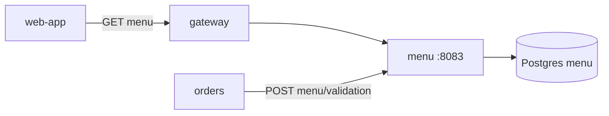
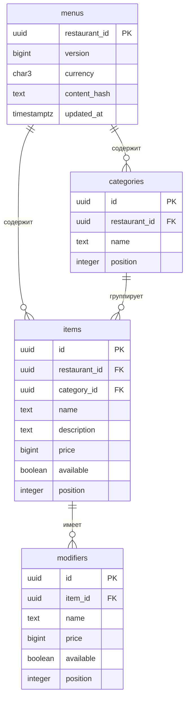
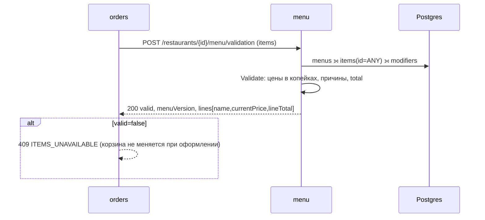

# menu-service — аналитическая документация

| | |
|---|---|
| Сервис | `services/menu`, порт `8083`, БД `menu` (Postgres) |
| Контракт | `contracts/openapi/menu.yaml` v1.3.0 |
| Kafka / идемпотентность | не используются (read-only каталог) |
| Доступ | публичный, гость допускается |
| Деньги | `bigint` копейки (ADR-13), в JSON `integer` |
| Состояние на | master `54d443b` (после S9) |

---

## 1. Суть

**Назначение.** Авторитетный источник меню и цен. Сервис отвечает на два вопроса:

1. «Что в меню ресторана?» — витрина для клиента (категории, позиции, модификаторы, цены, доступность), с кэшированием по `ETag`.
2. «Корзина корректна?» — `validateMenuItems`: проверка набора позиций и модификаторов, пересчёт цен и итога. Это единственная точка истины для цены и стоп-листа; `orders` не доверяет цене от клиента и ни разу не кэширует цену у себя.

**Принципы**

- **Недоступность — не ошибка запроса.** Проверка с позицией из стоп-листа возвращает `200`, `valid=false` и причину по каждой строке; решение (удалить позицию, предложить замену) принимает вызывающий.
- **Ресторан — часть ключа.** Позиция чужого ресторана = `ITEM_NOT_FOUND`.
- **Снапшот названия.** Валидация возвращает `name` позиции — `orders` кладёт его в строку заказа.
- **Версия меню** (`menuVersion`) растёт при любом изменении содержимого, включая стоп-лист; на ней построен `ETag`.

**Вне зоны ответственности**

- управление меню: CRUD-API нет, меню загружается seed-ом при старте (`SEED_ON_START`);
- шаблоны меню сети (ADR: меню на ресторан, без сетевого шаблона);
- скидки (`loyalty` + `orders`), налоги, НДС, состав/КБЖУ, фото, мультиязычность, расписание блюд (завтраки и т.д.);
- резервирование остатков: «доступно/нет» — флаг, а не количество.



---

## 2. Методы

| # | Метод и путь | operationId | Доступ | Успех | Назначение |
|---|---|---|---|---|---|
| 1 | `GET /restaurants/{restaurantId}/menu` | getMenu | публично | 200 / 304 | Меню ресторана |
| 2 | `POST /restaurants/{restaurantId}/menu/validation` | validateMenuItems | публично | 200 | Проверка корзины |
| 3 | `GET /health/`, `GET /actuator/health`, `GET /metrics` | — | служебные | | пробы и метрики |

Режим `--migrate-only` — применить миграции и выйти.

### 2.1. Ошибки

| `code` | HTTP | Условие |
|---|---|---|
| `INVALID_PARAMETER` | 400 | `restaurantId` не UUID; нарушены ограничения тела валидации (см. §3.2) |
| `INVALID_JSON` | 400 | тело не разобрано / лишние поля |
| `MENU_NOT_FOUND` | 404 | у ресторана нет меню (в seed — ресторан №6, а также любой неизвестный UUID) |
| `INTERNAL` | 500 | сбой БД |

Меню не проверяет, существует ли сам ресторан в `restaurant`: ответ зависит только от наличия записи в `menus`.

---

## 3. Контракты

### 3.1. `GET /restaurants/{restaurantId}/menu`

```json
{
  "restaurantId": "a1000000-0000-4000-8000-000000000004",
  "menuVersion": 3,
  "categories": [
    {
      "id": "uuid", "name": "Бургеры",
      "items": [
        {
          "id": "uuid", "name": "BLT Классик", "description": "Бекон, салат, томат, фирменный соус",
          "price": { "amount": 34900, "currency": "RUB" },
          "available": true,
          "modifiers": [ { "id": "uuid", "name": "Сыр чеддер", "price": { "amount": 5000, "currency": "RUB" }, "available": true } ]
        }
      ]
    }
  ]
}
```

Заголовки ответа: `ETag: "v<menuVersion>"`, `Cache-Control: public, max-age=30`. Запрос с `If-None-Match` (допускаются список значений, слабый валидатор `W/`, `*`) при совпадении → `304` без тела (заголовки `ETag` и `Cache-Control` сохраняются). Порядок категорий, позиций и модификаторов — по полю `position`, то есть как в источнике. Пустые массивы всегда присутствуют (`[]`, не `null`).

### 3.2. `POST /restaurants/{restaurantId}/menu/validation`

```json
// запрос
{ "items": [ { "menuItemId": "uuid", "quantity": 2, "modifierIds": ["uuid"] } ] }
```

| Поле | Ограничения |
|---|---|
| `items` | 1…100 строк |
| `menuItemId` | UUID |
| `quantity` | 1…99 |
| `modifierIds` | до 20 элементов, каждый UUID, **без дубликатов** (иначе 400) |

```json
// ответ 200
{
  "valid": false,
  "menuVersion": 3,
  "lines": [
    { "menuItemId": "…", "quantity": 2, "available": true, "name": "BLT Классик",
      "currentPrice": { "amount": 43800, "currency": "RUB" },
      "lineTotal":    { "amount": 87600, "currency": "RUB" } },
    { "menuItemId": "…", "quantity": 1, "available": false, "name": "Брауни",
      "currentPrice": { "amount": 17900, "currency": "RUB" }, "lineTotal": { "amount": 17900, "currency": "RUB" },
      "reasonCode": "ITEM_UNAVAILABLE", "reason": "Позиция недоступна" }
  ],
  "total": { "amount": 87600, "currency": "RUB" }
}
```

- `currentPrice` — цена **за единицу** с учётом всех найденных модификаторов (включая недоступные); `lineTotal = currentPrice × quantity`.
- `total` — сумма `lineTotal` **только по доступным строкам**.
- Для `ITEM_NOT_FOUND` цен и `name` нет.
- Строки возвращаются в порядке запроса; повтор одной позиции в двух строках допустим.

Коды причин (`reasonCode`) и их приоритет, от старшего к младшему:

| Код | Смысл | Сообщение (`reason`) |
|---|---|---|
| `ITEM_NOT_FOUND` | позиции нет в меню этого ресторана | «Позиции нет в меню ресторана» |
| `ITEM_UNAVAILABLE` | позиция в стоп-листе | «Позиция недоступна» |
| `MODIFIER_NOT_FOUND` | модификатор не относится к позиции | «Модификатор не относится к позиции» |
| `MODIFIER_UNAVAILABLE` | модификатор в стоп-листе | «Модификатор недоступен» |

### 3.3. Конфигурация

| Переменная | По умолчанию | Смысл |
|---|---|---|
| `DATABASE_URL` | обязательна | подключение |
| `HTTP_PORT`, `APP_ENV`, `LOG_LEVEL` | 8083, dev, info | базовые |
| `AUTH_MODE` | `dev` | `dev|jwks`; роли не требуются |
| `SEED_ON_START` | false | загрузить встроенные меню |

---

## 4. Логика

### 4.1. Алгоритм `Validate` (чистая функция `domain.Validate`)

Для каждой строки запроса, по порядку:

1. Позиция не найдена (среди позиций ресторана) → `ITEM_NOT_FOUND`, цен нет.
2. Иначе `unit = price позиции`; если позиция недоступна → `ITEM_UNAVAILABLE` (но цена всё равно считается).
3. Для каждого модификатора: не найден у позиции → `MODIFIER_NOT_FOUND` (перекрывает только отсутствие причины и `MODIFIER_UNAVAILABLE`, но не `ITEM_UNAVAILABLE`); найден → `unit += price`; найден, но недоступен и причины ещё нет → `MODIFIER_UNAVAILABLE`. **Цена недоступного модификатора включается в `unit`**, цена несуществующего — нет.
4. `lineTotal = unit × quantity`, `available = (причины нет)`.
5. `valid = все строки available`; `total += lineTotal` только для доступных строк.

Арифметика `int64`; предельные значения исключают переполнение: цена ≤ 10¹⁰ коп., строк ≤ 100, количество ≤ 99, модификаторов ≤ 20.

### 4.2. Загрузка данных

Одна SQL-выборка на запрос: `menus ⟕ items (id = ANY(ids) AND restaurant_id) ⟕ modifiers`. Дубли `menuItemId` в запросе схлопываются до уникальных id при выборке. Нет строки в `menus` → `MENU_NOT_FOUND`; строка есть, а позиций нет → меню есть, все строки `ITEM_NOT_FOUND`.

`getMenu` — тоже одна выборка (`menus ⟕ categories ⟕ items ⟕ modifiers`), сборка дерева в Go, сортировка `position, id`.

### 4.3. Версионирование и ETag

`menus.version` растёт на 1 при каждом изменении содержимого. Seed вычисляет `SHA-256` по JSON содержимого (валюта и дерево категорий, **включая флаги доступности**): совпадает с `content_hash` — ничего не делается (версия прежняя), отличается — категории удаляются каскадом, вставляются заново, `version+1`. Идентификаторы позиций стабильны (UUIDv5 от `restaurantId` и ключа), поэтому открытые корзины в orders не теряют ссылок при обновлении меню.

`ETag` = `"v<version>"`: слабая привязка к версии, а не хэшу тела; изменения вне seed без роста `version` клиенты увидят только после истечения `max-age` + повторного запроса без `If-None-Match`.

### 4.4. Роль в оформлении заказа

`orders` вызывает `validateMenuItems` при каждом наполнении корзины (`updateCartItems`) и ещё раз при `createOrder` (вне транзакции, таймаут 800 мс, 1 повтор, circuit breaker). Расхождение цены корзины и текущей → `409 PRICE_CHANGED`; недоступная позиция → `409 ITEMS_UNAVAILABLE`; menu недоступен → `503 MENU_UNAVAILABLE` (fail-closed).

---

## 5. События (Kafka)

Сервис не публикует и не потребляет события. Смена цены или стоп-лист не рассылаются; потребители узнают о них при следующей валидации. В перспективе (управление меню, S10+) потребуется событие изменения меню/стоп-листа для оперативного обновления клиентов.

---

## 6. Работа с БД

БД `menu`, роль `menu`; миграции модуля `menu` (`001_init.sql`).

### 6.1. ER-диаграмма



`menus.restaurant_id` — идентификатор ресторана из сервиса `restaurant`; внешнего ключа нет (база на сервис).

### 6.2. Таблицы

| Таблица | Ключ | Ограничения |
|---|---|---|
| `menus` | PK `restaurant_id` | `version ≥ 1`; `currency char(3)` default `'RUB'`; `content_hash` NOT NULL |
| `categories` | PK `id` | FK → `menus(restaurant_id)` `ON DELETE CASCADE` |
| `items` | PK `id` | FK → `menus`, FK → `categories` (оба CASCADE); `price` bigint CHECK `0 ≤ price ≤ 10 000 000 000` |
| `modifiers` | PK `id` | FK → `items` CASCADE; тот же CHECK цены |

Поле `available` — булев флаг стоп-листа (по умолчанию true). Цена модификатора прибавляется к цене позиции; бесплатный модификатор — `price = 0`.

### 6.3. Индексы

| Индекс | Колонки | Назначение |
|---|---|---|
| `categories_restaurant_idx` | `(restaurant_id, position)` | порядок категорий меню |
| `items_restaurant_idx` | `(restaurant_id, category_id, position)` | дерево меню; при валидации — фильтр по ресторану (поиск по PK `id`) |
| `modifiers_item_idx` | `(item_id, position)` | модификаторы позиции |
| PK `items(id)` | | `id = ANY($ids)` в `validateMenuItems` |

### 6.4. Транзакционность seed

На ресторан — отдельная транзакция: `SELECT … FOR UPDATE` строки `menus`; нет — вставка; хэш совпал — выход; различается — `DELETE categories` (каскад на items/modifiers), `UPDATE menus` (`version+1`), пересоздание дерева. Чтение (`getMenu`, валидация) не блокируется долго: окно между удалением и вставкой — внутри одной транзакции, читатели видят старую версию (READ COMMITTED).

---

## 7. Сценарии использования

### UC-MNU-01. Просмотр меню

`GET /restaurants/{id}/menu` → дерево; клиент сохраняет `ETag`; при повторе шлёт `If-None-Match` → `304`. Недоступные позиции видны с `available=false` (клиент показывает как «нет в наличии»).

### UC-MNU-02. Проверка корзины перед оформлением

orders отправляет позиции корзины → получает актуальные цены и названия → сравнивает с ценами корзины (снапшот). Если всё совпало — продолжает оформление.



### UC-MNU-03. Стоп-лист

Ресторан №1: «Брауни» недоступен. Валидация строки с брауни → `valid=false`, `ITEM_UNAVAILABLE`; total по остальным строкам считается. Ресторан №2: «Чикен бургер» и модификатор «Сыр чеддер» недоступны.

### UC-MNU-04. Чужая позиция

Позиция ресторана №4 в запросе к ресторану №1 → `ITEM_NOT_FOUND` (а не ошибка запроса); защита от подмены ресторана в корзине.

### UC-MNU-05. Ресторан без меню

Ресторан №6 (неактивный) меню не имеет: `404 MENU_NOT_FOUND`.

---

## 8. Прочие важные моменты

### 8.1. Демо-данные

Два шаблона и пять меню:

| Шаблон | Позиции |
|---|---|
| `classic` | BLT Классик 349 ₽ (+бекон 89, +чеддер 50, без лука 0), Чикен бургер 319 (+острый соус 20), Веджи бургер 299, Клаб-сэндвич 279, Кола 129, Лимонад 189 (+большой 60), Американо 149 (+овсяное молоко 50), Брауни 179 |
| `kiosk` | BLT Классик 339 (+чеддер 50), Кола 129, Американо 149 |

Рестораны 1, 2, 4, 5 — `classic`, №3 — `kiosk`; №6 меню нет. Стоп-лист: №1 — Брауни; №2 — Чикен бургер и чеддер. Id категорий/позиций/модификаторов — UUIDv5 (`namespace 6b1f4a52-…`) от `restaurantId/вид/ключ`, поэтому стабильны между запусками, но отличаются у разных ресторанов.

### 8.2. Ограничения и допущения

1. Нет API управления меню и стоп-листом; изменить можно только перезагрузкой seed (рестарт сервиса).
2. Одна валюта на меню; `Money.currency` берётся из `menus.currency`.
3. Недоступный модификатор влияет на `currentPrice` (цена включена), хотя строка недоступна — для UI это удобно, для расчёта сумм — используйте только `total`.
4. Список `items` в валидации ограничен 100 строками; `total` — `int64`.
5. `ETag` привязан к версии; ручные правки БД без `version+1` не инвалидируют кэш клиентов.
6. Нет пагинации меню: ответ целиком (размер — десятки позиций).
7. Нет информации об остатках и времени приготовления (это в `production.lead.time`, S4).

### 8.3. Нефункциональное

- Цель по производительности: `validateMenuItems` p99 ≲ 50 мс; грубый замер в песочнице — ≈30 мс при 16 параллельных клиентах (нагрузочные тесты — S11).
- Кэширование на клиенте и CDN допустимо: `Cache-Control: public, max-age=30`.
- Метрики RED; масштабирование горизонтальное.

### 8.4. Тестирование

Unit: `domain.Validate` (суммирование в копейках, приоритеты причин, смешанные строки, снапшот названия), seed, HTTP (вместе с настоящим `service`). Интеграционные `store`: порядок, изоляция по ресторану, рост версии, CHECK цены. Postman `postman/menu/` (21 запрос / 45 проверок), сквозной `postman/catalog/`, `make contract-check SCENARIO=catalog`.
