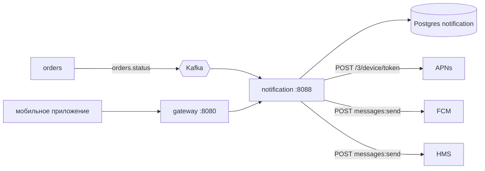
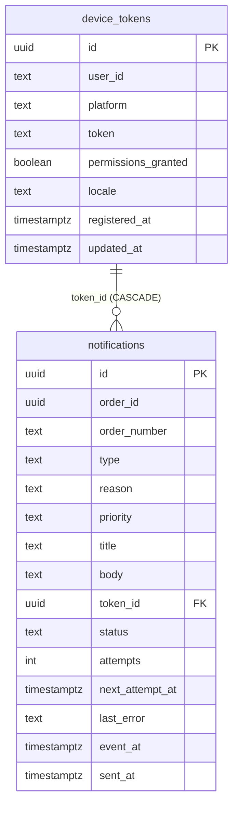
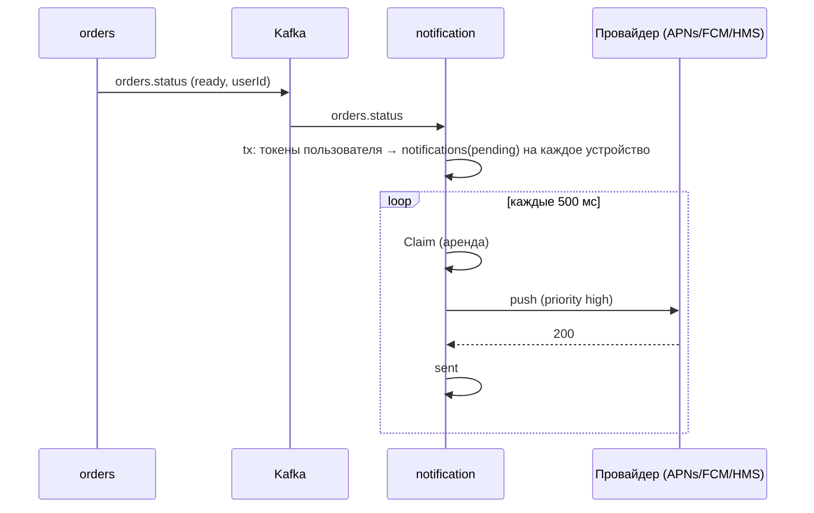

# notification-service — аналитическая документация

| | |
|---|---|
| Сервис | `services/notification`, порт `8088`, БД `notification` (Postgres) |
| Контракт | `contracts/openapi/notification.yaml` v1.2.0; событие `orders.status` и сообщение `PushNotification` — `contracts/asyncapi/kafka-events.yaml` v1.5.0 |
| Kafka | только потребляет `orders.status` (группа `notification-service`); сам ничего не публикует |
| Внешние системы | push-провайдеры APNs (iOS), FCM (Android), HMS (Huawei); в dev — `tools/mock-externals`, модуль `push` |
| Идемпотентность | `UNIQUE (order_id, type, token_id)` в очереди + inbox `processed_events` |
| Состояние на | master `54d443b` (после S9) |

---

## 1. Суть

**Назначение.** Доставляет клиенту push-уведомления о смене статуса заказа и хранит push-токены его устройств. Сервис односторонний: слушает `orders.status`, превращает значимые статусы в уведомления на каждое устройство владельца заказа и отправляет их провайдерам. Сбой push **никогда не влияет на заказ**: консьюмер не делает сетевых вызовов, он только ставит строки в очередь.

**Принципы**

- **Разделение «поставить» и «отправить».** Консьюмер в inbox-транзакции пишет строки `notifications` (по одной на устройство); отдельный цикл (`RunSender`) берёт их в «аренду» и вызывает провайдера вне транзакций БД. Падение процесса между отправкой и записью исхода не теряет очередь.
- **Не больше одного push на (заказ, тип, устройство)** — гарантирует уникальный индекс: повтор события, повторная обработка и параллельные консьюмеры не дают дубля.
- **Свежесть важнее полноты.** Событие старше `MAX_EVENT_AGE` (1 час) не отправляется: после простоя клиент не должен получить «заказ готов» часовой давности.
- **Только владельцу.** Получатель — `userId` из `orders.status`; гостевые заказы push не получают (осознанное ограничение).
- **Минимизация PII:** токены приватны (видны только владельцу), в уведомление попадают только номер заказа и тип.
- **Уважение разрешений:** токены с `permissionsGranted=false` пропускаются (при постановке) либо закрываются как `skipped` (если право отозвали уже после постановки).

**Вне зоны ответственности**

- SMS, e-mail, in-app сообщения, маркетинговые рассылки;
- push-подписка по темам, настройки пользователя по типам уведомлений;
- уведомления сотрудникам ресторана (только клиент заказа);
- события оплаты и доставки (`orders.payments.*`, `orders.delivery.status`) — сервис знает только `orders.status`;
- хранение истории уведомлений для показа клиенту (таблица — очередь отправки, а не «центр уведомлений»).

---

## 2. Методы

Доступны любому **аутентифицированному** пользователю (любая роль); гость → `401`. Каждый видит только свои токены.

| Метод | Путь | operationId | Успех |
|---|---|---|---|
| POST | `/notifications/device-tokens` | `registerDeviceToken` | `201` + `Location` (новый) / `200` (уже был — обновлён) |
| GET | `/notifications/device-tokens` | `listDeviceTokens` | `200` |
| DELETE | `/notifications/device-tokens/{tokenId}` | `deleteDeviceToken` | `204` |
| GET | `/healthz`, `/readyz`, `/metrics` | — | `200` |

**`registerDeviceToken`.** Тело: `platform` (`apns|fcm|huawei`), `token`, `permissionsGranted` (по умолчанию `true`). Язык уведомлений берётся из заголовка `Accept-Language` (`ru` или `en`, первый поддержанный тег в порядке перечисления, `q`-значения не учитываются; иначе `ru`). Ответ: `id, platform, token, permissionsGranted, locale, registeredAt`.

Повторная регистрация того же `(platform, token)` обновляет `permissionsGranted` и `locale`. Если токен ранее принадлежал **другому** пользователю (устройство сменило владельца — например, выход и вход под другой учётной записью), он переназначается новому владельцу, `registeredAt` обновляется, а ожидающие уведомления прежнего владельца удаляются.

**Ограничение:** у одного пользователя не больше **10** токенов; при превышении удаляются самые старые (по `registered_at`).

**Коды ошибок**

| HTTP | `code` | Когда |
|---|---|---|
| 400 | `VALIDATION_FAILED` | неизвестная платформа; токен пуст, длиннее 4096 или содержит пробелы/управляющие символы; `INVALID_JSON` — битое тело |
| 401 | `UNAUTHORIZED` | нет токена доступа / гость |
| 404 | `DEVICE_TOKEN_NOT_FOUND` | токена нет, он чужой или `tokenId` не UUID (существование чужого не раскрывается) |

---

## 3. Контракты

**OpenAPI** `notification.yaml` v1.2.0: три операции, все `x-status: implemented`.

**AsyncAPI.** Потребляемое — `orders.status`. Исходящие сообщения к провайдерам описаны каналами `pushApns` (`POST /3/device/{deviceToken}`), `pushFcm` (`POST /v1/projects/{projectId}/messages:send`) и `pushHms` (`POST /v1/{appId}/messages:send`) с общей схемой `PushNotification` (в сообщении `platform` = `ios|android|huawei`, `data{orderId, orderNumber, type}`).

**Протокол к провайдерам** (`internal/push`, HTTP/JSON, ключ в заголовке):

| Платформа | Особенности |
|---|---|
| `apns` | `apns-push-type: alert`, `apns-priority` 10 для `high` и 5 для `normal`, `apns-id` = id уведомления, `apns-topic` из конфигурации |
| `fcm` | проект из `PUSH_FCM_PROJECT` |
| `huawei` | приложение из `PUSH_HMS_APP_ID` |

В `data` каждого сообщения передаются `orderId`, `orderNumber`, `type`, чтобы приложение открыло нужный заказ. URL провайдера вырезается из текста ошибок (токен устройства не должен попасть в логи).

**Классификация ответа провайдера** (`classify`):

| Ответ | Исход | Действие |
|---|---|---|
| 2xx | `sent` | `status=sent`, `sent_at` |
| 404, 410; 400 с признаками плохого токена (`BadDeviceToken`, `Unregistered`, `UNREGISTERED`, `80300007`) | `invalid_token` | токен удаляется, его уведомления уходят каскадом |
| 401, 403, 408, 429, 5xx, сетевая ошибка | `retry` | повтор с backoff до `SEND_MAX_ATTEMPTS`, затем `failed` |
| остальное (прочие 4xx) | `failed` | `status=failed`, повтор не поможет |

401/403 трактуются как «повторить», потому что ключ провайдера могут поправить без рестарта.

**Конфигурация (env)**

| Переменная | По умолчанию | Смысл |
|---|---|---|
| `PUSH_APNS_URL`, `PUSH_FCM_URL`, `PUSH_HMS_URL` | `http://localhost:9095` | адреса провайдеров |
| `PUSH_APNS_KEY`, `PUSH_FCM_KEY`, `PUSH_HMS_KEY` | dev-значения только при `APP_ENV=dev` | вне dev обязательны, ≥ 16 символов, dev-значения запрещены |
| `PUSH_APNS_TOPIC`, `PUSH_FCM_PROJECT`, `PUSH_HMS_APP_ID` | `ru.example.food`, `food-platform`, `food-platform` | идентификаторы приложения |
| `PUSH_TIMEOUT` | 5s | таймаут HTTP-клиента провайдера |
| `MAX_EVENT_AGE` | 1h | событие/уведомление старше — пропускается |
| `SEND_INTERVAL` | 500ms | период цикла отправки |
| `SEND_BATCH` / `SEND_WORKERS` | 50 / 8 | сколько уведомлений за тик / параллельных отправок |
| `SEND_TIMEOUT` | 10s | на один вызов провайдера |
| `SEND_LEASE` | 30s | аренда уведомления; **должна быть > `SEND_TIMEOUT`**, иначе fail-fast при старте |
| `SEND_BACKOFF` / `SEND_BACKOFF_MAX` | 2s / 5m | пауза перед первым повтором / потолок |
| `SEND_MAX_ATTEMPTS` | 6 | попыток до `failed` |
| `RETENTION` | 7d | сколько хранить закрытые уведомления |

---

## 4. Логика

### 4.1 Соответствие статуса заказа уведомлению

| `orders.status` | Тип | Приоритет | Заголовок (ru) |
|---|---|---|---|
| `accepted` | `order_created` | normal | Заказ принят |
| `ready` | `order_ready` | **high** | Заказ готов |
| `on_delivery` | `on_delivery` | **high** | Курьер в пути |
| `delivered` | `delivered` | **high** | Заказ доставлен |
| `handed_over` | `handed_over` | normal | Заказ выдан |
| `cancelled` | `order_cancelled` | **high** | Заказ отменён |
| `not_received` | `order_not_received` | normal | Заказ не получен |
| `pending_payment`, `cooking`, `closed` | — | — | уведомления нет |

Приоритет определяет `apns-priority` (10/5) и срочность FCM/HMS.

### 4.2 Тексты

Шаблоны по языку (`ru`, `en`) и необязательной причине (`reason` из `orders.status`). Ключ с причиной точнее ключа без неё; если точного нет — используется общий (так, произвольная причина отмены персоналом даст «Заказ №… отменён.»).

| Тип + причина | Тело (ru) |
|---|---|
| `order_cancelled` | Заказ №N отменён. |
| `order_cancelled` + `payment_timeout` | …отменён: он не был оплачен вовремя. |
| `order_cancelled` + `out_of_stock` | …отменён: позиций нет в наличии. |
| `order_cancelled` + `restaurant_closed` | …отменён: ресторан закрыт. |
| `order_not_received` + `pickup_timeout` | Заказ №N не забрали вовремя. |
| `order_not_received` + `undelivered` | Курьеру не удалось доставить заказ №N. |

Язык берётся **из токена** (фиксируется при регистрации), поэтому у одного пользователя разные устройства могут получить разные языки. Неизвестный язык → `ru`.

### 4.3 Постановка в очередь (консьюмер `orders.status`)

Внутри inbox-транзакции, без сетевых вызовов:

1. Разбор и валидация: `orderId` — UUID, `status` непуст, `updatedAt` задан; иначе ошибка → повторы → `orders.status.dlq`.
2. `TypeFor(status)`: нет уведомления → метрика `ignored`, конец.
3. `userId` пуст → `no_recipient` (гость).
4. `now − updatedAt > MAX_EVENT_AGE` → `stale`.
5. Токены пользователя с `permissions_granted` (новые первыми); пусто → `no_devices`.
6. Для каждого токена — текст на языке токена и `INSERT … ON CONFLICT DO NOTHING` (`next_attempt_at = now`). Ни одной новой строки → `duplicate`; иначе `queued`.

### 4.4 Отправка (`Tick`, каждые `SEND_INTERVAL`)

1. **Устаревшие.** `ExpirePending`: `pending` старше `MAX_EVENT_AGE` по `event_at` закрываются как `skipped`.
2. **Уборка** (не чаще раза в минуту): удаление закрытых (`status <> 'pending'`) старше `RETENTION`.
3. **Аренда.** `Claim`: `FOR UPDATE SKIP LOCKED` выбирает до `Workers` созревших `pending`, сдвигает `next_attempt_at` на `SEND_LEASE` и увеличивает `attempts`. Несколько экземпляров не берут одно уведомление дважды.
4. **Отправка.** Параллельно, по раундам по `Workers` (до `Batch` за тик). Худший случай раунда — один вызов провайдера (`SEND_TIMEOUT` < `SEND_LEASE`), поэтому взятое в работу не «протухает» и не уходит повторно.
5. **Исход.** Записывается через отдельный контекст без отмены (5 с): даже при остановке сервиса исход фиксируется, иначе после рестарта был бы дубль.

| Исход | Запись |
|---|---|
| токен без разрешения | `skipped`, причина `permissions_revoked` |
| `sent` | `sent`, `sent_at` |
| `invalid_token` | токен удалён (каскад удаляет его уведомления) |
| `retry`, попыток < `MAX_ATTEMPTS` | `pending`, `next_attempt_at = now + backoff` |
| `retry`, попытки исчерпаны | `failed`, `max attempts: …` |
| `failed` | `failed`, причина провайдера |

Backoff: `SEND_BACKOFF · 2^(attempt−1)`, потолок `SEND_BACKOFF_MAX`: 2 с, 4 с, 8 с, … (при 6 попытках суммарно около минуты).

### 4.5 Управление токенами

`Register` выполняется в транзакции с `SELECT … FOR UPDATE` по `(platform, token)`; гонка двух параллельных регистраций нового токена разрешается повтором (до 3 попыток) после конфликта уникальности. После регистрации лишние токены (сверх 10) вытесняются. Метрика `notification_token_ops_total{op ∈ created|updated|moved|deleted|evicted}`.

---

## 5. События (Kafka)

### 5.1 Потребляемое: `orders.status`

Группа `notification-service`, ключ — `orderId`. Нужные поля: `orderId`, `orderNumber`, `status`, `reason`, `userId`, `updatedAt`. Остальные игнорируются.

Невалидный payload → повторы (5 попыток, backoff 200 мс…5 с) → `orders.status.dlq`. События, не порождающие уведомлений, пропускаются без ошибки.

### 5.2 Публикуемые

Нет. Исходящий канал — HTTP к push-провайдерам (см. §3).

### 5.3 Гарантии

At-least-once по Kafka + inbox `processed_events` + `UNIQUE (order_id, type, token_id)` дают effectively-once на уровне очереди. Сами push — **at-least-once**: если процесс упадёт после успешного ответа провайдера и до записи `sent`, уведомление уйдёт повторно (окно мало, исход записывается через `WithoutCancel`).

---

## 6. Работа с БД

БД `notification`; таблицу `processed_events` создаёт `pkg/kafka`. Миграция одна — `001_init.sql`.

### 6.1 ER-диаграмма

### 6.2 Таблицы

**`device_tokens`**

| Колонка | Тип | Ограничения |
|---|---|---|
| `id` | uuid PK | |
| `user_id` | text | не пусто |
| `platform` | text | `apns|fcm|huawei` |
| `token` | text | длина 1–4096 |
| `permissions_granted` | bool | по умолчанию `true` |
| `locale` | text | `ru|en`, по умолчанию `ru` |
| `registered_at`, `updated_at` | timestamptz | `registered_at` обновляется при смене владельца |
| — | `UNIQUE (platform, token)` | один физический токен = одна запись |

**`notifications`** — очередь отправки (одна строка на устройство).

| Колонка | Тип | Примечание |
|---|---|---|
| `id` | uuid PK | уходит провайдеру (`apns-id`) |
| `order_id`, `order_number` | uuid, text | |
| `type`, `reason` | text | тип и причина из `orders.status` |
| `priority` | text | `normal|high` |
| `title`, `body` | text | уже отрендеренные на языке токена |
| `token_id` | uuid FK → `device_tokens` | `ON DELETE CASCADE` |
| `status` | text | `pending|sent|failed|skipped` |
| `attempts` | int ≥ 0 | растёт при взятии в аренду |
| `next_attempt_at` | timestamptz | когда пора отправлять / пересматривать |
| `last_error` | text | причина последнего сбоя |
| `event_at` | timestamptz | время события `orders.status` (для проверки свежести) |
| `created_at`, `updated_at`, `sent_at` | timestamptz | |
| — | `UNIQUE (order_id, type, token_id)` | защита от дублей |

### 6.3 Индексы

| Индекс | Назначение |
|---|---|
| `UNIQUE (platform, token)` | поиск и дедупликация токена |
| `device_tokens_user_idx (user_id, registered_at DESC, id)` | список токенов пользователя, выбор получателей, вытеснение старых |
| `UNIQUE (order_id, type, token_id)` | идемпотентная постановка |
| `notifications_due_idx (next_attempt_at) WHERE status='pending'` | выборка `Claim` |
| `notifications_done_idx (updated_at) WHERE status <> 'pending'` | уборка закрытых |

### 6.4 Блокировки

`FOR UPDATE` строки токена при регистрации; `FOR UPDATE SKIP LOCKED` при аренде уведомлений; внешние вызовы — вне транзакций.

### 6.5 Жизненный цикл данных

Закрытые уведомления удаляются через `RETENTION` (7 дней). Токены удаляются вручную, вытеснением (>10), каскадом по провайдеру (`invalid_token`) или при переназначении. Устройства, которые не открывали приложение, остаются в таблице, пока провайдер не сообщит о недействительности токена.

---

## 7. Сценарии использования

### UC-NTF-01 Регистрация устройства

При входе в приложение клиент вызывает `POST /notifications/device-tokens` с токеном APNs/FCM/HMS и `Accept-Language`. Первая регистрация → `201`; повторная (токен обновился тем же значением, пользователь поменял язык или отозвал разрешения) → `200`.

### UC-NTF-02 Уведомление о смене статуса

### UC-NTF-03 Устройство удалено у провайдера

Провайдер отвечает `404/410`/`BadDeviceToken` → токен удаляется вместе со своими уведомлениями; остальные устройства пользователя получают push как обычно.

### UC-NTF-04 Временный сбой провайдера

`5xx`/`429`/таймаут → повтор через 2, 4, 8… секунд; после 6-й неудачи — `failed`, ERROR-лог. На остальные устройства сбой не влияет.

### UC-NTF-05 Простой сервиса

После перезапуска консьюмер читает накопленные события; «ready» часовой давности пропускается (`stale`), свежие уходят; зависшие `pending` старше `MAX_EVENT_AGE` закрываются как `skipped`.

### UC-NTF-06 Смена учётной записи на устройстве

Новый пользователь регистрирует тот же токен → токен переназначается, ожидающие уведомления прежнего владельца удаляются, чужие push новому пользователю не уходят.

### UC-NTF-07 Отзыв разрешений

Клиент вызывает регистрацию с `permissionsGranted=false` → новые уведомления на устройство не ставятся; уже стоящие в очереди закрываются как `skipped (permissions_revoked)` в момент отправки.

---

## 8. Прочие важные моменты

### Безопасность и приватность

- Токен доступа обязателен, гость исключён; чужой токен устройства недоступен ни для чтения, ни для удаления (всегда `404`).
- Ключи провайдеров вне dev обязательны, ≥ 16 символов, dev-значения запрещены (fail-fast).
- Токены устройств в логах: логируется `token_id`, а не сам токен; из ошибок HTTP вырезается URL (в нём токен).
- В тексте push нет суммы, адреса, имён; только номер заказа.

### Наблюдаемость

Метрики: `notification_events_total{result ∈ ignored|no_recipient|stale|no_devices|duplicate|queued}`, `notification_queued_total`, `notification_push_total{platform,result}`, `notification_push_duration_seconds{platform}`, `notification_expired_total`, `notification_tokens_revoked_total`, `notification_token_ops_total{op}`, плюс gauge «число ожидающих и возраст самого старого» (`Stats`). **Алерты-кандидаты:** рост `push_total{result="failed"}`, возраст самого старого `pending` заметно больше `SEND_BACKOFF_MAX`, рост `stale` (признак простоя).

### Известные ограничения и находки

1. **Гости и заказы без `userId` не получают уведомлений** — клиент без аккаунта не узнает, что заказ готов. Это осознанное решение (нет токенов), но продуктово ощутимое; альтернатива — привязка токена к заказу.
2. **Реагирует только на `orders.status`.** События оплаты (`paid`, возврат) и доставки (ETA, `failed/no_courier`) пользователю в push не приходят: например, «деньги возвращены» или «курьер не найден — заберите заказ сами» уведомлением не сопровождаются, пока orders не сменит статус.
3. **Язык фиксируется при регистрации токена**, а не берётся из профиля: смена языка в приложении без повторной регистрации токена не действует.
4. **Заголовок `Accept-Language` без учёта `q`**: `en;q=0.1, ru` даст `en`.
5. **`closed` не порождает push** (по таблице §4.1), поэтому пара `handed_over` → `closed` даёт клиенту одно уведомление; `delivered` и `handed_over` — разные типы и независимы.
6. **Окно дубля при падении между ответом провайдера и записью `sent`** (§5.3).
7. **Приоритет push и тексты зашиты в код**: добавление языка или шаблона требует релиза сервиса.
8. **401/403 от провайдера ведут к повторам**, то есть при неверном ключе очередь будет копить уведомления с повторами до `failed`; сигнал — рост `push_total{result="retry"}`.
9. **Нет API «центра уведомлений»:** история доступна только в БД, срок хранения — `RETENTION`.
