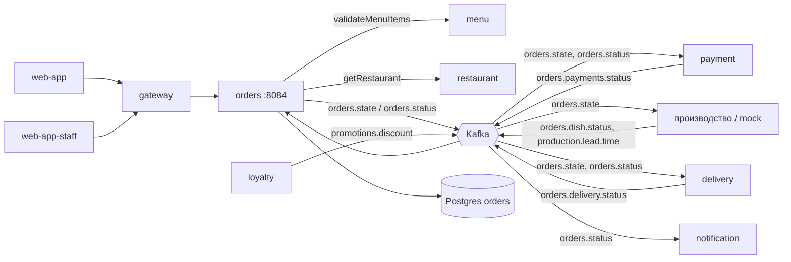
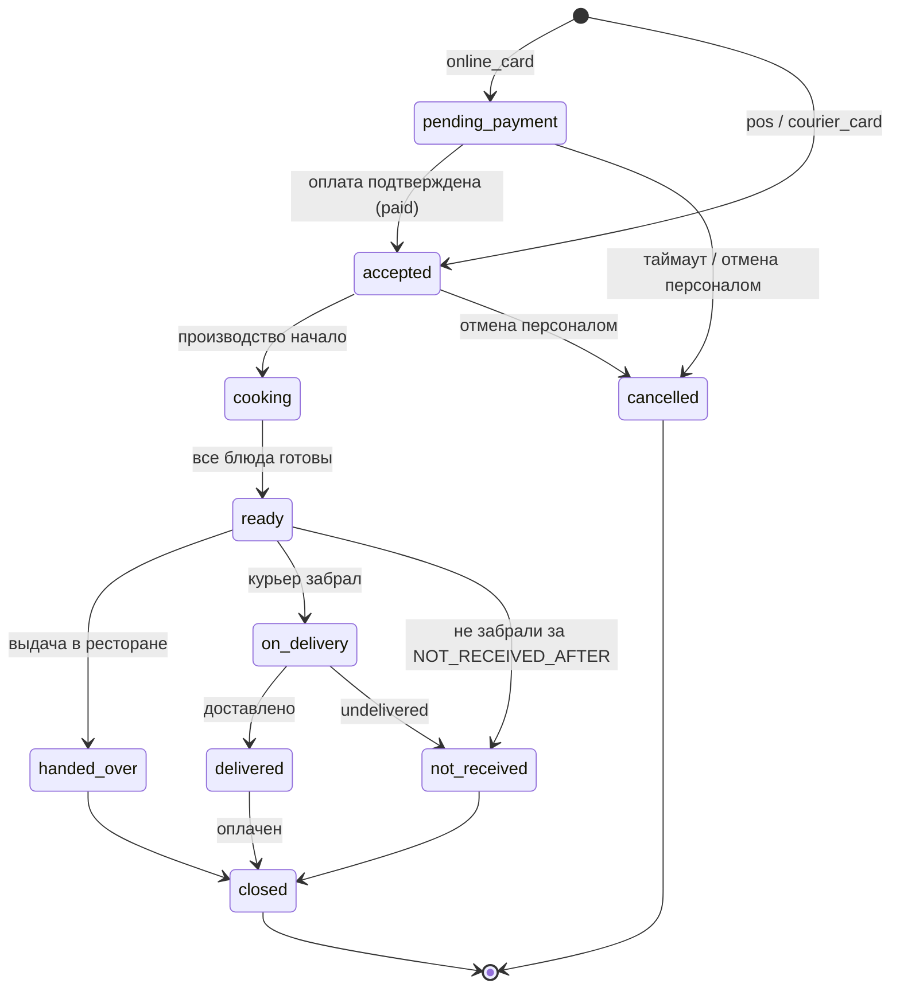
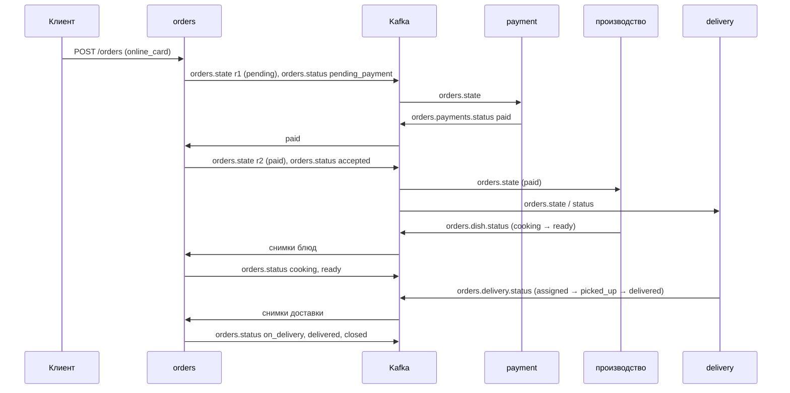
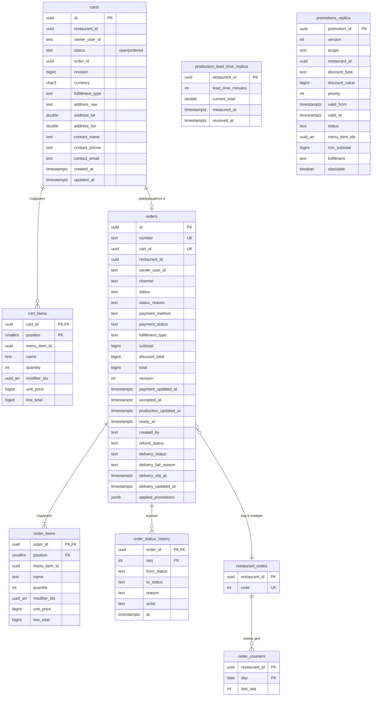

# orders-service — аналитическая документация

| | |
|---|---|
| Сервис | `services/orders`, порт `8084`, БД `orders` (Postgres) |
| Контракты | `contracts/openapi/orders.yaml` v1.7.0; события — `contracts/asyncapi/kafka-events.yaml` v1.5.0 |
| Kafka | публикует `orders.state`, `orders.status` (transactional outbox); потребляет 5 топиков в 4 группах |
| Идемпотентность | `POST /orders` — обязательный `Idempotency-Key` |
| Зависимости (синхронно) | `menu` (validateMenuItems), `restaurant` (getRestaurant) |
| Деньги | `bigint` копейки (ADR-13) |
| Состояние на | master `54d443b` (после S9) |

---

## 1. Суть

**Назначение.** Ядро заказа. Сервис владеет корзиной и заказом, **единственный** изменяет статус заказа и публикует его жизненный цикл остальным сервисам. Он реализует ADR-10: заказ создаётся до оплаты, а дальнейшие сервисы (payment, производство, delivery, notification) реагируют на события `orders.state` и `orders.status`.

**Ответственность**

- корзина: наполнение (цены только с сервера через `menu`), способ получения, контакты;
- оформление заказа: проверки (ресторан открыт, зона доставки, способ оплаты, актуальность цен и стоп-листа), расчёт скидки, нумерация, атомарная запись заказа + событий + ответа под `Idempotency-Key`;
- автомат статусов заказа и журнал переходов;
- реакции на внешние события: оплата (`orders.payments.status`), производство (`orders.dish.status`, `production.lead.time`), доставка (`orders.delivery.status`), акции (`promotions.discount`);
- операции персонала: поиск заказа по номеру, выдача, отмена, заказ «по факсу»;
- ETA (оценка времени готовности и вручения);
- таймеры: автоотмена неоплаченных, `not_received`, очистка корзин.

**Вне зоны ответственности**

- проведение платежей и возвратов (`payment`; orders лишь отражает `paymentStatus` и `refundStatus`);
- производство блюд (внешняя система; в dev — mock), назначение курьера (`delivery` + внешняя курьерская система);
- хранение меню/цен (`menu`), расписание/зона ресторана (`restaurant`), определение акций (`loyalty`);
- история заказов клиента (списка заказов нет — только чтение по id; отдельный `GET /orders` не реализован), отзывы, повтор заказа.



---

## 2. Методы

| # | Метод и путь | operationId | Доступ | Успех | Назначение |
|---|---|---|---|---|---|
| 1 | `POST /carts` | createCart | гость (`guest=true`) или пользователь | 201 | Создать корзину ресторана |
| 2 | `GET /carts/{cartId}` | getCart | владелец / гость по UUID | 200 | Корзина с суммами и скидками |
| 3 | `PUT /carts/{cartId}/items` | updateCartItems | то же | 200 | Заменить состав корзины |
| 4 | `PUT /carts/{cartId}/fulfillment` | setCartFulfillment | то же | 200 | Выбрать доставку/самовывоз |
| 5 | `POST /orders` | createOrder | то же (+ `staff_fax` — персонал) | 201 | Оформить заказ. **`Idempotency-Key` обязателен** |
| 6 | `GET /orders/{orderId}` | getOrder | владелец / гость по UUID | 200 | Заказ |
| 7 | `GET /orders/{orderId}/eta` | getOrderEta | то же | 200 | Оценка готовности/вручения |
| 8 | `PUT /orders/{orderId}/pickup-slot` | setPickupSlot | то же | 200 | Желаемый интервал самовывоза |
| 9 | `GET /orders/search?number=` | searchOrder | STAFF, FRANCHISE_OWNER, HQ_STAFF | 200 | Найти заказ по номеру (контакты клиента видны) |
| 10 | `POST /orders/{orderId}/issuance` | markOrderIssued | персонал | 200 | Выдать заказ |
| 11 | `POST /orders/{orderId}/cancellation` | cancelOrder | персонал | 200 | Отменить заказ |
| 12 | `GET /health/`, `GET /actuator/health` (db, kafka), `GET /metrics` | — | служебные | | |

Режим `--migrate-only` — применить миграции (сервиса, `kafka`, `idempotency`) и выйти.

### 2.1. Модель доступа

- **Гость** владеет ресурсом по знанию UUID (`cartId`/`orderId`). `createCart` без токена требует `guest=true`, иначе `401 UNAUTHENTICATED`.
- **Пользователь** видит только свои корзины/заказы; чужой ресурс → **404** (не 403, чтобы не раскрывать существование).
- **Персонал**: роль проверяется в HTTP-слое (`RequireRole`: гость → 401, `CUSTOMER` → 403), привязка к ресторану — в сервисе (`Actor.Can`: HQ — любой; STAFF/FRANCHISE_OWNER — из claim `restaurants[]`); чужой ресторан → 404.
- Заказ «по факсу» (`channel=staff_fax`) создаёт сотрудник от имени клиента: владельца нет (заказ гостевой), в `created_by` — id сотрудника.

### 2.2. Ошибки

| `code` | HTTP | Условие |
|---|---|---|
| `INVALID_JSON`, `INVALID_PARAMETER` | 400 | формат запроса, UUID, границы (корзина ≤ 50 строк, quantity 1…99, ≤ 20 модификаторов, дубликаты строк/модификаторов) |
| `INVALID_ORDER_NUMBER` | 400 | номер не соответствует `R<код>-<YYMMDD>-<NNNN>` |
| `IDEMPOTENCY_KEY_REQUIRED` | 400 | нет `Idempotency-Key` |
| `IDEMPOTENCY_KEY_INVALID` | 400 | недопустимый ключ |
| `UNAUTHENTICATED` / `UNAUTHORIZED` | 401 | нужна аутентификация (корзина без guest / операции персонала) |
| `FORBIDDEN` | 403 | не персонал либо нет доступа к ресторану (при `staff_fax`) |
| `CART_NOT_FOUND`, `ORDER_NOT_FOUND`, `RESTAURANT_NOT_FOUND` | 404 | в т.ч. чужой ресурс |
| `ITEMS_UNAVAILABLE` | 409 | в ответе `unavailableItems[]` (`menuItemId`, `reasonCode`, `reason`); при `updateCartItems` корзина сохраняется без недоступных позиций, при `createOrder` корзина не меняется |
| `PRICE_CHANGED` | 409 | цены изменились; корзина обновлена, нужен новый ключ идемпотентности |
| `TOTAL_CHANGED` | 409 | итог с учётом акций не совпал с `expectedTotal` |
| `RESTAURANT_CLOSED` | 409 | ресторан закрыт сейчас (E2) |
| `CART_CLOSED` | 409 | корзина уже оформлена |
| `CART_CHANGED` | 409 | корзина изменена параллельно |
| `ORDER_STATE_CONFLICT` | 409 | действие недопустимо в текущем статусе |
| `ORDER_NOT_PAID` | 409 | выдача неоплаченного заказа |
| `IDEMPOTENCY_IN_PROGRESS` | 409 | запрос с этим ключом ещё выполняется |
| `IDEMPOTENCY_KEY_REUSED` | 422 | тот же ключ с другим телом |
| `CART_EMPTY`, `FULFILLMENT_REQUIRED` | 422 | корзина пуста / не выбран способ получения |
| `PAYMENT_METHOD_NOT_ALLOWED` | 422 | способ оплаты не допустим для способа получения; онлайн-оплата для факса |
| `CONTACT_REQUIRED` | 422 | гостю и факсу нужен `contact.phone` |
| `ADDRESS_REQUIRED`, `ADDRESS_LOCATION_REQUIRED` | 422 | для доставки нужны адрес и координаты |
| `DELIVERY_NOT_AVAILABLE` | 422 | у ресторана нет доставки |
| `ADDRESS_OUT_OF_ZONE` | 422 | дальше радиуса; расширение `distanceMeters`, `radiusMeters`, `hint=pickup` |
| `INVALID_SLOT` | 422 | слот не проходит проверку или заказ не на самовывоз |
| `NOT_PICKUP_ORDER` | 422 | выдача в ресторане допустима только для самовывоза (и доставки без курьера) |
| `MENU_UNAVAILABLE`, `RESTAURANT_UNAVAILABLE` | 503 | зависимость недоступна (fail-closed) |

> **Расхождение документации.** `RESTAURANT_CLOSED` отдаётся с кодом **409** (так в коде и в `orders.yaml`); в PROJECT-STATE по ошибке записано 422.

---

## 3. Контракты

### 3.1. Корзина

`POST /carts` `{ "restaurantId": "uuid", "guest": true, "contact": {name, phone, email} }` → `201`, `Location: /carts/{id}`.

`PUT /carts/{id}/items`: `{ "items": [ { "menuItemId", "quantity", "modifierIds" } ] }` — **полная замена** состава (пустой массив очищает корзину; поле `items` обязательно). Каждая строка должна быть уникальна по паре «позиция + набор модификаторов» (порядок модификаторов не важен).

`PUT /carts/{id}/fulfillment`:

```json
{ "type": "delivery", "address": { "raw": "Невский пр., 28", "location": { "lat": 59.9358, "lon": 30.3257 } } }
```

Для `delivery`: `address.raw` обязателен (≤ 300 символов), координаты — обе или ни одной (но без координат тоже `422 ADDRESS_LOCATION_REQUIRED`), внутри диапазона; ресторан должен поддерживать доставку и адрес — лежать в радиусе доставки.

Ответ `Cart`:

```json
{
  "id": "uuid", "restaurantId": "uuid", "status": "open|ordered", "orderId": "uuid?",
  "items": [ { "menuItemId", "quantity", "modifierIds", "name", "unitPrice": Money, "lineTotal": Money, "available": true } ],
  "appliedPromotions": [ { "promotionId", "title", "discount": Money } ],
  "fulfillment": { "type": "delivery", "address": { "raw", "location" } },
  "subtotal": Money, "discountTotal": Money, "total": Money
}
```

Суммы корзины пересчитываются **при каждом чтении** (скидки зависят от реплики акций и времени). `Money = { amount: int64 копейки, currency }`.

### 3.2. Оформление заказа

```
POST /orders
Idempotency-Key: <uuid>
{ "cartId": "uuid", "paymentMethod": "online_card|courier_card|pos", "contact": {…},
  "channel": "online|staff_fax", "expectedTotal": { "amount": 74430, "currency": "RUB" } }
```

→ `201 Order`, `Location: /orders/{id}`. Повтор с тем же ключом и телом возвращает **тот же ответ байт-в-байт** с заголовком `Idempotent-Replay: true`.

Допустимые способы оплаты:

| Способ получения | online_card | courier_card | pos |
|---|---|---|---|
| pickup | да | нет | да |
| delivery | да | да | нет |

Ответ `Order`: `id, number, restaurantId, status, statusReason?, channel, paymentStatus, refundStatus?, paymentMethod, items[], fulfillment, pickupSlot?, subtotal, discountTotal, appliedPromotions[], total, delivery?, createdAt`. Для персонала (`searchOrder`) добавляются `contact` и `createdBy`. `delivery` (`status`, `failReason`, `hint=pickup` при `no_courier`, `etaAt` пока доставка не завершена) присутствует только у заказов с доставкой и только когда пришёл хотя бы один статус курьера.

### 3.3. ETA

`GET /orders/{id}/eta` → `{ readyAt, deliveryAt?, estimateMinutes, approximate }`. Алгоритм — в §4.5.

### 3.4. Слот самовывоза

`PUT /orders/{id}/pickup-slot` `{ from, to }` (RFC 3339): `from < to`; `from` не в прошлом (допуск 1 мин); длина ≤ 4 ч; не дальше 7 суток вперёд. Допустим только для самовывоза в статусах `pending_payment`/`accepted`; иначе `422 INVALID_SLOT` / `409 ORDER_STATE_CONFLICT`. Публикуется `orders.state` с `revision+1`.

### 3.5. Персонал

- `GET /orders/search?number=R1-261021-0007` — регистр не важен; формат `^R\d{1,9}-\d{6}-\d{4,9}$`.
- `POST /orders/{id}/issuance` — тела нет. `ready → handed_over → closed` одной транзакцией.
- `POST /orders/{id}/cancellation` `{ "reason": "customer_request|out_of_stock|restaurant_closed|other" }`.

### 3.6. События

**Публикует (transactional outbox, ключ партиции = `orderId`)**

| Топик | Тип | Когда | Содержимое |
|---|---|---|---|
| `orders.state` | `orders.state.v1` | создание заказа (`revision=1`); смена слота (`revision+1`); оплата (`revision+1`, `paymentStatus=paid`) | `orderId, revision, orderNumber, restaurantId, source (online|fax), fulfillmentType, deliveryAddress?, deliveryLocation?, customer{userId?, guest, phone, name}, items[{dishId, name, quantity, modifiers[], price}], totalAmount, paymentMethod (online|courier|restaurant), paymentStatus (pending|paid), appliedPromotions[ids], requestedPickupInterval?, createdAt` |
| `orders.status` | `orders.status.v1` | **каждый** переход статуса | `orderId, orderNumber, status, reason?, etaReadyAt? (для accepted/cooking), userId? (владелец; пусто — гость/факс), updatedAt` |

Заголовки конверта: `event-id`, `event-type`, `occurred-at`, `traceparent`.

**Потребляет**

| Группа | Топик | Продюсер | Обработчик |
|---|---|---|---|
| `orders-service` | `orders.payments.status` | payment | `HandlePaymentStatus` |
| `orders-service-production` | `orders.dish.status`, `production.lead.time` | производство | `HandleDishStatus`, `HandleLeadTime` |
| `orders-service-delivery` | `orders.delivery.status` | delivery | `HandleDeliveryStatus` |
| `orders-service-promotions` | `promotions.discount` (читается с начала) | loyalty | `HandlePromotion` |

Раздельные группы изолируют «ядовитые» и медленные события: проблема с производством не задерживает оплату. Все обработчики идут через inbox (`processed_events`), ретраи (5 попыток, backoff 200 мс…5 с), затем `<topic>.dlq`.

### 3.7. Конфигурация (env)

| Переменная | По умолчанию | Смысл |
|---|---|---|
| `DATABASE_URL` | обяз. | |
| `KAFKA_BROKERS` | пусто | пусто — relay и консьюмеры выключены, события копятся в outbox |
| `AUTH_MODE` и др. | `dev` | `dev|jwks` |
| `MENU_URL`, `RESTAURANT_URL` | `http://localhost:8083/8082` | |
| `UPSTREAM_TIMEOUT` | 800ms | на одну попытку; 1 ретрай, circuit breaker |
| `PAYMENT_TIMEOUT` | 15m | автоотмена неоплаченного |
| `PAYMENT_UNKNOWN_GRACE` | 1h | добавка к таймауту при `paymentStatus=unknown` |
| `CART_TTL` | 168h | удаление заброшенных корзин |
| `JANITOR_INTERVAL` | 30s | период таймеров |
| `ETA_PREP_MINUTES` / `ETA_DELIVERY_MINUTES` | 20 / 30 | типовые времена |
| `LEAD_TIME_TTL` | 15m | срок годности оценки производства |
| `DELIVERY_ETA_TTL` | 30m | срок годности ETA курьера |
| `NOT_RECEIVED_AFTER` | 2h | порог «не забрали» |
| `PROMOTION_CACHE_TTL` | 2s | кэш реплики акций; `0s` — без кэша; отрицательное запрещено |

---

## 4. Логика

### 4.1. Жизненный цикл заказа (автомат)



Таблица переходов — единственный источник правды (`domain.transitions`); `Terminal()` — статус без исходящих (`closed`, `cancelled`). Из `cooking` отмена **запрещена**. Каждый переход пишет строку в `order_status_history` (`seq`, `from`, `to`, `reason`, `actor`, `at`) и событие `orders.status` — в той же транзакции.

Значения `actor`: `customer`, `system`, `production`, `delivery`, `staff:<userId>`. Значения `reason` (основание): `paid`, `payment_timeout`, `production`, `courier_picked_up`, `delivered`, `undelivered`, `issued`, `pickup_timeout`, а при отмене персоналом — причина из перечня.

`Transition` идемпотентен: переход в тот же статус — без эффекта (консьюмеры повторяют события).

### 4.2. Оформление заказа (`CreateOrder`)

Порядок строго фиксирован: **все внешние вызовы — до транзакции**, затем одна транзакция.

1. Валидация входа: `cartId` UUID; `channel ∈ {"", online, staff_fax}`; для `staff_fax` актор — персонал; контакты (телефон нормализуется к E.164, e-mail — формат).
2. Загрузка корзины с проверкой доступа; статус `open`; для факса — доступ к ресторану корзины.
3. Бизнес-правила: корзина не пуста; способ получения выбран; способ оплаты разрешён матрицей; для факса онлайн-оплата запрещена; гостю и факсу нужен `contact.phone` (контакт корзины сливается с контактом запроса, значения запроса приоритетнее).
4. `restaurant.Get`: недоступен → `503 RESTAURANT_UNAVAILABLE`; `!openNow` → `409 RESTAURANT_CLOSED`; для доставки: доставка включена и **повторная проверка зоны** (`checkZone`, fail-closed).
5. `revalidate` через `menu.Validate`: недоступное → `409 ITEMS_UNAVAILABLE` (корзина не меняется); цена изменилась → корзина **обновляется** новыми ценами и `409 PRICE_CHANGED`; menu недоступен → `503 MENU_UNAVAILABLE`.
6. Расчёт скидки (`Discounter.Apply` → `domain.Net`); если задан `expectedTotal` и итог или валюта не совпали → `409 TOTAL_CHANGED`.
7. Определение статуса: `online_card → pending_payment`, остальные → `accepted`.
8. Код ресторана (`restaurant_codes`, вне транзакции под advisory-lock) → **транзакция**: блокировка корзины `FOR UPDATE`; проверки `status=open` и `revision` не изменилась (`CART_CHANGED`); номер заказа (`order_counters`); вставка `orders` + `order_items` + первая запись истории; закрытие корзины (`ordered`, `order_id`); `orders.state` (`revision=1`) и `orders.status` в outbox (для `accepted` — с `etaReadyAt`, `accepted_at` проставляется); **сохранение ответа под ключом идемпотентности** (`Claim.CompleteTx`). Коммит.
9. После коммита — `Wake()` relay. Нарушение `UNIQUE(cart_id)` → `409 CART_CLOSED` (страховка от гонки).

Номер: `R<код ресторана>-<YYMMDD>-<NNNN>`; код — identity в `restaurant_codes`, счётчик — на (ресторан, местный день по часовому поясу ресторана). Номера внутри дня идут без пропусков. Счётчик — «горячая строка» ресторана (допущение MVP, пересмотреть в S11).

### 4.3. Идемпотентность создания заказа

`pkg/idempotency` на Postgres. Scope ключа — `userId` (ключи гостей различаются телом, `cartId` неугадываем). Повтор → тот же 201 + `Idempotent-Replay: true`; другое тело → `422 IDEMPOTENCY_KEY_REUSED`; параллельный повтор в процессе → `409 IDEMPOTENCY_IN_PROGRESS`; 5xx не сохраняется; 4xx сохраняется (после исправления тела нужен новый ключ). Заказ и ответ фиксируются **атомарно**. Проверено: 24 параллельных запроса с одним ключом → один заказ.

### 4.4. Скидки (S8)

- Источник — реплика акций `promotions_replica` (событие `promotions.discount`). Синхронного вызова `loyalty` нет (корзина пересчитывается при каждом чтении).
- `ReplicaDiscounter` читает действующие акции (`status=active`, `valid_to` в будущем) и кэширует снимок на `PROMOTION_CACHE_TTL`. Ошибка чтения → последний снимок (stale-if-error); снимка не было вовсе → скидки нет (оформление не блокируется). Кэш локален экземпляру и сбрасывается при применении события на нём.
- `domain.Calculate` (чистая функция): кандидаты — акции, подходящие по статусу, окну, охвату (`national`/`local` ресторана корзины), валюте, способу получения, `minSubtotal`; порядок — приоритет по убыванию, затем id. База акции — остатки подходящих строк (`menuItemIds`; пусто — весь заказ). Нестекуемая акция пропускается, если одна из её строк уже затронута другой нестекуемой (выигрывает больший приоритет); стекуемые применяются к остатку. `percent` — сотые доли процента (1500 = 15 %), **банковское округление один раз на акцию**; `fixed` — копейки, не больше базы. Скидка акции распределяется по строкам методом наибольших остатков (сумма долей = скидке, 128-битная арифметика). Итоговая скидка не превышает подытог. Тип `gift` не рассчитывается.
- Скидка **фиксируется** в заказе (`orders.applied_promotions` JSONB) и не меняется при завершении акции.

### 4.5. ETA (`estimate`)

1. Заказ уже `ready` или дальше → `readyAt` = момент перехода в `ready` из журнала, `estimateMinutes=0`, `approximate=false`.
2. Иначе база: `accepted_at`, если есть; иначе `max(created_at, now)`. Время приготовления: свежая реплика лид-тайма ресторана (возраст ≤ `LEAD_TIME_TTL`) → её минуты, `approximate=false`; иначе `ETA_PREP_MINUTES`, `approximate=true`. `readyAt = база + приготовление`; для самовывоза со слотом — не раньше начала слота.
3. Доставка: `deliveryAt` — фактический момент `delivered` по журналу; `nil`, если доставка `failed` (клиенту предлагается самовывоз); свежий `etaAt` курьера (в будущем и обновлялся ≤ `DELIVERY_ETA_TTL`), но не раньше `readyAt`; иначе `readyAt + ETA_DELIVERY_MINUTES`, `approximate=true`.
4. `estimateMinutes` = округление вверх до минуты от `now` до целевого времени, не меньше 0.

### 4.6. Реакция на оплату (`HandlePaymentStatus`)

| Событие | Действие |
|---|---|
| `paid`, заказ `pending_payment` | `paymentStatus=paid`, `revision+1`, `pending_payment → accepted` (reason `paid`), `orders.state` (paid) и `orders.status`; если заказ уже `delivered` — закрыть (`closed`) |
| `paid`, заказ `cancelled` | статус не оживляется, `orders.state` не публикуется; `paymentStatus=paid`, `refund_status=pending`, метрика `orders_paid_after_cancel_total`, ошибка в лог; возврат делает payment |
| `declined` | `paymentStatus=declined`; заказ остаётся `pending_payment` (клиент может оплатить заново) |
| `unknown` | `paymentStatus=unknown`; автоотмена отсрочена на `PAYMENT_UNKNOWN_GRACE` |
| `pending` | `paymentStatus=pending` |
| любое с `refundStatus` | `refund_status` обновляется **независимо** от защит ниже |

Защиты: событие с `updatedAt` старше сохранённого `payment_updated_at` игнорируется; `paid` терминален (не перезаписывается); неизвестный заказ → ошибка (ретраи → DLQ).

### 4.7. Реакция на производство

`orders.dish.status` — **снимок всех блюд заказа** (не дельта). `AggregateDishes`: все блюда `ready` → `ready`; есть `cooking`/`ready` → `cooking`; иначе `accepted`. Блюдо заказа, которого нет в снимке, считается `queued`. Идентификатор блюда сопоставляется с `menuItemId` позиции заказа. Из `accepted` сразу в «все ready» заказ проходит `cooking → ready` **в одной транзакции** с двумя событиями `orders.status`. Защиты: снимок старше `production_updated_at` — `stale`; статус не откатывается; для `pending_payment`/`cancelled` — `ignored`, предупреждение; заказ не найден — ошибка (DLQ). После перехода в `ready` вызывается `advanceDelivery` (доставка могла опередить готовность).

`production.lead.time` — `{restaurantId, leadTimeMinutes (0…1440), currentLoad, measuredAt}`: upsert в `production_lead_time_replica` только если `measured_at` не старее.

### 4.8. Реакция на доставку

Снимок статуса доставки сохраняется, если `updatedAt` новее (`delivery_updated_at`). Затем `advanceDelivery`:

| Статус доставки | Действие над заказом |
|---|---|
| `picked_up`, `en_route` | `ready → on_delivery` (reason `courier_picked_up`) |
| `delivered` | `→ on_delivery → delivered`; если оплачен — `closed` |
| `failed` + `undelivered` | `→ on_delivery → not_received` |
| `failed` + `no_courier` | заказ **не меняется** (E2: остаётся `ready`, клиенту предложено забрать самому, `hint=pickup`; персонал может выдать заказ) |
| `failed` + `cancelled`, `searching`, `assigned` | заказ не меняется |

Если заказ ещё готовится — применение откладывается до `ready`.

### 4.9. Таймеры (janitor, период 30 с)

| Задача | Условие | Результат |
|---|---|---|
| `ExpireUnpaid` | `pending_payment` старше `PAYMENT_TIMEOUT` (для `unknown` — старше `PAYMENT_TIMEOUT + PAYMENT_UNKNOWN_GRACE`), до 100 за проход | `cancelled`, reason `payment_timeout`; статус перепроверяется под блокировкой (`cancelIfUnpaid`) |
| `ExpireNotReceived` | `ready`, самовывоз (или доставка с `failed/no_courier`), `ready_at` старше `NOT_RECEIVED_AFTER` | `not_received`, reason `pickup_timeout`; повторная проверка под блокировкой |
| `PurgeCarts` (раз в 10 мин) | `open` и `updated_at` старше `CART_TTL` | удаление |

### 4.10. Операции персонала

- **`IssueOrder`**: ресторан доступен; уже `closed`/`handed_over` и выдавался — повтор без эффекта; самовывоз (или `PickupFallback`), статус `ready`, оплата `paid` (иначе `409 ORDER_NOT_PAID`); `ready → handed_over → closed` одной транзакцией.
- **`CancelOrder`**: допустимо только в `pending_payment`/`accepted` (иначе `409 ORDER_STATE_CONFLICT`); повтор для `cancelled` — без эффекта; если заказ оплачен — `refund_status=pending` сразу, возврат инициирует payment по `orders.status=cancelled`.

---

## 5. События и порядок доставки

Принципы, на которых держится согласованность:

- **Transactional outbox**: событие пишется в `outbox` в той же транзакции, что и изменение; relay (`FOR UPDATE SKIP LOCKED`) публикует «минимум один раз», `Wake()` ускоряет публикацию после коммита.
- **Ревизии** (`orders.state.revision`) и `updatedAt` защищают потребителей от переупорядочивания.
- **Ключ партиции** `orderId` упорядочивает события одного заказа внутри топика, но не между топиками — поэтому каждый потребитель сам защищается от «опережающих» событий (см. §4.6–4.8).
- **Отказ брокера** не останавливает приём заказов: события копятся в outbox (метрики `OutboxCollectors`).

Последовательность «онлайн-заказ с доставкой»:



---

## 6. Работа с БД

БД `orders`. Миграции модуля `orders` (001–006) + `kafka` (outbox/inbox) + `idempotency`.

### 6.1. ER-диаграмма



Реплики `production_lead_time_replica` и `promotions_replica` не связаны внешними ключами (данные чужих сервисов); `orders.restaurant_id` — без FK на `restaurant`.

### 6.2. Ключевые ограничения

| Таблица | Ограничение |
|---|---|
| `carts` | `status ∈ {open, ordered}`; CHECK `(status='ordered') = (order_id IS NOT NULL)`; `fulfillment_type ∈ {delivery, pickup}` |
| `cart_items` | PK `(cart_id, position)`; `quantity 1…99`; цены ≥ 0; FK CASCADE |
| `orders` | `number` UNIQUE; **`cart_id` UNIQUE** (один заказ на корзину — защита на уровне БД); `status` из 10 значений; `payment_method ∈ {online_card, courier_card, pos}`; `payment_status ∈ {pending, authorized, paid, declined, unknown}`; CHECK `total = subtotal − discount_total`; CHECK `(pickup_from IS NULL) = (pickup_to IS NULL)`; `refund_status ∈ {pending, refunded, failed}`; `delivery_status ∈ {searching, assigned, picked_up, en_route, delivered, failed}`; `delivery_fail_reason ∈ {no_courier, undelivered, cancelled}`; `channel ∈ {online, staff_fax}` |
| `order_items` | PK `(order_id, position)`; FK CASCADE |
| `order_status_history` | PK `(order_id, seq)`; `seq` = max+1 внутри транзакции под блокировкой заказа |
| `promotions_replica` | `version ≥ 1`; `scope ∈ {national, local}`; CHECK `(scope='local') = (restaurant_id IS NOT NULL)`; процент хранится как сотые доли |

Значение `payment_status='authorized'` разрешено схемой, но в доменной модели orders не используется.

### 6.3. Индексы

| Индекс | Колонки / условие | Для чего |
|---|---|---|
| `carts_stale_idx` | `(updated_at) WHERE status='open'` | очистка заброшенных корзин |
| UNIQUE `orders.number`, `orders.cart_id` | | поиск по номеру (`searchOrder`); защита от двойного оформления |
| `orders_restaurant_idx` | `(restaurant_id, created_at DESC)` | списки по ресторану |
| `orders_owner_idx` | `(owner_user_id, created_at DESC) WHERE owner_user_id IS NOT NULL` | заказы пользователя |
| `orders_unpaid_idx` | `(created_at) WHERE status='pending_payment'` | таймер автоотмены |
| `orders_accepted_idx` | `(accepted_at) WHERE status='accepted'` | метрика зависших заказов |
| `orders_ready_idx` | `(ready_at) WHERE status='ready' AND fulfillment_type='pickup'` | таймер `not_received` |
| `orders_ready_pickup_fallback_idx` | `(ready_at) WHERE status='ready' AND fulfillment_type='delivery' AND delivery_status='failed'` | таймер для доставки без курьера |
| `promotions_replica_active_idx` | `(valid_to) WHERE status='active'` | выборка действующих акций |
| `outbox_unpublished_idx` | `(id) WHERE published_at IS NULL` | relay |
| `idempotency_keys_expires_idx` | `(expires_at)` | очистка ключей |

Не индексированы осознанно: `orders.status` целиком (выборки — по частичным индексам), `order_status_history` читается по PK.

### 6.4. Блокировки и транзакции

- Любое изменение заказа — `SELECT … FOR UPDATE` строки `orders`; консьюмеры работают в одной транзакции с записью inbox.
- Создание заказа блокирует корзину; повторное параллельное оформление ждёт и затем получает `CART_CLOSED`.
- Код ресторана создаётся **вне** транзакции оформления в короткой транзакции под advisory-lock (иначе `ON CONFLICT DO NOTHING` расходует identity и даёт дыры, S2.1).
- Хранимые данные заказа — **снапшот**: название и цена позиции фиксируются на момент оформления, скидка — как применённая акция.

### 6.5. Рост данных и ретенция

`orders`, `order_items`, `order_status_history` растут без ограничения (архивации нет); `outbox` — публикуемые строки не удаляются (очистка не реализована); `processed_events` — аналогично; корзины чистятся по TTL; ключи идемпотентности — по `expires_at`. Политика хранения (партиционирование по дате, архив) — вопрос S11.

---

## 7. Сценарии использования

### UC-ORD-01. Гость оформляет заказ с самовывозом и онлайн-оплатой

1. `POST /carts {restaurantId, guest:true, contact.phone}` → 201.
2. `PUT /carts/{id}/items` → цены и названия из menu, скидки по реплике акций.
3. `PUT /carts/{id}/fulfillment {type: pickup}`.
4. `POST /orders` (`online_card`, `Idempotency-Key`) → 201 `pending_payment`.
5. Оплата в payment (см. документ payment) → `orders.payments.status paid` → заказ `accepted` с `etaReadyAt`.
6. Производство: `cooking → ready`; клиент опрашивает `GET /orders/{id}` / `eta` и получает push (notification).
7. Сотрудник выдаёт заказ: `POST /orders/{id}/issuance` → `closed`.

**Альтернативы:** A1 позиция в стоп-листе → 409 `ITEMS_UNAVAILABLE`, корзина без этой позиции (при наполнении) / без изменений (при оформлении); A2 цена выросла → 409 `PRICE_CHANGED`, клиент подтверждает новой сумме с новым ключом; A3 ресторан закрыт → 409 `RESTAURANT_CLOSED`; A4 menu недоступен → 503, корзина сохранена; A5 банк отказал → `paymentStatus=declined`, заказ остаётся `pending_payment`, можно оплатить заново; A6 не оплатили за 15 минут → `cancelled (payment_timeout)`; A7 тот же запрос повторён → тот же 201 (`Idempotent-Replay`); A8 акция изменилась между просмотром и оформлением → 409 `TOTAL_CHANGED`.

### UC-ORD-02. Заказ с доставкой и оплатой курьеру

Доставка требует координаты и попадания в радиус (`422 ADDRESS_OUT_OF_ZONE` с `hint=pickup`). `courier_card` → заказ `accepted` сразу (`pending` по оплате); курьер ищется параллельно с готовкой; платёж создаёт система (payment), деньги подтверждает шлюз после вручения; `delivered` → `closed`, когда `paymentStatus=paid`.

**E2 «нет курьера»:** `delivery.failed/no_courier` → заказ остаётся `ready`, в ответе `delivery.hint=pickup`; клиент забирает сам, персонал выдаёт заказ (`NOT_PICKUP_ORDER` для доставки не срабатывает), либо через 2 часа `not_received`.

### UC-ORD-03. ETA

`GET /orders/{id}/eta` — оценка по свежим данным производства (`approximate=false`) или типовая (`true`).

### UC-ORD-04. Сотрудник принимает заказ по факсу

Сотрудник создаёт корзину (`guest:true`) и заказ с `channel=staff_fax`, `pos` или `courier_card`, обязательным `contact.phone`; заказ без владельца, `source=fax` в событии, push не отправляется.

### UC-ORD-05. Отмена

Сотрудник: `POST /orders/{id}/cancellation` в `pending_payment`/`accepted`. Оплаченный заказ получает `refundStatus=pending`; payment выполняет возврат и сообщает `refunded|failed` в `orders.payments.status` (`refundStatus` отражается в заказе). Отмена после начала приготовления невозможна (`409 ORDER_STATE_CONFLICT`).

### UC-ORD-06. Поиск заказа на кассе

`GET /orders/search?number=…` → заказ с контактом клиента; чужого ресторана — 404.

### UC-ORD-07. Авария очереди производства (E3)

Заказ остаётся `accepted`, метрика `orders_stuck_in_accepted_seconds` растёт; после восстановления снимки блюд догоняют статус без дублей.

---

## 8. Прочие важные моменты

### 8.1. Метрики

`orders_created_total{payment_method,fulfillment}`, `orders_status_transitions_total{to}`, `orders_upstream_failures_total{upstream}`, `orders_carts_purged_total`, `orders_paid_after_cancel_total`, `orders_promotion_events_total{result}`, `orders_promotion_replica_loads_total{result}`, `orders_production_events_total{event,result}`, `orders_refund_events_total{status}`, `orders_delivery_events_total{result}`, gauges `orders_accepted`, `orders_stuck_in_accepted_seconds` (collector по БД на каждый scrape), метрики outbox, RED. Реестр имеет константную метку `service="orders"`. Алертов и дашбордов нет (S11).

### 8.2. Безопасность и приватность

- Контакты клиента (телефон, e-mail, адрес) видны владельцу и персоналу ресторана; в журналы маскируются (`pkg/logging`).
- В событиях `orders.state` передаются телефон и имя клиента (нужны производству/курьеру); `orders.status` — только `userId`.
- Ограничение: гость идентифицируется знанием UUID — утечка `orderId` раскрывает заказ гостя.

### 8.3. Известные ограничения и долги

1. Нет списка заказов пользователя/ресторана и пагинации; нет повтора заказа.
2. `paymentMethod` фиксируется при оформлении, сменить нельзя.
3. Тип скидки `gift`, баллы, промокоды не поддержаны; кэш скидок — на экземпляр (корзины на разных репликах могут кратко различаться; `expectedTotal` ловит расхождение при оформлении).
4. Отмена клиентом самостоятельно невозможна (только персонал/таймер).
5. Горячая строка `order_counters` сериализует заказы одного ресторана (S11).
6. Нет очистки `outbox`/`processed_events`/истории; нет архивации заказов.
7. Нет отмены/возврата по сигналу производства; нет статуса блюд в API.
8. E1 ETA (устаревшая оценка) покрыта unit-тестами, но не Postman (долг №28).
9. Таймаут/ретраи к menu/restaurant — единые (800 мс, 1 повтор); circuit breaker локален экземпляру.
10. Время в ответах — UTC (`createdAt`); в delivery-API — со смещением сервера (долг №55).

### 8.4. Тестирование

- Unit/интеграционные (реальный Postgres, `kfake`): domain (автомат, скидки с property-тестом 5000 входов, агрегация блюд), service (≈25 сценариев корзины/заказа, `payments_test`, `production_test` — 13, `delivery_test`, `staff_test`, `promotions_test`, `status_owner_test`), httpapi (replay, `KEY_REUSED`, параллельные ключи, владение), clients, config, `outbox_test`.
- Postman: `postman/orders/` — 66 запросов / 130 проверок; `postman/staff/` — 168 / 175; `postman/e2e/` — сквозной M1 (+доставка, акции, push), через gateway с JWT.
- `make contract-check SCENARIO=orders|staff` (в CI), `make loyalty-e2e`, `make notification-e2e`.
