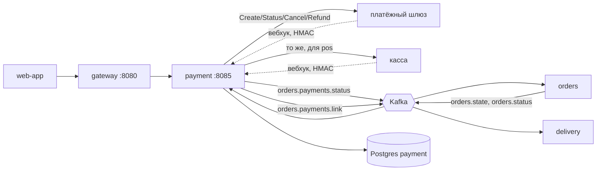
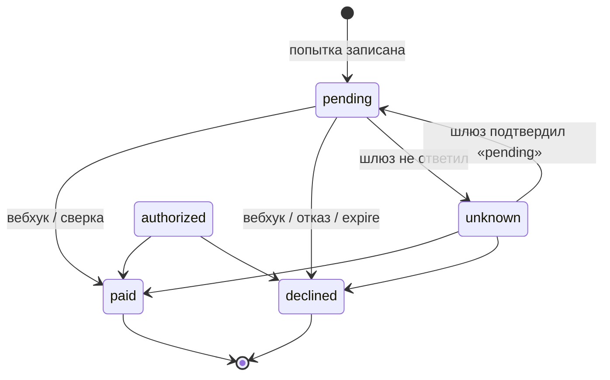
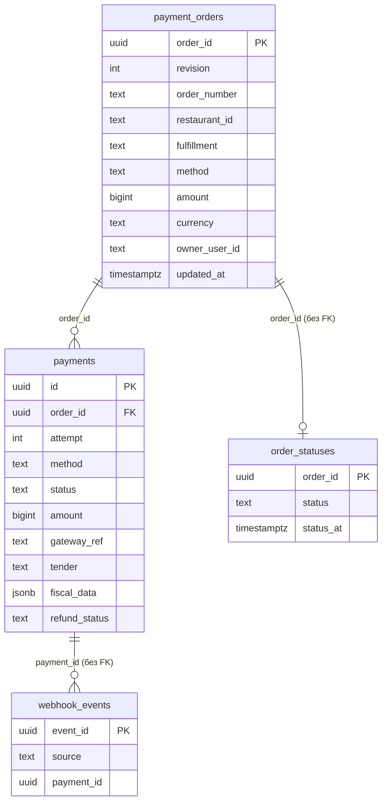
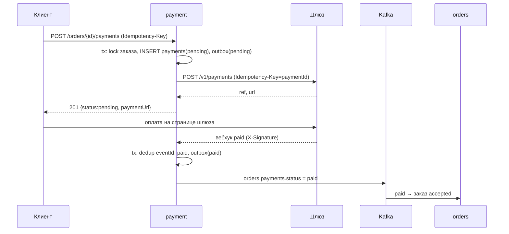

# payment-service — аналитическая документация

| | |
|---|---|
| Сервис | `services/payment`, порт `8085`, БД `payment` (Postgres) |
| Контракт | `contracts/openapi/payment.yaml` v1.4.0; события — `contracts/asyncapi/kafka-events.yaml` v1.5.0 |
| Kafka | потребляет `orders.state`, `orders.status`; публикует `orders.payments.status`, `orders.payments.link` |
| Внешние системы | платёжный шлюз (эквайринг), кассовая система (POS); в dev обе — `tools/mock-externals` |
| Идемпотентность | `Idempotency-Key` на `POST /orders/{id}/payments` и `/payments/pos` (`pkg/idempotency`); вебхуки — по `eventId` |
| Деньги | `bigint` копейки (ADR-13); валюта — ISO-4217 из заказа |
| Состояние на | master `54d443b` (после S9) |

---

## 1. Суть

**Назначение.** Единственный владелец факта «заказ оплачен». Сервис проводит оплату заказа через внешний шлюз или кассу, принимает асинхронные подтверждения, сверяется со шлюзом при потере уведомлений и возвращает деньги по отменённым заказам. Результат публикуется событием `orders.payments.status`; `orders` по нему переводит заказ `pending_payment → accepted` (ADR-10).

**Три способа оплаты и кто их запускает**

| `method` | Событие `method` | Кто инициирует | Где платит клиент |
|---|---|---|---|
| `online_card` | `online` | клиент, `POST /orders/{id}/payments` | страница шлюза (`paymentUrl`) |
| `courier_card` | `courier` | система сама, на событие `orders.state` (UC-PAY-03) | ссылка у курьера; ссылку публикует `orders.payments.link` |
| `pos` | `restaurant` | сотрудник, `POST /orders/{id}/payments/pos` | касса ресторана (карта или наличные) |

Способ оплаты выбирается при оформлении заказа и хранится в заказе. Сменить его в payment нельзя: `method` в запросе должен совпадать с `payment_orders.method`, иначе `422 PAYMENT_METHOD_NOT_ALLOWED`.

**Инварианты («деньги не списываются дважды»)** — зафиксированы в шапке `service.go`:

1. Попытка записывается в БД **до** вызова шлюза; вызов идёт вне транзакции, с `Idempotency-Key = paymentId`.
2. На заказ — не более одной «живой» попытки (`pending|authorized|unknown`) и не более одного `paid` — уникальные частичные индексы БД.
3. Таймаут шлюза → `unknown`, новая попытка блокируется, итог добывает reconciler (`GET` статуса у шлюза).
4. Статус меняется в одном месте (`applyFiscalTx`) по автомату `domain.CanTransition`, под `FOR UPDATE` строки платежа.
5. Вебхук дедуплицируется по `eventId`, сумма сверяется с суммой платежа.

**Вне зоны ответственности**

- карточные данные: пользователь платит на стороне шлюза, сервис их не видит (PCI DSS вне периметра);
- чаевые, частичные оплаты, разделение счёта, частичные возвраты (возврат — только на полную сумму);
- двухстадийная оплата: статус `authorized` предусмотрен автоматом, но в коде не выставляется;
- фискализация онлайн-оплат: фискальный документ хранится только для `pos`, как его вернула касса;
- ручной интерфейс возвратов: API нет, `failed` разбирает человек по метрике и логу.

---

## 2. Методы

Базовый префикс снаружи — gateway (`:8080`), см. `gateway.md`. Вебхуки идут **мимо gateway** прямо в сервис.

| Метод | Путь | operationId | Доступ | Идемпотентность | Успех |
|---|---|---|---|---|---|
| GET | `/orders/{orderId}/payment-methods` | `getPaymentMethods` | владелец заказа или гость, знающий id | — | `200` |
| POST | `/orders/{orderId}/payments` | `initiatePayment` | то же | `Idempotency-Key` обязателен | `201` (pending) / `202` (unknown) |
| POST | `/orders/{orderId}/payments/pos` | `initiatePosPayment` | `STAFF`, `FRANCHISE_OWNER`, `HQ_STAFF` | `Idempotency-Key` обязателен | `201` / `202` |
| GET | `/orders/{orderId}/payments/{paymentId}` | `getPayment` | владелец/гость или сотрудник ресторана заказа | — | `200` |
| POST | `/webhooks/payments/gateway` | `onPaymentGatewayStatus` | подпись `X-Signature` | по `eventId` | `200 {"status":"accepted"}` |
| POST | `/webhooks/payments/pos` | `onPosPaymentConfirmation` | подпись `X-Signature` | по `eventId` | `200` |
| GET | `/healthz`, `/readyz`, `/metrics` | — | служебные | — | `200` |

`readyz` проверяет БД и Kafka (если брокеры заданы).

**Тела**

- `initiatePayment`: `{method: online_card|courier_card|pos, returnUrl?}`. `returnUrl` — абсолютный `http(s)`; по умолчанию `DEFAULT_RETURN_URL`.
- `initiatePosPayment`: `{tender: card|cash}`.
- `Payment` (ответ): `id, orderId, method, status, amount{amount,currency}, attempt, paymentUrl?, declineReason?, tender?, fiscalData?, refund{status,requestedAt,refundedAt,reason}?, paidAt?, createdAt, updatedAt`.
- Вебхук (`PaymentStatusCallback`): `eventId, orderId, paymentId, status (paid|declined), externalRef?, reason?, amount{amount,currency}?, fiscalData?`.

**Коды ошибок** (problem+json, поле `code`)

| HTTP | `code` | Когда |
|---|---|---|
| 400 | `INVALID_PARAMETER` | неверный `method`/`tender`/`returnUrl`, не-UUID в вебхуке, `status` вебхука не `paid`/`declined` |
| 400 | `INVALID_JSON`, `IDEMPOTENCY_KEY_REQUIRED` | тело/заголовок |
| 401 | `UNAUTHORIZED` | нет токена (pos-метод); `INVALID_SIGNATURE` — вебхук без/с неверной подписью или вне окна 5 мин |
| 402 | `PAYMENT_DECLINED` | шлюз синхронно отказал в создании операции |
| 403 | `FORBIDDEN` | pos вызван не персоналом |
| 404 | `ORDER_NOT_FOUND`, `PAYMENT_NOT_FOUND` | чужой/неизвестный заказ; `Retry-After: 1`, потому что реплика заказа могла не дойти |
| 409 | `PAYMENT_IN_PROGRESS`, `PAYMENT_STATUS_UNKNOWN`, `ALREADY_PAID`, `ORDER_NOT_PAYABLE`, `IDEMPOTENCY_IN_PROGRESS` | см. §4; у первых трёх в ответе расширение `paymentId` |
| 413 | `BODY_TOO_LARGE` | тело вебхука > 64 КиБ |
| 422 | `PAYMENT_METHOD_NOT_ALLOWED`, `PAYMENT_METHOD_NOT_SUPPORTED`, `AMOUNT_MISMATCH` | см. §4 |
| 503 | `POS_UNAVAILABLE`, `WEBHOOK_DISABLED` | не настроена касса / не задан секрет вебхука |

---

## 3. Контракты

**OpenAPI** `payment.yaml` v1.4.0: все 6 операций помечены `x-status: implemented`. Схема `PaymentConflictProblem` расширяет problem+json полем `paymentId`.

**Подпись вебхуков** (`pkg/webhook`): заголовок `X-Signature`, HMAC-SHA256 от тела с меткой времени; окно допустимого расхождения/replay — 5 минут (`DefaultTolerance`). Секреты раздельные: `GATEWAY_WEBHOOK_SECRET`, `POS_WEBHOOK_SECRET`. Пустой секрет отключает приём (`503 WEBHOOK_DISABLED`).

**Исходящий протокол к шлюзу/кассе** (`internal/gateway`, REST/JSON, `Authorization: Bearer <API key>`):

| Операция | Запрос | Идемпотентность |
|---|---|---|
| `Create` | `POST /v1/payments` | `Idempotency-Key = paymentId` |
| `Status` | `GET /v1/payments/{ref}` | — |
| `Cancel` | `POST /v1/payments/{ref}/cancel` | — |
| `Refund` | `POST /v1/payments/{ref}/refund` | `Idempotency-Key = paymentId` |

Ответ шлюза: `ref`, `url`, `status` (`pending|paid|declined`), `amount`, `currency`, `reason`, `fiscalData`. Классификация ошибок: **4xx** — `RejectedError` (определённый отказ, повторять бессмысленно); `404` — `ErrNotFound`; таймаут, 5xx, обрыв — «неизвестно». Таймаут одной попытки — `GATEWAY_TIMEOUT` (5 с).

**AsyncAPI** (подробно — §5): `orders.payments.status` и `orders.payments.link` (продюсер), `orders.state` и `orders.status` (потребитель). У каждого топика есть `.dlq`.

**Конфигурация (env)**

| Переменная | По умолчанию | Смысл |
|---|---|---|
| `GATEWAY_URL`, `POS_URL` | `localhost:9091`, `:9093` | адреса шлюза/кассы |
| `GATEWAY_API_KEY`, `POS_API_KEY`, `GATEWAY_WEBHOOK_SECRET`, `POS_WEBHOOK_SECRET` | dev-значения только при `APP_ENV=dev` | вне dev обязательны, ≥ 16 символов, dev-значения запрещены |
| `GATEWAY_TIMEOUT` | 5s | один вызов шлюза |
| `WEBHOOK_WAIT` | 10s | сколько ждать вебхук до первой сверки |
| `PENDING_EXPIRY` | 10m | неоплаченная онлайн-попытка отменяется у шлюза |
| `COURIER_PAYMENT_TTL` | 4h | то же для оплаты курьеру |
| `RECONCILE_BACKOFF_MIN` / `_MAX` | 5s / 5m | backoff опроса и повтора возврата |
| `RECONCILE_INTERVAL` | 2s | период циклов reconciler и возвратов |
| `DEFAULT_RETURN_URL` | `http://localhost:3000/orders` | возврат со страницы шлюза |
| `KAFKA_BROKERS`, `AUTH_MODE`, `AUTH_JWKS_URL`… | — | общие |

Внутренние (не в env): `PollLease` 30 с, `ReconcileBatch` 20.

---

## 4. Логика

### 4.1 Автомат статусов платежа

`paid` и `declined` финальны. Правила `applyFiscalTx`:

- тот же статус — no-op (идемпотентность вебхука/опроса);
- финальный платёж + пришло нефинальное наблюдение (`pending`/`unknown`) — тихо игнорируется;
- противоречие (`paid ↔ declined`) — не применяется, растёт `payment_conflicting_updates_total`, пишется предупреждение;
- `paid` по уже **отменённому** заказу — применяется (деньги получены!) с `refund_required=true`, `payment_paid_after_cancel_total++`, лог уровня ERROR;
- фискальный документ кассы сохраняется только вместе с `paid`;
- смена статуса и запись события `orders.payments.status` в outbox — одна транзакция.

### 4.2 Инициирование онлайн-оплаты (`Initiate`)

1. `loadOrder`: заказ берётся из **реплики** `payment_orders`; чужой (владелец не совпал) и несуществующий — одинаково `404` (существование не раскрывается). Гостевой заказ (`owner_user_id=''`) доступен любому, кто знает UUID.
2. `method` запроса ≠ методу заказа → `422 PAYMENT_METHOD_NOT_ALLOWED`; метод не `online_card` → `422 PAYMENT_METHOD_NOT_SUPPORTED` (`pos` — отдельным методом, `courier_card` создаёт система).
3. Валидация `returnUrl`.
4. `startAttempt` (одна транзакция):
   - `SELECT … FOR UPDATE` реплики заказа — сериализует попытки одного заказа;
   - есть `paid` → `409 ALREADY_PAID` (с `paymentId`);
   - `payable`: метод заказа `online_card` и статус заказа `""` (событие `orders.status` ещё не дошло) или `pending_payment`, иначе `409 ORDER_NOT_PAYABLE`;
   - живая попытка `unknown` → `409 PAYMENT_STATUS_UNKNOWN`; `pending`/`authorized` → `409 PAYMENT_IN_PROGRESS`;
   - вставка `payments` (`attempt = max+1`, `status=pending`, `next_poll_at = now + WEBHOOK_WAIT`), событие `status=pending` в outbox.
5. Вызов шлюза **вне транзакции**, на `context.WithoutCancel` (отмена запроса клиентом не обрывает бухгалтерию попытки):

| Результат шлюза | Что делает сервис | Ответ клиенту |
|---|---|---|
| успех | сохраняет `gateway_ref`, `payment_url` | `201`, `status=pending` + `paymentUrl` |
| успех, но запись ссылки не удалась | помечает `unknown` (reconciler повторит `Create` тем же ключом) | `202` |
| `RejectedError` (4xx) | `declined`, `reason=gateway_rejected` | `402 PAYMENT_DECLINED` |
| таймаут/5xx/обрыв | `unknown` | `202` |

Если вебхук успел раньше ответа, возвращается уже актуальный платёж (читается из БД после записи операции).

После `declined` можно создать новую попытку (`attempt+1`). После `unknown` — нельзя до выяснения: двойное списание страшнее неудобства.

### 4.3 Оплата на кассе (`InitiatePos`, UC-PAY-04)

Те же правила, что у онлайн-оплаты, плюс:

- защита в глубину: роль проверяется на HTTP-слое (`RequireRole`) **и** в сервисе (`requireStaff`: нет `userId` → 401, не персонал → 403);
- ограничение рестораном: заказ ищется через `Actor.Can(restaurantId)`; `HQ_STAFF` видит все рестораны, остальные — только из claim `restaurants`. Чужой ресторан → `404`, а не `403`;
- `tender ∈ {card, cash}` (наличные тоже проводятся через терминал); БД это гарантирует: `CHECK ((method='pos') = (tender IS NOT NULL))`;
- допустимые статусы заказа (`PosPayable`): `""`, `accepted`, `cooking`, `ready` — то есть касса может принять деньги до выдачи, но не у отменённого/выданного заказа;
- касса не настроена (`POS_URL` не поднят в сервисе) → `503 POS_UNAVAILABLE`;
- роль проверяется **снаружи** идемпотентности, поэтому отказ 401/403 не запоминается под ключом.

### 4.4 Оплата курьеру (`startCourierPayment`, UC-PAY-03)

Клиент платёж не создаёт. На каждый `orders.state` заказа с `fulfillment=delivery` и `method=courier_card`, если заказ не отменён и платежей нет, обработчик в **inbox-транзакции** вставляет платёж `pending` с `next_poll_at = now`. Операцию у шлюза создаёт reconciler (ветка `reconcileInit`: `gateway_ref` пуст), в одной транзакции записывая операцию и событие `orders.payments.link` со ссылкой и `expiresAt = created_at + COURIER_PAYMENT_TTL`. Ссылку подхватывает delivery и передаёт в курьерскую систему.

Повторные `revision`, перепроигрывание — безопасны (платёж уже есть).

### 4.5 Приём вебхука (`HandleCallback`)

Порядок в HTTP-слое: секрет задан → тело ≤ 64 КиБ → подпись и окно времени → разбор JSON (неизвестные поля не отвергаются). В сервисе, в одной транзакции:

1. `eventId`, `orderId`, `paymentId` — UUID, иначе `400`.
2. `status` ∈ {`paid`, `declined`} (`pending` не принимается).
3. Платёж читается `FOR UPDATE`; не найден **или** `orderId` не совпал **или** `p.Method ≠ канал` → `404 PAYMENT_NOT_FOUND` (метка `not_found`). Канал: `/gateway` ↔ `online_card`, `/pos` ↔ `pos`.
4. Если передана сумма: сумма или валюта отличаются → `422 AMOUNT_MISMATCH`, метрика `payment_amount_mismatch_total` (тревога). Проверка стоит **до** записи `eventId`, поэтому повторная доставка того же некорректного события будет повторять отказ.
5. `TryRecordWebhook` (`INSERT … ON CONFLICT DO NOTHING`): повтор → `200` без эффекта (`duplicate`).
6. `applyFiscalTx` (причина отказа по умолчанию — `declined`).

### 4.6 Reconciler (сверка со шлюзом)

Цикл раз в `RECONCILE_INTERVAL`, пачками по 20, пока пачка полная. `ClaimDue` одним запросом выбирает платежи `pending|authorized|unknown` с `next_poll_at <= now` через `FOR UPDATE SKIP LOCKED` и сдвигает `next_poll_at` на `PollLease` (30 с) — «аренда»: вызовы шлюза идут без блокировок БД, несколько экземпляров не опрашивают одно и то же. Результат применяется тем же автоматом, что и вебхук, поэтому гонка «вебхук ↔ опрос» безопасна: проигравший получает no-op.

Ветвление `reconcile`:

| Состояние | Действие |
|---|---|
| `gateway_ref` пуст | `reconcileInit`: повтор `Create` с тем же ключом → сохранить операцию (и link для courier); `unknown→pending`; отказ → `declined`; снова сбой → `unknown` |
| ошибка `Status` | `ErrNotFound` — результат `error` (без смены статуса); иначе `pending → unknown` |
| шлюз: `paid` | сверка суммы (расхождение — `error`, платёж **не** применяется, метрика), затем `paid` (+ fiscal) |
| шлюз: `declined` | `declined` с причиной шлюза |
| шлюз: `pending`, заказ отменён | `expire`: `Cancel` у шлюза |
| шлюз: `pending`, был `unknown` | вернуть в `pending` |
| шлюз: `pending`, `now − created_at > expiry` | `expire` (`PENDING_EXPIRY` 10 мин для online/pos, `COURIER_PAYMENT_TTL` 4 ч для courier) |

`expire` вызывает `Cancel`; если за время ожидания платёж успели провести, шлюз вернёт `paid` — применяется `paid` («деньги важнее»), иначе `declined` с причиной `expired`/`order_cancelled`.

Остаётся нефинальным → следующий опрос через `backoff(poll_attempts) = min(PollMin·2^n, PollMax)`.

Событие `orders.state → cancelled` ускоряет это: `ExpediteLive` сдвигает `next_poll_at` живых платежей на «сейчас».

### 4.7 Возвраты (S6)

Возврат — отдельный процесс поверх `paid` (статус платежа остаётся `paid`): `(нет) → pending → refunded | failed`.

- **Запрос.** «Свип» `RequestRefunds` ищет платежи `paid` с `refund_status IS NULL` у заказов со статусом `cancelled` (`FOR UPDATE … SKIP LOCKED`), ставит `refund_status=pending` и публикует `orders.payments.status` с `refundStatus=pending`. Свип, а не реакция на одно событие, потому что отмена может прийти в любой момент относительно оплаты, а Kafka не упорядочивает топики между собой. Повторы безопасны.
- **Исполнение.** `ClaimRefunds` (аналог аренды) → `Refund` у шлюза с ключом `paymentId`: повтор после таймаута не заведёт второй возврат.

| Ответ шлюза | Результат |
|---|---|
| `refunded` | `refund_status=refunded`, `refund_ref`, `refunded_at`, событие |
| «в обработке» | повтор позже тем же ключом (`gateway_pending`) |
| `RejectedError` (4xx) | `failed` (причина — код шлюза или `rejected`), ручная обработка |
| `ErrNotFound` | `failed`, `gateway_operation_not_found` |
| нет шлюза или `gateway_ref` | `failed`, `no_gateway_operation` |
| прочая ошибка | повтор с backoff |

Сумма возврата — всегда полная сумма платежа.

### 4.8 Реплика заказа и порядок событий

`orders.state` пишется в `payment_orders` по правилу `WHERE revision < EXCLUDED.revision` — устаревшая ревизия игнорируется. `orders.status` пишется в `order_statuses` по правилу `status_at <= EXCLUDED.status_at`. Топики между собой не упорядочены, поэтому статус хранится **отдельно** от реплики и пустой статус (`""`) трактуется как «ещё не дошёл, заказ только создан».

---

## 5. События (Kafka)

Конверт события и правила inbox/outbox — общие (см. `README.md`). Ключ партиции — `orderId`.

### 5.1 Публикуемые

**`orders.payments.status`** (`orders.payments.status.v1`, DLQ `.dlq`) — при любом изменении платежа: создание (`pending`), смена статуса, запрос и итог возврата.

| Поле | Тип | Примечание |
|---|---|---|
| `orderId`, `paymentId` | uuid | |
| `attempt` | int | |
| `status` | `pending|authorized|paid|declined|unknown` | |
| `method` | `online|courier|restaurant` | `Method.EventForm()` |
| `amount{amount,currency}` | int64 копейки | |
| `gatewayReference` | string? | |
| `reason` | string? | причина отказа |
| `paidAt` | RFC 3339? | |
| `refundStatus` | `pending|refunded|failed`? | S6 |
| `refundedAt` | RFC 3339? | |
| `updatedAt` | RFC 3339 | |

Потребители — orders (`paid → accepted`, реакции на `declined` и возвраты — см. `orders.md`) и delivery.

**`orders.payments.link`** (`orders.payments.link.v1`, DLQ `.dlq`) — ссылка на оплату курьеру: `orderId, paymentId, paymentUrl, amount, expiresAt`. Публикуется один раз, когда reconciler создал операцию у шлюза. Потребитель — delivery.

### 5.2 Потребляемые (группа `payment-service`)

| Топик | Что делает |
|---|---|
| `orders.state` | валидирует payload (UUID, `paymentMethod ∈ online|courier|restaurant`, `revision ≥ 1`, сумма ≥ 0, валюта не пуста); upsert реплики; для `courier` — создаёт платёж |
| `orders.status` | сохраняет статус заказа; при `cancelled` ускоряет опрос живых платежей |

Невалидный payload → ошибка → повторы (5 попыток, backoff 200 мс…5 с) → `<topic>.dlq`.

### 5.3 Гарантии

- Публикация — transactional outbox: событие и смена статуса в одной транзакции; relay будится `Wake()` после коммита.
- Потребление — inbox `processed_events` в одной транзакции с обработчиком (at-least-once + идемпотентный обработчик = effectively-once).
- Событие `pending` публикуется на каждую попытку, поэтому потребитель обязан быть идемпотентным по `(paymentId, status)`.

---

## 6. Работа с БД

БД `payment`. Кроме доменных таблиц модули `pkg/kafka` и `pkg/idempotency` создают `outbox`, `processed_events`, `idempotency_keys`. Миграции: `001_init.sql` (S3), `002_staff.sql` (S6, касса и возвраты).

### 6.1 ER-диаграмма

### 6.2 Таблицы

**`payment_orders`** — реплика заказа (из `orders.state`). `CHECK`: `revision ≥ 1`, `fulfillment ∈ (delivery,pickup)`, `method ∈ (online_card,courier_card,pos)`, `amount ≥ 0`, `currency ~ '^[A-Z]{3}$'`. `owner_user_id=''` — гость.

**`order_statuses`** — последний известный `orders.status` (`status`, `status_at`). Отдельно, потому что топики не упорядочены.

**`payments`** — попытки оплаты.

| Колонка | Тип | Примечание |
|---|---|---|
| `id` | uuid PK | он же `Idempotency-Key` и `reference` для шлюза |
| `order_id` | uuid FK → `payment_orders` | |
| `attempt` | int ≥ 1 | `UNIQUE (order_id, attempt)` |
| `method` | text | `online_card|courier_card|pos` |
| `status` | text | `pending|authorized|paid|declined|unknown` |
| `amount`, `currency` | bigint, text | снимок суммы заказа на момент попытки |
| `gateway_ref` | text NULL | идентификатор операции у шлюза |
| `payment_url`, `return_url` | text | |
| `decline_reason` | text | |
| `refund_required` | bool | деньги получены по отменённому заказу (информационный флаг) |
| `poll_attempts`, `next_poll_at` | int, timestamptz | планирование сверки; `NULL` у финальных |
| `created_at`, `updated_at`, `paid_at` | timestamptz | |
| `tender` | text NULL | `card|cash`; обязателен ровно для `pos` |
| `fiscal_data` | jsonb NULL | документ кассы |
| `refund_status` | text NULL | `pending|refunded|failed` |
| `refund_ref`, `refund_reason` | text | |
| `refund_requested_at`, `refunded_at` | timestamptz | |
| `refund_attempts`, `refund_next_at` | int, timestamptz | |

**`webhook_events`** — `event_id` PK (дедупликация), `source`, `payment_id`, `received_at`.

### 6.3 Индексы и ограничения

| Индекс / ограничение | Назначение |
|---|---|
| `payments_one_live` — `UNIQUE (order_id) WHERE status IN ('pending','authorized','unknown')` | не более одной живой попытки на заказ |
| `payments_one_paid` — `UNIQUE (order_id) WHERE status='paid'` | не более одного успешного платежа |
| `payments_gateway_ref_uq` — `UNIQUE (gateway_ref) WHERE gateway_ref IS NOT NULL` | одна операция шлюза = один платёж |
| `payments_poll_idx` — `(next_poll_at) WHERE status IN ('pending','unknown')` | выборка `ClaimDue` |
| `payments_refund_idx` — `(refund_next_at) WHERE refund_status='pending'` | выборка `ClaimRefunds` |
| `order_statuses_cancelled_idx` — `(order_id) WHERE status='cancelled'` | свип возвратов |
| `payments_tender_pos` — `CHECK ((method='pos') = (tender IS NOT NULL))` | согласованность кассового платежа |

Замечание: `payments_poll_idx` покрывает `pending|unknown`, а `ClaimDue` выбирает ещё и `authorized`. Статус `authorized` в коде не выставляется, поэтому на практике расхождения нет, но при включении двухстадийной оплаты индекс нужно пересоздать.

### 6.4 Блокировки и транзакции

- Создание попытки: `FOR UPDATE` реплики заказа (сериализация попыток по заказу).
- Смена статуса: `FOR UPDATE` строки платежа.
- Выборки reconciler и возвратов: `FOR UPDATE SKIP LOCKED` внутри одного `UPDATE … RETURNING` (аренда).
- Вызовы внешних систем — **всегда вне транзакций**.

### 6.5 Объём и жизненный цикл данных

Очистки нет: `payments`, `webhook_events`, `order_statuses`, `payment_orders` растут неограниченно (как и `outbox`/`processed_events` общего модуля). Для проекта достаточно; для продакшена нужна политика хранения (платёжные данные обычно хранят по требованиям регулятора) и партиционирование `webhook_events`.

---

## 7. Сценарии использования

### UC-PAY-01 Получить способы оплаты

Клиент после оформления заказа запрашивает `GET …/payment-methods`. Сервис возвращает два варианта по способу получения: самовывоз — `online_card`, `pos`; доставка — `online_card`, `courier_card`. `enabled=true` только у выбранного при оформлении способа и только если заказ оплачиваем (нет `paid`, для online статус `pending_payment`).

Альтернативы: заказ неизвестен → `404` с `Retry-After: 1` (клиент повторяет — событие не дошло).

### UC-PAY-02 Онлайн-оплата картой

Исключения: шлюз не ответил → `202`, `unknown`, reconciler доведёт; вебхук потерян → через `WEBHOOK_WAIT` сверка по `Status`; клиент закрыл страницу → через `PENDING_EXPIRY` попытка отменяется (`declined/expired`), можно платить заново.

### UC-PAY-03 Оплата картой курьеру

`orders.state` (delivery + courier) → платёж `pending` в inbox-транзакции → reconciler создаёт операцию → `orders.payments.link` → delivery передаёт ссылку курьеру → клиент платит курьеру → вебхук/сверка → `paid`. TTL — 4 часа.

### UC-PAY-04 Оплата на кассе

Сотрудник вызывает `POST …/payments/pos {tender}` → запись попытки → вызов кассы → `201` → касса подтверждает вебхуком `/webhooks/payments/pos` (с `fiscalData`) → `paid`. Чужой ресторан → `404`; касса недоступна → `503`.

### UC-PAY-05 Повтор после отказа

Платёж `declined` → клиент снова `POST …/payments` (новый `Idempotency-Key`) → `attempt=2`.

### UC-PAY-06 Повторный клик / сетевой ретрай

Тот же `Idempotency-Key` и тело → возвращается сохранённый ответ; параллельный запрос с тем же ключом → `409 IDEMPOTENCY_IN_PROGRESS`; другой ключ при живой попытке → `409 PAYMENT_IN_PROGRESS` с `paymentId`.

### UC-PAY-07 Отмена оплаченного заказа

`orders.status = cancelled` → свип ставит `refund_status=pending` → `Refund` → `refunded` → событие со `refundStatus=refunded` → событие доступно потребителям топика. Сбой шлюза → повторы с backoff; отказ 4xx → `failed`, алерт и ручная обработка.

### UC-PAY-08 Деньги пришли по отменённому заказу

Заказ отменён, но клиент успел оплатить: вебхук `paid` применяется (флаг `refund_required`, ERROR-лог, метрика), свип создаёт возврат.

---

## 8. Прочие важные моменты

### Безопасность

- Токен проверяется локально по JWKS (ADR-11); вебхуки — мимо gateway, защита — HMAC и окно 5 минут. Секреты вне dev обязательны, ≥ 16 символов, dev-значения запрещены (fail-fast при старте).
- Доступ к чужому заказу даёт `404`, а не `403`.
- Подпись проверяется по сырым байтам тела; размер тела ограничен 64 КиБ.
- Карточные данные в сервис не попадают; логируются `payment_id`, `order_id`, суммы.

### Наблюдаемость

Метрики: `payment_created_total{method}`, `payment_status_transitions_total{status}`, `payment_gateway_calls_total{op,result}`, `payment_gateway_call_duration_seconds{op}`, `payment_webhooks_total{source,result}`, `payment_amount_mismatch_total`, `payment_paid_after_cancel_total`, `payment_conflicting_updates_total{from,to}`, `payment_reconcile_total{result}`, `payment_refunds_total{result}`, плюс gauges «число и возраст `unknown`» и «возвраты `pending`/`failed`». **Алерты-кандидаты**: любой рост `amount_mismatch`, `paid_after_cancel`, `refunds{failed}`; `unknown` старше нескольких минут.

### Известные ограничения и находки

1. **Вебхук для `courier_card` не принимается.** `HandleCallback` сверяет `p.Method` с каналом вебхука; канал шлюза всегда `online_card`, поэтому подтверждение по платежу `courier_card` получит `404 PAYMENT_NOT_FOUND`. Итог такого платежа добывает только reconciler (опрос `Status`), что работает, но медленнее. Если шлюз реально шлёт вебхуки по курьерским платежам, нужно разрешить `courier_card` на канале `/gateway`.
2. **Флаг `refund_required` не управляет возвратами** — свип выбирает платежи по `order_statuses.status='cancelled'`; флаг только информационный.
3. **Нет интерфейса ручной обработки `refund_status=failed`** и повторного запуска возврата — только метрика, лог и SQL.
4. **Только полный возврат**; частичный (например, возврат недопоставленной позиции) невозможен.
5. **`authorized` не используется**, индекс `payments_poll_idx` его не покрывает (см. §6.3).
6. **Нет очистки данных** (см. §6.5).
7. **`ErrNotFound` от шлюза при сверке** оставляет платёж в текущем статусе, опрос продолжается по backoff до бесконечности; автоматического перехода в `declined`/алерта нет.
8. **Сумма возврата и платежа берётся из реплики заказа на момент попытки.** Изменение суммы заказа после создания попытки (если orders когда-либо это разрешит) payment не отследит: старая попытка останется со старой суммой.
9. Идемпотентность HTTP привязана к `userId`; для гостя область ключа пуста, то есть ключ гостя общий в пределах пути заказа.
