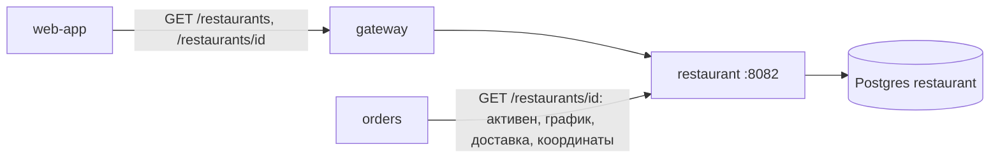
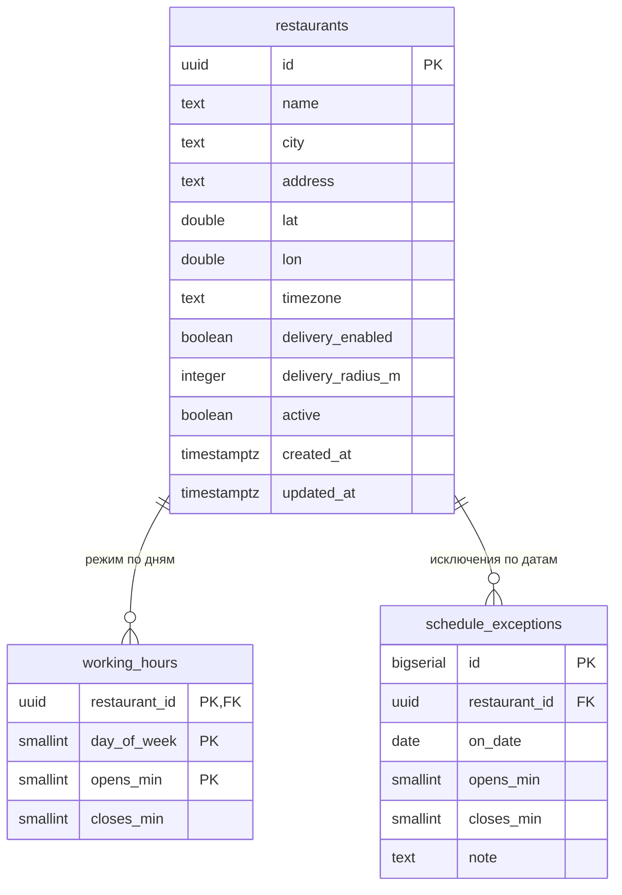
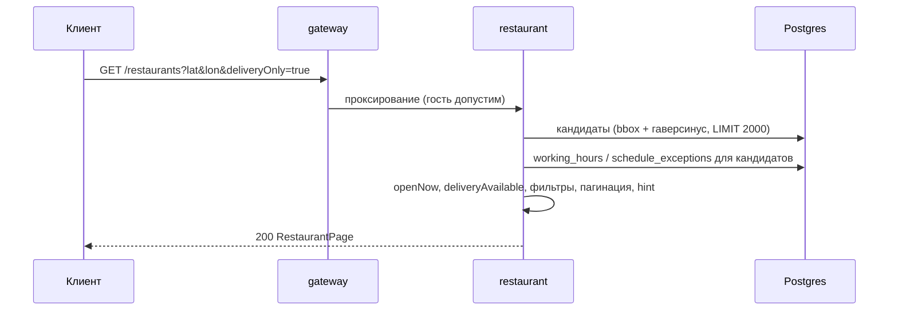

# restaurant-service — аналитическая документация

| | |
|---|---|
| Сервис | `services/restaurant`, порт `8082`, БД `restaurant` (Postgres) |
| Контракт | `contracts/openapi/restaurant.yaml` v1.2.0 |
| Kafka / идемпотентность | не используются (read-only каталог) |
| Доступ | публичный, гость допускается; токен не требуется |
| Состояние на | master `54d443b` (после S9) |

---

## 1. Суть

**Назначение.** Справочник ресторанов сети: найти ближайшие рестораны по геопозиции или адресу, получить карточку ресторана (адрес, координаты, часовой пояс, режим работы, исключения по датам, параметры доставки). Реализует UC-FND-01.

**Решаемые задачи**

- поиск по центру (lat/lon либо город из справочника) с радиусом, сортировкой по расстоянию, фильтрами «только с доставкой» и «открыты сейчас», пагинацией;
- расчёт признаков на лету: `openNow` (по расписанию в часовом поясе ресторана), `deliveryAvailable` (доставка включена **и** центр поиска внутри радиуса доставки);
- подсказка `hint` при пустой выдаче (самовывоз / расширить радиус / изменить адрес);
- служить источником правил для `orders`: проверка, что ресторан существует, открыт и доставляет в радиус (`GET /restaurants/{id}`).

**Вне зоны ответственности**

- меню и цены (сервис `menu`);
- CRUD ресторанов: API управления нет, справочник загружается seed-ом при старте (`SEED_ON_START`); управление каталогом — отдельная задача после S11;
- реальное геокодирование: бэкенд не обращается к картографическим сервисам. Клиент определяет координаты сам (Mapkit, решение Д2); для текстового адреса есть мок-справочник из четырёх городов;
- полигоны зон доставки (только круг `deliveryRadiusMeters` вокруг ресторана).

**Потребители**



Внутри `orders` ресторан запрашивается при оформлении заказа и при проверке зоны доставки (S7, `checkZone`, дважды: при выборе способа получения и при создании заказа). Недоступность restaurant → `503 RESTAURANT_UNAVAILABLE` в orders (fail-closed).

---

## 2. Методы

| # | Метод и путь | operationId | Доступ | Успех | Назначение |
|---|---|---|---|---|---|
| 1 | `GET /restaurants` | searchRestaurants | публично | 200 | Поиск ресторанов |
| 2 | `GET /restaurants/{restaurantId}` | getRestaurant | публично | 200 | Карточка ресторана |
| 3 | `GET /health/`, `GET /health` | — | служебный | 200 | liveness |
| 4 | `GET /actuator/health` | — | служебный | 200/503 | readiness (компонент `db`) |
| 5 | `GET /metrics` | — | служебный | 200 | Prometheus |

Режим `--migrate-only` — применить миграции и выйти (Job в k8s).

### 2.1. Параметры `GET /restaurants`

| Параметр | Тип / границы | По умолчанию | Смысл |
|---|---|---|---|
| `lat`, `lon` | double, [-90;90] / [-180;180] | — | Центр поиска. Задаются **только вместе** |
| `address` | строка | — | Город/адрес; используется, **только если `lat/lon` не заданы** |
| `deliveryOnly` | bool | false | Только рестораны, доставляющие в центр |
| `openNow` | bool | false | Только открытые в момент запроса |
| `radiusMeters` | int, 100…50000 | 5000 | Радиус от центра; без центра игнорируется (но валидируется) |
| `limit` | int, 1…100 | 20 | Размер страницы |
| `offset` | int, ≥0 | 0 | Смещение |

### 2.2. Ошибки

| `code` | HTTP | Условие |
|---|---|---|
| `COORDINATES_INCOMPLETE` | 400 | задан только один из `lat`/`lon` |
| `INVALID_PARAMETER` | 400 | координаты вне диапазона/не число; булев/целый параметр невалиден или вне границ; `restaurantId` не UUID |
| `RESTAURANT_NOT_FOUND` | 404 | ресторана нет **или он неактивен** (`active=false` скрыт как несуществующий) |
| `INTERNAL` | 500 | сбой БД и прочее |

> Неузнанный `address` — **не ошибка**: ответ `200`, `items=[]`, `total=0`, `hint=change_address`.

---

## 3. Контракты

### 3.1. Ответ поиска `RestaurantPage`

```json
{
  "items": [
    {
      "id": "a1000000-0000-4000-8000-000000000004",
      "name": "BLT Невский",
      "address": "Санкт-Петербург, Невский пр., 28",
      "city": "Санкт-Петербург",
      "location": { "lat": 59.9358, "lon": 30.3257 },
      "distanceMeters": 412,
      "deliveryAvailable": true,
      "openNow": true
    }
  ],
  "total": 1, "limit": 20, "offset": 0,
  "center": { "lat": 59.9343, "lon": 30.3351 },
  "hint": "pickup"
}
```

- `distanceMeters` и `center` присутствуют только при заданном/определённом центре.
- `hint` присутствует только при пустом результате (`items=[]` и `total=0`): `pickup`, `expand_radius`, `change_address`.
- `total` — число подходящих ресторанов **среди кандидатов** (не более 2000, см. §4.2).

### 3.2. Ответ карточки `RestaurantDetail`

Поля `RestaurantSummary` плюс:

| Поле | Смысл |
|---|---|
| `timezone` | IANA, например `Europe/Moscow` |
| `deliveryEnabled` | доставка включена |
| `deliveryRadiusMeters` | радиус доставки, 0 если доставки нет |
| `workingHours[]` | `{dayOfWeek 1..7 (ISO, 1=пн), opensAt "HH:MM", closesAt "HH:MM" (допустим "24:00" и ночной "02:00")}` — несколько интервалов в день = перерыв |
| `scheduleExceptions[]` | `{date YYYY-MM-DD, closed, opensAt?, closesAt?, note?}`, **только текущие и будущие** (с начала позавчерашнего дня) |

В карточке `deliveryAvailable` = `deliveryEnabled` (центра нет, расстояние не считается) и **не** означает, что адрес клиента входит в зону; зону проверяет orders.

### 3.3. Конфигурация (env)

| Переменная | По умолчанию | Смысл |
|---|---|---|
| `DATABASE_URL` | обязательна | подключение |
| `HTTP_PORT`, `APP_ENV`, `LOG_LEVEL` | 8082, dev, info | базовые |
| `AUTH_MODE` | `dev` | `dev|jwks`; `jwks` при работе за gateway (`AUTH_JWKS_URL`, `AUTH_ISSUER`, `AUTH_AUDIENCE`). Роли не нужны: middleware только извлекает личность |
| `SEED_ON_START` | false | загрузить справочник ресторанов (в dev-срезе `true`) |

---

## 4. Логика

### 4.1. Слои

`httpapi` (разбор параметров, DTO) → `service` (фильтры, признаки, hint) → `store` (SQL) ↔ `domain` (чистая логика: расписание, гео) и `geocode` (справочник городов).

### 4.2. Алгоритм поиска

1. **Центр.** Если заданы `lat/lon` — они. Иначе, если задан `address`, — `geocode.Resolve`: нормализация (нижний регистр, `ё→е`, дефисы/запятые/точки → пробелы), поиск слова-целиком по названию и синонимам.

   | Город | Центр (lat, lon) | Синонимы |
   |---|---|---|
   | Москва | 55.7558, 37.6173 | moscow, мск |
   | Санкт-Петербург | 59.9343, 30.3351 | санкт петербург, петербург, спб, питер, saint/st petersburg |
   | Казань | 55.7961, 49.1064 | kazan |
   | Екатеринбург | 56.8389, 60.6057 | yekaterinburg, екб |

   Адрес не распознан → сразу `200`, пусто, `hint=change_address` (в БД не ходим). Центра нет вовсе → поиск без расстояний по всем активным.
2. **Кандидаты (SQL).** С центром: bounding-box по индексу `(lat, lon)` (учитывает антимеридиан и полюса, запас 0,1 % на сжатие Земли) → точный гаверсинус в SQL → фильтр `dist ≤ radius` → сортировка `dist, name, id` → `LIMIT 2000`. Без центра: все активные, сортировка `name, id`, `LIMIT 2000`.
3. **Расписания.** Одним запросом на всех кандидатов подгружаются `working_hours` и `schedule_exceptions` в окне `[сегодня−2, сегодня+2]` суток.
4. **Признаки** в Go: `openNow = Schedule.IsOpen(now)`; `deliveryAvailable = deliveryEnabled AND distance ≤ deliveryRadius` при наличии центра, иначе `deliveryEnabled`.
5. **Фильтры в Go:** `openNow` отбрасывает закрытые; `deliveryOnly` откладывает недоставляемые в отдельный список (нужен для подсказки).
6. **Пагинация** в Go по отфильтрованному списку; `total` = размер отфильтрованного списка (≤ 2000 из-за лимита кандидатов).
7. **Подсказка при пустой выдаче:**

   | Условие | `hint` |
   |---|---|
   | `deliveryOnly` и есть открытые рестораны без доставки в эту точку | `pickup` |
   | иначе, центр есть и радиус < 50000 | `expand_radius` |
   | иначе, центр есть (радиус уже максимальный) | `change_address` |
   | центра нет | подсказки нет |

### 4.3. Расписание `Schedule.IsOpen(now)`

Время переводится в часовой пояс ресторана; сравниваются минуты от полуночи. Правила:

- интервал `[opens, closes)`; конец суток записывается как `24:00` (1440);
- **ночной интервал** — `closes ≤ opens` (например 10:00–02:00): действует с `opens` до полуночи дня начала и «хвостом» до `closes` следующего дня;
- в один день может быть несколько интервалов (перерыв);
- **исключение по дате заменяет режим дня целиком**: `closed=true` — день закрыт; иначе — свои интервалы (допускаются несколько записей на дату);
- «хвост» вчерашнего ночного интервала считается по режиму **вчерашнего** дня, включая его исключения: если вчера исключение отменило ночной интервал, хвоста сегодня нет;
- Часовой пояс — IANA, `time/tzdata` встроен в бинарь (distroless без zoneinfo). Интервалы хранятся как «стенные» часы без привязки к UTC-смещению.

### 4.4. Геометрия

`domain.DistanceMeters` — гаверсинус по сфере R = 6 371 000 м, округление до метра; SQL повторяет ту же формулу, интеграционный тест сверяет их. `BoundingBox` проверяется property-тестом на 3000 случайных точек в круге для девяти центров (включая полюс и антимеридиан): ни одна точка круга не должна выпасть из прямоугольника.

### 4.5. Seed

Идемпотентный upsert по `id` в одной транзакции; для каждого ресторана `working_hours` и `schedule_exceptions` **удаляются и вставляются заново**. Проверки файла: UUID, часовой пояс загружается, `deliveryEnabled ⇔ deliveryRadiusMeters > 0`, день 1…7, интервал непустой. Рестораны, удалённые из файла, из БД **не удаляются** (деактивировать нужно `active=false` явно).

---

## 5. События (Kafka)

Сервис не публикует и не потребляет события. Изменения справочника не транслируются: потребители (orders) каждый раз читают актуальное состояние запросом. Когда появится управление каталогом, понадобится событие вроде `restaurant.changed`, чтобы orders мог кэшировать.

---

## 6. Работа с БД

БД `restaurant`, роль `restaurant`; миграции модуля `restaurant` (`001_init.sql`).

### 6.1. ER-диаграмма



### 6.2. Таблицы и ограничения

**`restaurants`**

| Колонка | Тип | Ограничения |
|---|---|---|
| `id` | uuid | PK |
| `name`, `city`, `address`, `timezone` | text | NOT NULL |
| `lat` | double precision | CHECK −90…90 |
| `lon` | double precision | CHECK −180…180 |
| `delivery_enabled` | boolean | NOT NULL, default false |
| `delivery_radius_m` | integer | NOT NULL, default 0, CHECK ≥ 0 |
| `active` | boolean | NOT NULL, default true |
| `created_at`, `updated_at` | timestamptz | default now() |
| (табличный) | | CHECK `delivery_enabled OR delivery_radius_m = 0` |

**`working_hours`** — PK `(restaurant_id, day_of_week, opens_min)`, FK на `restaurants` `ON DELETE CASCADE`; `day_of_week` 1…7 (ISO); `opens_min` 0…1439; `closes_min` 1…1440; CHECK `opens_min <> closes_min`. Ночной интервал выражается `closes_min ≤ opens_min`.

**`schedule_exceptions`** — суррогатный PK `id`; FK `ON DELETE CASCADE`; `on_date` date; закрытый день — оба `opens_min`/`closes_min` NULL, рабочий интервал — оба заданы (CHECK `(opens IS NULL) = (closes IS NULL)` и `opens <> closes`); `note` по умолчанию `''`. Несколько строк на дату = несколько интервалов.

### 6.3. Индексы

| Индекс | Колонки | Назначение |
|---|---|---|
| `restaurants_geo_idx` | `(lat, lon) WHERE active` | bounding-box предфильтр поиска (частичный — только активные) |
| PK `working_hours` | `(restaurant_id, day_of_week, opens_min)` | выборка графика пачкой `ANY($ids)` |
| `schedule_exceptions_idx` | `(restaurant_id, on_date)` | выборка исключений в окне дат |

### 6.4. Запросы (профиль нагрузки)

| Операция | SQL | Заметки |
|---|---|---|
| Поиск с центром | 1 запрос кандидатов + 2 запроса расписаний (`= ANY`) | до 2000 строк, сортировка в SQL |
| Поиск без центра | то же, `ORDER BY name, id` | |
| Карточка | `SELECT … WHERE id AND active` + 2 запроса расписаний | исключения — все с `now−2 суток` |

Сжатые числа: десятки–тысячи ресторанов, запрос — единицы миллисекунд.

### 6.5. Трейд-офф: без PostGIS

Bounding-box по B-tree + гаверсинус на ≤ 2000 строк достаточен для сотен/тысяч точек; PostGIS добавил бы 300+ МБ к образу и операционную сложность. **Граница замены:** десятки тысяч точек или полигональные зоны доставки → PostGIS + GiST.

---

## 7. Сценарии использования

### UC-FND-01. Найти ближайшие рестораны

- **Актор:** клиент (гость или авторизованный). **Предусловие:** клиент знает координаты (Mapkit) или город.
- **Основной поток:** `GET /restaurants?lat=59.9343&lon=30.3351&radiusMeters=5000` → список по возрастанию расстояния с `openNow` и `deliveryAvailable` → клиент открывает ресторан → `GET /restaurants/{id}` → переход в меню.
- **A1. Текстовый адрес:** `GET /restaurants?address=Санкт-Петербург, Невский 28` → центр города из справочника.
- **A2. Нет ресторанов в радиусе:** пустой список + `hint=expand_radius`; клиент повторяет с большим `radiusMeters`.
- **A3. Доставка не покрывает точку:** `deliveryOnly=true`, пусто, но в радиусе есть открытые рестораны → `hint=pickup`; клиент переключается на самовывоз.
- **A4. Адрес не распознан:** `200`, пусто, `hint=change_address`.
- **A5. Только одна из координат:** `400 COORDINATES_INCOMPLETE`.



### UC-FND-02. Посмотреть карточку и график

`GET /restaurants/{id}` → адрес, график, исключения (например, сокращённый день 31 декабря). Неактивный ресторан → 404.

### UC-FND-03. Ночной график

Ресторан «Арбат» по пятницам и субботам работает 10:00–02:00. В 01:30 субботы `openNow=true` (хвост пятничного интервала); в 01:30 воскресенья — по режиму субботы (в субботу ночной интервал тоже действует → открыт).

### UC-FND-04. Использование из orders

При создании корзины/оформлении заказа orders запрашивает ресторан: `404` → заказ невозможен; нет доставки или адрес вне радиуса → `422 ADDRESS_OUT_OF_ZONE` (`hint=pickup`); график → `422 RESTAURANT_CLOSED`.

---

## 8. Прочие важные моменты

### 8.1. Демо-данные (seed)

| № | id (последний октет) | Название | Город | Доставка | График |
|---|---|---|---|---|---|
| 1 | …0001 | BLT Тверская | Москва | да, 5000 м | 09–22, исключения: 2026-12-31 10–18, 2027-01-01 закрыто |
| 2 | …0002 | BLT Арбат | Москва | да, 3000 м | вс–чт 10–23, пт–сб 10–02 (ночной) |
| 3 | …0003 | BLT Парк Горького | Москва | нет | 08–20 |
| 4 | …0004 | BLT Невский | Санкт-Петербург | да, 4000 м | круглосуточно (00:00–24:00); ресторан сценариев Postman orders/payment/e2e |
| 5 | …0005 | BLT Баумана | Казань | да, 3000 м | 09–21 |
| 6 | …0006 | BLT Закрыт навсегда | Москва | да, 3000 м | **неактивен** → 404 |

Все рестораны в seed — в `Europe/Moscow`. Исключения на 2026-12-31/2027-01-01 пропадут из выдачи после этих дат (долг №9).

### 8.2. Известные ограничения

1. `total` ограничен 2000 (потолок кандидатов); для сети такого размера пагинация станет неточной — тогда нужен keyset и PostGIS.
2. Геокодер — четыре города, поиск по улице невозможен; точность адреса определяет клиент через Mapkit.
3. Радиус доставки — круг, без учёта дорожной сети/полигонов.
4. Нет API управления; обновление справочника — через seed/миграции. Seed не удаляет рестораны.
5. `SEED_ON_START` не блокируется в `prod` (в отличие от auth) — в helm-values для restaurant/menu его нужно задавать явно, по умолчанию отключён.
6. Выбор из карточки: `deliveryAvailable` без центра = `deliveryEnabled` (не гарантия покрытия адреса).
7. Расписание не учитывает переходы на летнее время в «стенных» минутах дополнительно (в РФ нет DST; при международной сети проверить).

### 8.3. Нефункциональное

- Метрики: RED (`http_requests_total`, `http_request_duration_seconds`, `http_requests_in_flight`) по шаблону маршрута.
- Кэширование ответов отсутствует (ни ETag, ни `Cache-Control`); кандидат на оптимизацию — короткий `max-age` для поиска и ETag для карточки.
- Масштабирование горизонтальное: без состояния.

### 8.4. Тестирование

Unit: расписание (интервалы, ночные, `24:00`, исключения, хвост), гео (property-тест bounding-box), геокодер, сервис с fake-репозиторием, HTTP, seed. Интеграционные `store` на Postgres (SQL-расстояние против Go, антимеридиан, upsert). Postman: `postman/restaurant/` (24 запроса / 53 проверки), сквозной `postman/catalog/` (6/13), `make contract-check SCENARIO=catalog` (в CI job `contract-check`).
